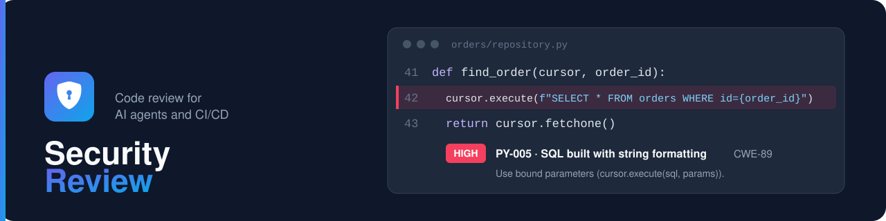

# Security Review

![licence] ![Python] ![Angular] [![ci::status]][ci::github] [![pypi::version]][pypi::web] [![docker::pulls]][docker::hub] [![documentation::badge]][documentation::web]

[licence]: https://img.shields.io/github/license/cyr-ius/security-review?label=Licence&color=blue
[python]: https://img.shields.io/badge/Python-3.14%2B-blue?logo=python
[angular]: https://img.shields.io/badge/Angular-22-blue?logo=angular
[ci::status]: https://img.shields.io/github/actions/workflow/status/cyr-ius/security-review/tests.yml?branch=dev&label=Tests&color=blue&logo=github
[ci::github]: https://github.com/cyr-ius/security-review/actions
[pypi::version]: https://img.shields.io/pypi/v/security-review?color=blue&logo=pypi&logoColor=white
[pypi::web]: https://pypi.org/project/security-review/
[docker::pulls]: https://img.shields.io/docker/pulls/cyrius44/security-review.svg?logo=docker
[docker::hub]: https://hub.docker.com/r/cyrius44/security-review
[documentation::badge]: https://img.shields.io/badge/Documentation-MkDocs-green?logo=materialformkdocs
[documentation::web]: https://cyr-ius.github.io/security-review/fr/

**Security Review est un serveur MCP de revue de code sécurité assistée par l'IA.** Il fait de
votre assistant IA (GitHub Copilot, Claude, Codex...) un relecteur sécurité qui suit vos règles,
et conserve chaque finding jusqu'à ce qu'une personne décide de son sort.

📖 **Documentation complète : <https://cyr-ius.github.io/security-review/fr/>** · 🇬🇧 [English version](README.md)

## Pourquoi

Les assistants IA écrivent et relisent vite, mais livrés à eux-mêmes ils oublient des
vérifications, inventent leurs propres critères et ne laissent aucune trace. Security Review
leur apporte :

- **une méthode** : prompts de revue et checklists par technologie, identiques pour toute l'équipe ;
- **des outils** : un scan du code et des dépendances, exécuté par le serveur ;
- **une mémoire** : chaque revue est enregistrée, chaque finding suivi jusqu'à sa correction ou son acceptation ;
- **un garde-fou** : un agent ne ferme jamais un finding, c'est une personne qui le fait, dans l'interface web.

## Comment ça marche

1. Dans votre éditeur, vous demandez une revue à l'assistant : *« fais une revue de sécurité de mes changements »*.
2. L'assistant suit le prompt `security-review`, scanne le code et déroule la checklist.
3. Il enregistre son rapport sur le serveur, avec chaque finding (fichier, ligne, criticité, correction).
4. Votre équipe trie les findings dans l'interface web : corrigé, risque accepté, faux positif.
5. En CI/CD, le **gate** bloque la fusion tant que des findings graves restent ouverts.

## Ce que vous obtenez

| | |
|---|---|
| 🔍 **Détection** | plus de 250 règles et 140 items de checklist pour une vingtaine de langages et plateformes (Python, Java, Go, C#, TypeScript, Docker, Kubernetes, Terraform, CI...), et 235 règles de propagation [OpenGrep](https://cyr-ius.github.io/security-review/fr/review/analysis/opengrep/) |
| 📦 **Dépendances** | manifestes, lockfiles et SBOM comparés à la [base OSV](https://cyr-ius.github.io/security-review/fr/review/analysis/dependencies/), hors ligne |
| 🛡️ **Injection de prompt** | [détection des instructions cachées](https://cyr-ius.github.io/security-review/fr/review/analysis/read-guard/) visant les assistants IA dans les fichiers qu'ils lisent |
| 📐 **Vos normes** | vos propres [règles](https://cyr-ius.github.io/security-review/fr/review/rules/), [checklists](https://cyr-ius.github.io/security-review/fr/review/checklists/) et [normes de développement](https://cyr-ius.github.io/security-review/fr/review/standards/), transmises à l'assistant avant qu'il code |
| 🖥️ **Interface web** | tableau de bord, [triage](https://cyr-ius.github.io/security-review/fr/usage/triage/), projets, comptes et [rôles](https://cyr-ius.github.io/security-review/fr/usage/access-control/), [connexion OIDC](https://cyr-ius.github.io/security-review/fr/usage/sso/) ; en anglais, français ou espagnol |
| 🚦 **CI/CD** | client [`security-review-ci`](https://cyr-ius.github.io/security-review/fr/advanced/architecture/ci/) : [gate](https://cyr-ius.github.io/security-review/fr/review/gate/), [SARIF](https://cyr-ius.github.io/security-review/fr/advanced/reports/sarif/), tendances, scan de tout le dépôt |
| 🔗 **Connecteurs** | findings envoyés vers [Jira, ServiceNow, GitHub, GitLab](https://cyr-ius.github.io/security-review/fr/usage/connectors/) ou votre propre outil |
| 🔐 **Sécurité** | [jetons](https://cyr-ius.github.io/security-review/fr/usage/tokens/) avec expiration, [connexion OAuth](https://cyr-ius.github.io/security-review/fr/advanced/mcp-oauth/) des clients MCP, [TLS](https://cyr-ius.github.io/security-review/fr/advanced/tls/), [journal d'audit et métriques Prometheus](https://cyr-ius.github.io/security-review/fr/usage/audit-metrics/) |

## Démarrage rapide

Le produit a deux parties principales qui partagent une base de données : le **serveur MCP**,
utilisé par les assistants IA, et le **serveur Controller**, utilisé par les personnes
(interface web, API REST). Voir [les services et leurs rôles](https://cyr-ius.github.io/security-review/fr/services/).

Dans un dossier vide, démarrez PostgreSQL, le serveur Controller et le serveur MCP avec Docker
Compose, puis obtenez le mot de passe du compte `admin` :

```bash
mkdir secreview && cd secreview
curl -fsSLO https://raw.githubusercontent.com/cyr-ius/security-review/master/examples/docker/docker-compose.yml
(umask 077 && printf 'POSTGRES_PASSWORD=%s\nSECREVIEW_SECRET_KEY=%s\n' "$(openssl rand -hex 24)" "$(openssl rand -hex 32)" > .env)
docker compose up -d --wait
docker compose exec controller security-review-controller user reset-password admin   # mot de passe affiché une fois
# interface web : http://127.0.0.1:8080/ui/   endpoint MCP : http://127.0.0.1:8000/mcp
```

Ensuite :

1. Connectez-vous à <http://127.0.0.1:8080/ui/> en `admin`.
2. Sur la page **Général**, saisissez `http://127.0.0.1:8080` comme **URL publique du serveur Controller**.
3. Sur la page **Jetons**, saisissez `http://127.0.0.1:8000/mcp` comme **Point d’accès MCP** et
   activez **Connexion OAuth**.
4. Déclarez le serveur dans `.mcp.json` à la racine de votre dépôt (VS Code, GitHub Copilot,
   Claude Code). Aucun jeton à fournir : à la première connexion, l'hôte ouvre le navigateur pour
   vous connecter.

```json
{
  "mcpServers": {
    "security-review": {
      "type": "http",
      "url": "http://127.0.0.1:8000/mcp"
    }
  }
}
```

> [!WARNING]
> Ces URL en HTTP simple servent à un essai sur votre machine, mais les ports sont ouverts sur
> toutes les interfaces. Pour une équipe, [activez le HTTPS](https://cyr-ius.github.io/security-review/fr/advanced/tls/).

Pour aller plus loin : [mise en service du serveur](https://cyr-ius.github.io/security-review/fr/getting-started/deploy/) ·
[connexion de l'hôte](https://cyr-ius.github.io/security-review/fr/getting-started/host/) ·
[mode local, sans serveur](https://cyr-ius.github.io/security-review/fr/getting-started/stdio/) ·
[sans conteneurs](https://cyr-ius.github.io/security-review/fr/advanced/deployment/manual-install/) ·
[images Docker](https://cyr-ius.github.io/security-review/fr/advanced/deployment/docker/#images-publiees) ·
[architecture et Kubernetes](https://cyr-ius.github.io/security-review/fr/advanced/architecture/) ·
[configuration](https://cyr-ius.github.io/security-review/fr/reference/configuration/)

## En bref

| | |
|---|---|
| **Prompts** | `security-review`, `api-security-review`, `configuration-review`, `codebase-review`, `dependency-review`, `triage-report`, `development-standards` |
| **Outils principaux** | `scan_code`, `scan_dependencies`, `start_codebase_scan`, `get_review_checklist`, `save_security_report`, `propose_finding_status`, `check_project_gate`, `export_sarif`, `export_findings_report` ([liste complète](https://cyr-ius.github.io/security-review/fr/reference/prompts-tools/)) |
| **Commandes** | `security-review-mcp` (serveur MCP), `security-review-controller` (serveur Controller et administration), `security-review-ci` (pipelines), `security-review-scan-engine` ([moteurs de scan](https://cyr-ius.github.io/security-review/fr/advanced/architecture/scan-engine/) facultatifs) — [référence CLI](https://cyr-ius.github.io/security-review/fr/reference/cli/) |

## Limites

Avec OpenGrep (image Docker `-opengrep`), le scan suit le flux de données dans un fichier
([résultats sur l'OWASP Benchmark](https://cyr-ius.github.io/security-review/fr/reference/detection-benchmark/)) ;
sans lui, le scan par motifs ne donne que des pistes. Aucun des deux ne
suit un flux d'un fichier à l'autre : la revue par l'IA couvre le
reste. Voir
[sécurité et limites](https://cyr-ius.github.io/security-review/fr/reference/security/).

## Contribuer

```bash
uv sync --extra dev && uv run pytest && uv run ruff check .
```

Le développement se fait sur `dev` ; les versions sont créées par Release Please. Voir le
[guide de contribution](https://cyr-ius.github.io/security-review/fr/contributing/) et
[`AGENTS.md`](AGENTS.md) (consignes pour les agents IA).

## Sécurité et licence

Signalez une vulnérabilité en privé, comme décrit dans [`SECURITY.md`](SECURITY.md). Le projet
est distribué sous [licence Apache 2.0](LICENSE).
