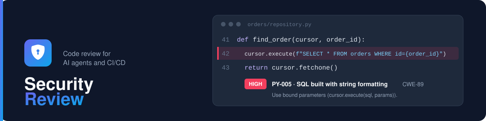

# Security Review

![licence] ![Python] ![Angular] [![ci::status]][ci::github] [![pypi::version]][pypi::web] [![docker::pulls]][docker::hub] [![documentation::badge]][documentation::web]

[licence]: https://img.shields.io/github/license/cyr-ius/security-review?label=Licence&color=blue
[python]: https://img.shields.io/badge/Python-3.14%2B-blue?logo=python
[angular]: https://img.shields.io/badge/Angular-22-blue?logo=angular
[ci::status]: https://img.shields.io/github/actions/workflow/status/cyr-ius/security-review/tests.yml?branch=dev&label=Tests&color=blue&logo=github
[ci::github]: https://github.com/cyr-ius/security-review/actions
[pypi::version]: https://img.shields.io/pypi/v/security-review?color=blue&logo=pypi&logoColor=white
[pypi::web]: https://pypi.org/project/security-review/
[docker::pulls]: https://img.shields.io/docker/pulls/cyrius44/security-review.svg?logo=docker
[docker::hub]: https://hub.docker.com/r/cyrius44/security-review
[documentation::badge]: https://img.shields.io/badge/Documentation-MkDocs-green?logo=materialformkdocs
[documentation::web]: https://cyr-ius.github.io/security-review/fr/

**Serveur MCP de revue de code sécurité assistée par l'IA** : votre assistant IA (VS Code /
Copilot, Claude) ou un agent CI/CD relit le code pour détecter les failles et les mauvaises
configurations. Il fournit des prompts de revue,
des checklists, un scan par motifs, une analyse de propagation (*taint*) par OpenGrep sur le serveur Controller,
une analyse de dépendances hors ligne et une base de rapports (SQLite ou PostgreSQL) exploitable
en pipeline.

📖 **Documentation complète : <https://cyr-ius.github.io/security-review/fr/>**

🇬🇧 [English version](README.md)

## Capacités

| | |
|---|---|
| **Prompts** | `security-review`, `api-security-review`, `configuration-review`, `codebase-review`, `dependency-review`, `triage-report`, `development-standards` |
| **Outils** | checklists, `scan_code`, `scan_dependencies`, [`start_codebase_scan`](https://cyr-ius.github.io/security-review/fr/review/analysis/code-scan/#scan-lance-par-lagent-start_codebase_scan) (l'agent fait scanner tout le dépôt par le serveur Controller sans le lire ni avoir besoin d'un jeton `ci`), enregistrement et lecture des rapports avec leur [couverture de checklist](https://cyr-ius.github.io/security-review/fr/review/prompts-tools/#couverture-de-la-revue) (regroupés par un [nom de projet normalisé](https://cyr-ius.github.io/security-review/fr/review/prompts-tools/#nom-du-projet)), [propositions de statut](https://cyr-ius.github.io/security-review/fr/review/prompts-tools/#statut-dun-finding) (`propose_finding_status` : un agent ne ferme jamais un finding ; en mode local, [`decide_finding_status`](https://cyr-ius.github.io/security-review/fr/review/prompts-tools/#decision-du-developpeur-en-mode-local) applique la décision du développeur confirmée dans l'hôte), [propositions de règles OpenGrep](https://cyr-ius.github.io/security-review/fr/review/analysis/opengrep/#regles-proposees-par-les-agents) (`propose_opengrep_rule`, installées après l'approbation d'une personne), posture et gate projet, export SARIF, [rapport Markdown des findings](https://cyr-ius.github.io/security-review/fr/getting-started/stdio/#rapport-des-findings-security_reportmd) (`SECURITY_REPORT.md`), tendances, gestion des règles |
| **CLI** | `security-review-mcp` (serveur MCP : `serve`, `local` pour le mode local) et `security-review-controller` (`serve`, `db`, `advisories`, `rules`, `opengrep`, `token`, `user`, `audit`), codes de sortie 0 / 1 / 2 |
| **Pipelines** | [`security-review-ci`](https://cyr-ius.github.io/security-review/fr/advanced/architecture/ci/) (`gate`, `sarif`, `trend`, [`scan-code`](https://cyr-ius.github.io/security-review/fr/review/analysis/code-scan/), [`scan-deps`](https://cyr-ius.github.io/security-review/fr/review/analysis/dependencies/#scan-dans-un-pipeline-security-review-ci-scan-deps), qui enregistrent leurs rapports par l'API) : client léger de l'API REST pour Jenkins, GitLab ou GitHub, avec un jeton `ci` restreint aux projets sélectionnés, sans pilote de base, [installé seul](https://cyr-ius.github.io/security-review/fr/advanced/architecture/ci/#installation) sans Python (`uv tool install security-review-ci`, ou [depuis le serveur Controller](https://cyr-ius.github.io/security-review/fr/advanced/architecture/ci/#depuis-le-serveur-controller) sans PyPI) ; sur un poste de travail (hook de commit), avec un [jeton `ci` personnel](https://cyr-ius.github.io/security-review/fr/review/analysis/dependencies/#scan-depuis-un-poste-de-travail-hook-de-commit) |
| **Règles** | Plus de 200 règles et plus de 120 items de checklist : Python, Java, Go, C#, Rust, backend TypeScript / Node.js, Angular, Docker, Kubernetes, configuration, GitLab CI, Jenkins, Spring, FastAPI, [injection de prompt visant les assistants IA](https://cyr-ius.github.io/security-review/fr/review/rules/#regles-par-defaut-par-plateforme) (caractères cachés, instructions injectées ; [garde de lecture](https://cyr-ius.github.io/security-review/fr/review/analysis/read-guard/) `security-review-ci guard`, hook pour Claude Code, Copilot ou Codex), copiés en base au premier lancement, plus vos propres [règles](https://cyr-ius.github.io/security-review/fr/review/rules/) et [checklists](https://cyr-ius.github.io/security-review/fr/review/checklists/) (import/export TOML en CLI ou dans l'interface web) ; règles YAML [OpenGrep](https://cyr-ius.github.io/security-review/fr/review/analysis/opengrep/) exécutées par `scan-code` (binaire inclus dans l'image Docker `-opengrep`), avec [147 règles par défaut](https://cyr-ius.github.io/security-review/fr/review/analysis/opengrep/#regles-par-defaut) (analyse de propagation depuis la requête vers SQL, commandes, fichiers, URL...) installées au démarrage par l'image `-opengrep` ou par `security-review-controller opengrep install` |
| **Normes de développement** | [conventions par technologie](https://cyr-ius.github.io/security-review/fr/review/standards/) gérées dans l'interface web (import/export TOML) et transmises à l'assistant IA avant qu'il code (prompt, outils `get_development_standards` / `list_development_standards`, ressources) |
| **Vulnérabilités** | manifestes, lockfiles et [SBOM CycloneDX](https://cyr-ius.github.io/security-review/fr/review/analysis/dependencies/#sbom-cyclonedx-dependances-transitives) comparés à une base OSV (PyPI, npm, Maven, Go, crates.io, NuGet) importée hors ligne ou [mise à jour chaque jour par le serveur Controller](https://cyr-ius.github.io/security-review/fr/review/analysis/dependencies/#mise-a-jour-automatique-par-le-serveur-controller), proxy facultatif |
| **Transport** | HTTP (mode partagé) ou stdio (mode local), avec jetons Bearer stockés en base (CLI `token`), avec [expiration et renouvellement](https://cyr-ius.github.io/security-review/fr/advanced/bearer-tokens/#expiration-et-renouvellement-des-jetons), et [TLS](https://cyr-ius.github.io/security-review/fr/advanced/tls/) (éventuellement mutuel) |
| **Audit et métriques** | [journal d'audit](https://cyr-ius.github.io/security-review/fr/usage/audit-metrics/) des décisions de triage, des jetons et des demandes de projet, et [métriques Prometheus](https://cyr-ius.github.io/security-review/fr/reference/metrics/) sur `/metrics` (jeton `metrics`) |
| **Connecteurs** | [findings envoyés vers d'autres outils](https://cyr-ius.github.io/security-review/fr/usage/connectors/) : Jira et ServiceNow intégrés, [connecteurs tiers](https://cyr-ius.github.io/security-review/fr/usage/connectors/third-party/) pour tout autre système (registre de vulnérabilités, GRC...) ; chaque connecteur activé dans l'interface web, à la main ou automatiquement au-dessus d'un seuil de sévérité, un enregistrement par problème |
| **Déploiement** | serveur MCP et serveur Controller (API REST, interface web) [séparés](https://cyr-ius.github.io/security-review/fr/advanced/architecture/) sur une base partagée, migrations Alembic, exemples Docker Compose et Kubernetes ; une [image Docker](https://cyr-ius.github.io/security-review/fr/advanced/deployment/docker/#choisir-le-processus) lancée avec `controller` ou `mcp` (HTTP ou stdio avec `SECREVIEW_TRANSPORT`) |
| **Enrôlement** | un client MCP sans jeton est [invité à créer un jeton MCP personnel](https://cyr-ius.github.io/security-review/fr/advanced/architecture/mcp-server/#enrolement-jeton-personnel-et-demande-de-projet) dans l'interface web ; ensuite l'outil MCP `request_project` crée le projet de la revue, ou le demande (ou l'accès à un projet existant) pour qu'un administrateur le valide, ce qui en donne l'accès à l'utilisateur ; un jeton refusé reçoit un `401` qui indique comment en obtenir un nouveau |
| **Connexion OAuth** | facultative, activée depuis l'interface web : l'hôte MCP n'a besoin d'aucun jeton, il [se connecte par le navigateur](https://cyr-ius.github.io/security-review/fr/advanced/mcp-oauth/) (OAuth 2.1 avec PKCE, le serveur Controller comme serveur d'autorisation) et agit comme un jeton MCP personnel de l'utilisateur |
| **Interface web** | en anglais, français ou espagnol : tableau de bord, [triage par une personne](https://cyr-ius.github.io/security-review/fr/usage/triage/) (approbateur des risques acceptés et faux positifs, motif et expiration des risques acceptés, [plusieurs findings à la fois](https://cyr-ius.github.io/security-review/fr/usage/triage/#plusieurs-findings-a-la-fois)), [acceptations de risque](https://cyr-ius.github.io/security-review/fr/usage/triage/#acceptations-de-risque) à renouveler ou supprimer, avec commentaires en ajout seul, [liste des findings ouverts par projet](https://cyr-ius.github.io/security-review/fr/usage/#pages) pour une revue par un expert, gestion des [règles, checklists, jetons (par projet ou pour tous les projets), paramètres généraux (langue des rapports, adresse du serveur Controller), proxy sortant (OSV et OIDC) et mises à jour OSV](https://cyr-ius.github.io/security-review/fr/usage/), [comptes utilisateurs](https://cyr-ius.github.io/security-review/fr/usage/user-accounts/) locaux ou OIDC, seuls à ouvrir l'interface (les jetons sont destinés aux machines : agents MCP, pipelines, scripts ; [jetons API](https://cyr-ius.github.io/security-review/fr/usage/tokens/#jetons-api) personnels ou de rôle pour l'API REST et le Swagger, [jetons MCP personnels](https://cyr-ius.github.io/security-review/fr/usage/tokens/#jetons-mcp-et-ci-personnels) sur les projets de l'utilisateur, sauf avec `SECREVIEW_PERSONAL_TOKENS_ENABLED=false` ; compte `admin` initial dans les logs), [connexion OIDC OpenID Connect](https://cyr-ius.github.io/security-review/fr/usage/sso/) facultative, [configurable dans l'interface](https://cyr-ius.github.io/security-review/fr/usage/sso/#configurer-le-oidc-dans-linterface), avec création des comptes à la volée, et [rôles et permissions](https://cyr-ius.github.io/security-review/fr/usage/access-control/) (rôles sur tout le serveur et projets de chaque compte avec leurs propres droits par projet, recherche de projets et sélection multiple, et [correspondances OIDC](https://cyr-ius.github.io/security-review/fr/usage/sso/#correspondances-oidc) des groupes du fournisseur d'identité) |

Détail : [fonctionnement d'une revue](https://cyr-ius.github.io/security-review/fr/review/) (règles, checklists, normes, `AGENTS.md`),
[prompts et outils](https://cyr-ius.github.io/security-review/fr/review/prompts-tools/),
[analyse du code complet](https://cyr-ius.github.io/security-review/fr/review/analysis/code-scan/),
[dépendances](https://cyr-ius.github.io/security-review/fr/review/analysis/dependencies/),
[gate](https://cyr-ius.github.io/security-review/fr/review/gate/),
[SARIF](https://cyr-ius.github.io/security-review/fr/advanced/reports/sarif/),
[tendances](https://cyr-ius.github.io/security-review/fr/advanced/architecture/ci/#rapport-de-tendance).

## Démarrage rapide

Le produit repose sur **trois services** : le **serveur MCP** (`security-review-mcp`), utilisé
par les agents, le **serveur Controller** (`security-review-controller`), utilisé par les
personnes (interface web, API REST, jetons et comptes), sur une base partagée, et le client de
pipeline (`security-review-ci`). Voir
[trois services, trois rôles](https://cyr-ius.github.io/security-review/fr/services/).

Dans un dossier vide, ce bloc démarre PostgreSQL, le serveur Controller et le serveur MCP avec
Docker Compose et réinitialise le mot de passe du compte `admin` :

```bash
mkdir secreview && cd secreview
curl -fsSLO https://raw.githubusercontent.com/cyr-ius/security-review/master/examples/docker/docker-compose.yml
(umask 077 && printf 'POSTGRES_PASSWORD=%s\nSECREVIEW_SECRET_KEY=%s\n' "$(openssl rand -hex 24)" "$(openssl rand -hex 32)" > .env)
docker compose up -d --wait
docker compose exec controller security-review-controller user reset-password admin   # mot de passe affiché une fois
# interface web : http://127.0.0.1:8080/ui/   endpoint MCP : http://127.0.0.1:8000/mcp
```

Connectez-vous à l'interface web en `admin`. Sur la page **Général**, saisissez
`http://127.0.0.1:8080` comme **URL publique du serveur Controller** ; sur la page **Jetons**,
saisissez `http://127.0.0.1:8000/mcp` comme **Point d’accès MCP** et activez **Connexion OAuth**
([connexion OAuth des clients MCP](https://cyr-ius.github.io/security-review/fr/advanced/mcp-oauth/)). Déclarez le serveur dans
`.mcp.json` à la racine du dépôt (VS Code, GitHub Copilot, Claude Code), sans jeton : à la
première connexion, l'hôte ouvre le navigateur pour vous connecter. Ces URL en `127.0.0.1`, en
HTTP simple, servent à un essai sur la même machine : pour l'équipe, activez le HTTPS.

```json
{
  "mcpServers": {
    "security-review": {
      "type": "http",
      "url": "http://127.0.0.1:8000/mcp"
    }
  }
}
```

Pas à pas : [mise en service du serveur](https://cyr-ius.github.io/security-review/fr/getting-started/deploy/),
[connexion de l'hôte](https://cyr-ius.github.io/security-review/fr/getting-started/host/) (VS Code, Claude, enrôlement).
Autres cas : [sans conteneurs](https://cyr-ius.github.io/security-review/fr/advanced/deployment/manual-install/),
[installation hors ligne](https://cyr-ius.github.io/security-review/fr/advanced/deployment/installation/),
[mode local (stdio)](https://cyr-ius.github.io/security-review/fr/getting-started/stdio/),
[Jetons Bearer](https://cyr-ius.github.io/security-review/fr/advanced/bearer-tokens/), [TLS](https://cyr-ius.github.io/security-review/fr/advanced/tls/),
[images Docker](https://cyr-ius.github.io/security-review/fr/advanced/deployment/docker/#images-publiees) (`ghcr.io/cyr-ius/security-review`, `docker.io/cyrius44/security-review`) et [Docker Compose avec PostgreSQL](https://cyr-ius.github.io/security-review/fr/advanced/deployment/docker/#docker-compose-avec-postgresql),
[architecture et Kubernetes](https://cyr-ius.github.io/security-review/fr/advanced/architecture/),
[variables `SECREVIEW_*`](https://cyr-ius.github.io/security-review/fr/reference/configuration/).

## Limites

Avec le moteur OpenGrep (image `-opengrep`), le scan est une analyse statique (SAST) qui suit le flux de données dans un fichier, d'une fonction à l'autre
([résultats sur l'OWASP Benchmark](https://cyr-ius.github.io/security-review/fr/advanced/detection-benchmark/)) ; sans lui, le scan par motifs
ne produit que des pistes, avec des faux positifs. Aucun des deux ne suit un flux d'un fichier à l'autre : la revue par l'IA
et une relecture humaine couvrent le reste. Ce n'est pas une analyse SCA complète. Voir
[sécurité et limites](https://cyr-ius.github.io/security-review/fr/reference/security/).

## Contribuer

```bash
uv sync --extra dev && uv run pytest && uv run ruff check .
```

Le développement se fait sur `dev` ; une version (tag `vX.Y.Z` sur `master`) est créée par
Release Please. Voir le [guide de contribution](https://cyr-ius.github.io/security-review/fr/contributing/)
et [`AGENTS.md`](AGENTS.md) (consignes pour les agents IA).

## Sécurité et licence

Signalez une vulnérabilité en privé, comme décrit dans [`SECURITY.md`](SECURITY.md). Le projet
est distribué sous [licence Apache 2.0](LICENSE).
