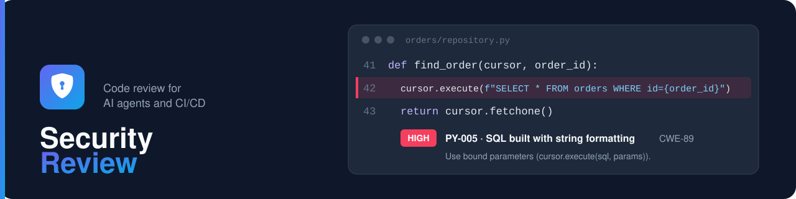

# Security Review

![licence] ![Python] ![Angular] [![ci::status]][ci::github] [![pypi::version]][pypi::web] [![docker::pulls]][docker::hub] [![documentation::badge]][documentation::web]

[licence]: https://img.shields.io/github/license/cyr-ius/security-review?label=Licence&color=blue
[python]: https://img.shields.io/badge/Python-3.14%2B-blue?logo=python
[angular]: https://img.shields.io/badge/Angular-22-blue?logo=angular
[ci::status]: https://img.shields.io/github/actions/workflow/status/cyr-ius/security-review/tests.yml?branch=dev&label=Tests&color=blue&logo=github
[ci::github]: https://github.com/cyr-ius/security-review/actions
[pypi::version]: https://img.shields.io/pypi/v/security-review?color=blue&logo=pypi&logoColor=white
[pypi::web]: https://pypi.org/project/security-review/
[docker::pulls]: https://img.shields.io/docker/pulls/cyrius44/security-review.svg?logo=docker
[docker::hub]: https://hub.docker.com/r/cyrius44/security-review
[documentation::badge]: https://img.shields.io/badge/Documentation-MkDocs-green?logo=materialformkdocs
[documentation::web]: https://cyr-ius.github.io/security-review/

**Security Review is an MCP server for AI-assisted security code review.** It turns your AI
assistant (GitHub Copilot, Claude, Codex...) into a security reviewer that follows your rules,
and keeps every finding until a person decides what to do with it.

📖 **Full documentation: <https://cyr-ius.github.io/security-review/>** · 🇫🇷 [Version française](README.fr.md)

## Why

AI assistants write and review code fast, but on their own they forget checks, invent their
own criteria and leave no trace. Security Review gives them:

- **a method**: review prompts and checklists by technology, the same for the whole team;
- **tools**: a scan of the code and the dependencies, run by the server;
- **a memory**: every review is saved, every finding is tracked until it is fixed or accepted;
- **a safeguard**: an agent never closes a finding, a person does, in the web interface.

## How it works

1. In your editor, you ask the assistant for a review: *"run a security review of my changes"*.
2. The assistant follows the `security-review` prompt, scans the code and checks the checklist.
3. It saves its report on the server, with each finding (file, line, severity, fix).
4. Your team triages the findings in the web interface: fixed, accepted risk, false positive.
5. In CI/CD, the **gate** blocks the merge while serious findings stay open.

## What you get

| | |
|---|---|
| 🔍 **Detection** | 250+ rules and 140+ checklist items for about twenty languages and platforms (Python, Java, Go, C#, TypeScript, Docker, Kubernetes, Terraform, CI...), and 264 [OpenGrep](https://cyr-ius.github.io/security-review/review/analysis/opengrep/) taint rules |
| 📦 **Dependencies** | manifests, lockfiles and SBOMs checked against the [OSV database](https://cyr-ius.github.io/security-review/review/analysis/dependencies/), offline |
| 🛡️ **Prompt injection** | [detection of hidden instructions](https://cyr-ius.github.io/security-review/review/analysis/read-guard/) aimed at AI assistants in the files they read |
| 📐 **Your standards** | your own [rules](https://cyr-ius.github.io/security-review/review/rules/), [checklists](https://cyr-ius.github.io/security-review/review/checklists/) and [development standards](https://cyr-ius.github.io/security-review/review/standards/), given to the assistant before it codes |
| 🖥️ **Web interface** | dashboard, [triage](https://cyr-ius.github.io/security-review/usage/triage/), projects, accounts and [roles](https://cyr-ius.github.io/security-review/usage/access-control/), [OIDC login](https://cyr-ius.github.io/security-review/usage/sso/); in English, French or Spanish |
| 🚦 **CI/CD** | [`security-review-ci`](https://cyr-ius.github.io/security-review/advanced/architecture/ci/) client: [gate](https://cyr-ius.github.io/security-review/review/gate/), [SARIF](https://cyr-ius.github.io/security-review/advanced/reports/sarif/), trends, scan of the whole repository |
| 🔗 **Connectors** | findings sent to [Jira, ServiceNow, GitHub, GitLab](https://cyr-ius.github.io/security-review/usage/connectors/) or your own tool |
| 🔐 **Security** | [tokens](https://cyr-ius.github.io/security-review/usage/tokens/) with expiry, [OAuth login](https://cyr-ius.github.io/security-review/advanced/mcp-oauth/) of MCP clients, [TLS](https://cyr-ius.github.io/security-review/advanced/tls/), [audit log and Prometheus metrics](https://cyr-ius.github.io/security-review/usage/audit-metrics/) |

## Quick start

The product has two main parts sharing one database: the **MCP server**, used by the AI
assistants, and the **Controller server**, used by people (web interface, REST API). See
[the services and their roles](https://cyr-ius.github.io/security-review/services/).

In an empty folder, start PostgreSQL, the Controller server and the MCP server with Docker
Compose, then get the password of the `admin` account:

```bash
mkdir secreview && cd secreview
curl -fsSLO https://raw.githubusercontent.com/cyr-ius/security-review/master/examples/docker/docker-compose.yml
(umask 077 && printf 'POSTGRES_PASSWORD=%s\nSECREVIEW_SECRET_KEY=%s\n' "$(openssl rand -hex 24)" "$(openssl rand -hex 32)" > .env)
docker compose up -d --wait
docker compose exec controller security-review-controller user reset-password admin   # password shown once
# web interface: http://127.0.0.1:8080/ui/   MCP endpoint: http://127.0.0.1:8000/mcp
```

Then:

1. Log in to <http://127.0.0.1:8080/ui/> as `admin`.
2. On the **General** page, enter `http://127.0.0.1:8080` as **Public URL of the Controller server**.
3. On the **Tokens** page, enter `http://127.0.0.1:8000/mcp` as **MCP endpoint** and turn on
   **Enable OAuth login**.
4. Declare the server in `.mcp.json` at the root of your repository (VS Code, GitHub Copilot,
   Claude Code). No token needed: at the first connection, the host opens the browser to sign in.

```json
{
  "mcpServers": {
    "security-review": {
      "type": "http",
      "url": "http://127.0.0.1:8000/mcp"
    }
  }
}
```

> [!WARNING]
> These plain HTTP URLs are for a test on your own machine, but the ports are open on every
> interface. For a team, [enable HTTPS](https://cyr-ius.github.io/security-review/advanced/tls/).

Next steps: [deploying the server](https://cyr-ius.github.io/security-review/getting-started/deploy/) ·
[connecting the host](https://cyr-ius.github.io/security-review/getting-started/host/) ·
[local mode, without a server](https://cyr-ius.github.io/security-review/getting-started/stdio/) ·
[without containers](https://cyr-ius.github.io/security-review/advanced/deployment/manual-install/) ·
[Docker images](https://cyr-ius.github.io/security-review/advanced/deployment/docker/#published-images) ·
[architecture and Kubernetes](https://cyr-ius.github.io/security-review/advanced/architecture/) ·
[configuration](https://cyr-ius.github.io/security-review/reference/configuration/)

## At a glance

| | |
|---|---|
| **Prompts** | `security-review`, `api-security-review`, `configuration-review`, `codebase-review`, `dependency-review`, `triage-report`, `development-standards` |
| **Main tools** | `scan_code`, `scan_dependencies`, `start_codebase_scan`, `get_review_checklist`, `save_security_report`, `propose_finding_status`, `check_project_gate`, `export_sarif`, `export_findings_report` ([full list](https://cyr-ius.github.io/security-review/reference/prompts-tools/)) |
| **Commands** | `security-review-mcp` (MCP server), `security-review-controller` (Controller server and administration), `security-review-ci` (pipelines), `security-review-scan-engine` (optional [scan engines](https://cyr-ius.github.io/security-review/advanced/architecture/scan-engine/)) — [CLI reference](https://cyr-ius.github.io/security-review/reference/cli/) |

## Limits

With OpenGrep (`-opengrep` Docker image), the scan follows the data flow within a file
([OWASP Benchmark results](https://cyr-ius.github.io/security-review/reference/detection-benchmark/));
without it, the pattern scan only gives leads. Neither follows a flow from
one file to another: the AI review covers the rest. See [security and limits](https://cyr-ius.github.io/security-review/reference/security/).

## Contributing

```bash
uv sync --extra dev && uv run pytest && uv run ruff check .
```

Development happens on `dev`; versions are created by Release Please. See the
[contribution guide](https://cyr-ius.github.io/security-review/contributing/) and
[`AGENTS.md`](AGENTS.md) (instructions for AI agents).

## Security and license

Report a vulnerability privately, as described in [`SECURITY.md`](SECURITY.md). The project is
distributed under the [Apache 2.0 license](LICENSE).
