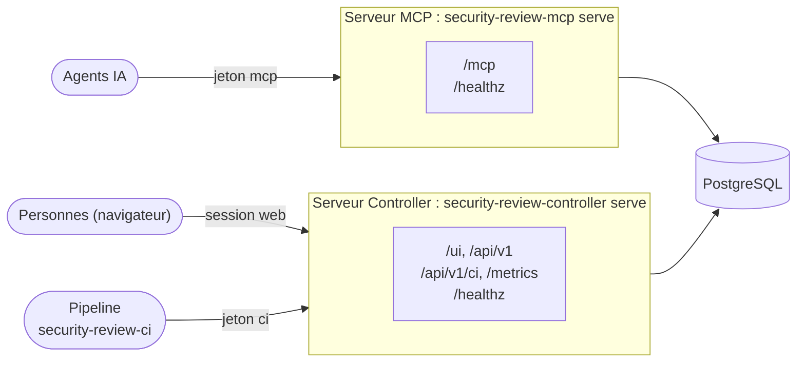

# Architecture

En mode partagé, le serveur se compose de **deux processus** indépendants qui partagent la même base de
données. Ils peuvent tourner dans deux conteneurs, deux pods ou sur deux machines. Le client de pipeline
`security-review-ci` n'est pas un troisième processus : il tourne dans le pipeline et appelle
l'API REST du serveur Controller.

| | Serveur MCP | Serveur Controller |
|---|---|---|
| Commande | `security-review-mcp serve --transport streamable-http` | `security-review-controller serve` |
| Sert | `/mcp`, `/healthz` | API REST `/api/v1`, interface `/ui`, `/healthz` |
| Identifiants acceptés | jetons `mcp` (personnels ou non) et `admin` | sessions web (utilisateurs), jetons `admin` et `api` ; jetons `ci` (personnels ou non) sur les seules routes de pipeline `/api/v1/ci/` (gate, SARIF, tendance, scans) ; jetons `metrics` sur `/metrics` seulement |
| Routes sans jeton | serveur d'enrôlement sur `/mcp` (sans outil), `/healthz` | fichiers de `/ui`, connexion (`/api/v1/auth/`), `/healthz`, et la documentation de l'API quand `SECREVIEW_SWAGGER_ENABLED=true` |
| Schéma de la base | vérifie seulement | migre |
| Exposition conseillée | aux agents, avec TLS | aux personnes et aux pipelines, avec TLS |

Les deux processus ne s'appellent jamais : tout passe par la base. Un jeton créé ou révoqué sur
le serveur Controller s'applique à la requête suivante du serveur MCP. Une règle modifiée est rechargée
en quelques secondes. Un projet demandé par un agent (`request_project`) attend sa validation
dans l'écran **Projets** du serveur Controller.

Aucun des deux processus n'expose de **route d'écriture sans authentification**, hormis la
connexion du serveur Controller : un client sans jeton ne fait que lire, sur le serveur MCP, comment
créer un jeton personnel.

Routes, démarrage, migrations du schéma, tâches de fond et exposition de chaque processus : voir
[Serveur MCP](mcp-server.md) et [Serveur Controller](controller.md).

!!! note "Base partagée"
    Avec SQLite, les deux processus doivent tourner sur la même machine et partager le fichier.
    Dès qu'ils sont dans des pods ou sur des machines différents, utilisez PostgreSQL
    (extra `postgres` du paquet PyPI, inclus dans l'image), déployé avec
    [Docker Compose](../deployment/docker.md#docker-compose-avec-postgresql) ou [Kubernetes](../deployment/kubernetes.md#deploiement).
    Migrations, conservation et sauvegarde : voir [Base de données](../database.md).

En [mode local (stdio)](../../getting-started/stdio.md), seul `security-review-mcp local` est
nécessaire : il crée et migre lui-même sa base SQLite locale.
