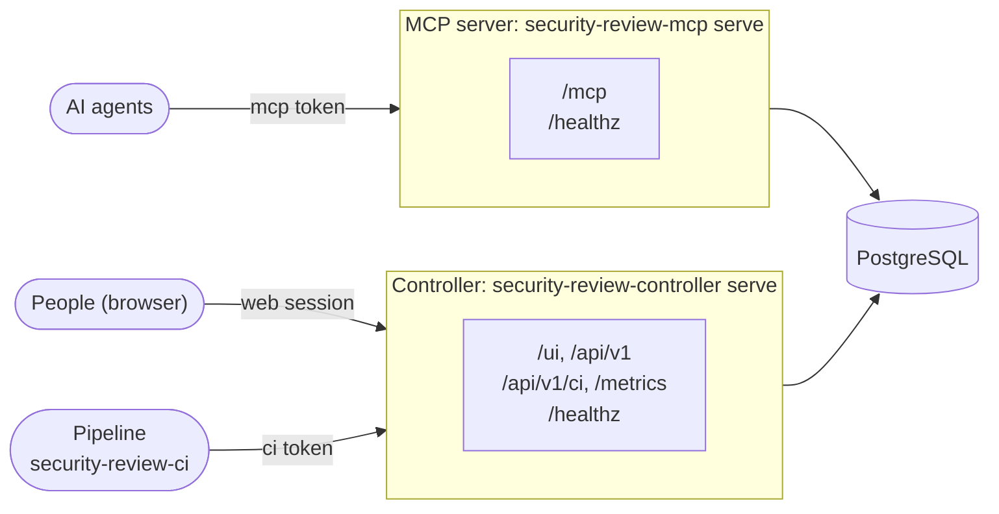

# Architecture

In shared mode, the server is made of **two independent processes** sharing the same database. They can
run in two containers, two pods or on two machines. The pipeline client `security-review-ci`
is not a third process: it runs in the pipeline and calls the REST API of the controller.

| | MCP server | Controller |
|---|---|---|
| Command | `security-review-mcp serve --transport streamable-http` | `security-review-controller serve` |
| Serves | `/mcp`, `/healthz` | REST API `/api/v1`, interface `/ui`, `/healthz` |
| Accepted credentials | `mcp` tokens (personal or not) and `admin` tokens | web sessions (users), `admin` and `api` tokens; `ci` tokens and personal `mcp` tokens on the pipeline routes `/api/v1/ci/` only (gate, SARIF, trend, scans); `metrics` tokens on `/metrics` only |
| Routes without a token | enrollment server on `/mcp` (no tool), `/healthz` | `/ui` files, login (`/api/v1/auth/`), `/healthz`, and the API documentation when `SECREVIEW_SWAGGER_ENABLED=true` |
| Database schema | only checks it | migrates it |
| Advised exposure | the agents, with TLS | the people and the pipelines, with TLS |

The two processes never call each other: everything goes through the database. A token created
or revoked on the controller applies to the next request of the MCP server. A changed rule is
reloaded within a few seconds. A project requested by an agent (`request_project`) waits in the
**Projects** screen of the controller, for an approval.

Neither process exposes an **unauthenticated write route**, apart from the login of the
controller: a client without a token only reads, on the MCP server, how to create a personal
token.

The routes, start-up, schema migrations, background tasks and exposure of each process: see
[MCP server](mcp-server.md) and [Controller](controller.md).

!!! note "Shared database"
    With SQLite, both processes must run on the same machine and share the file. As soon as
    they are in different pods or on different machines, use PostgreSQL (`postgres` extra
    of the PyPI package, included in the image), deployed with
    [Docker Compose](../deployment/docker.md#docker-compose-with-postgresql) or [Kubernetes](../deployment/kubernetes.md#deployment).

In [local mode (stdio)](../../getting-started/stdio.md), only `security-review-mcp local` is
needed: it creates and migrates its local SQLite database itself.
