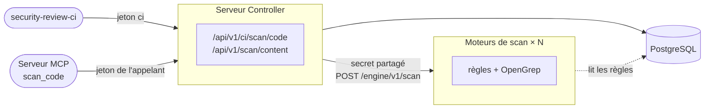

# Moteurs de scan

Avec de nombreux développeurs, les scans de code des pipelines (`security-review-ci scan-code`,
et [`start_codebase_scan`](../../review/analysis/code-scan.md#scan-lance-par-lagent-start_codebase_scan)
des agents) et les [fragments de `scan_code` délégués par le serveur MCP](../../review/analysis/opengrep.md#scans-de-fragments-scan_code)
prennent le processeur et la mémoire du serveur Controller : les règles internes tournent dans son
processus, OpenGrep dans ses sous-processus. Les **moteurs de scan** (`security-review-scan-engine`)
reprennent ce travail, avec autant de réplicas que nécessaire. Ils sont **facultatifs** : sans
eux, le serveur Controller scanne lui-même, comme avant.



| | Serveur Controller | Moteur de scan |
|---|---|---|
| Rôle | Authentification, tickets de scan, droits sur les projets, rapports, SARIF, verdict | Règles et OpenGrep sur les fichiers reçus, rien d'autre |
| Base de données | Lecture et écriture | Lecture des règles seulement (un compte en lecture seule suffit), jamais de migration |
| Règles OpenGrep | Les installe et les gère | Lit le même répertoire (volume monté en lecture seule) |
| Clients | Personnes, pipelines, serveur MCP | Le serveur Controller seulement |

Le scan des dépendances (`scan-deps`) reste sur le serveur Controller : il lit la base d'avis de
vulnérabilité.

## Activation

1. Générez un secret partagé par le serveur Controller et les moteurs :

    ```bash
    openssl rand -hex 32
    ```

2. Démarrez les moteurs avec ce secret, la base et les réglages OpenGrep
   (les `SECREVIEW_OPENGREP_*` s'appliquent désormais aux moteurs) :

    ```bash
    SECREVIEW_SCAN_ENGINE_TOKEN=<secret> \
    SECREVIEW_DATABASE_URL=postgresql+psycopg2://secreview_ro:...@db:5432/secreview \
    security-review-scan-engine --host 0.0.0.0 --port 8000
    ```

    Avec l'image : `docker run ... ghcr.io/cyr-ius/security-review:latest-opengrep scan-engine` ;
    sur Kubernetes : `examples/kubernetes/scan-engine.yaml` (Deployment, Service, NetworkPolicy, et
    le volume partagé des règles OpenGrep).

3. Indiquez-les au serveur Controller, derrière une seule adresse (`Service` Kubernetes, service
   Compose à plusieurs réplicas, répartiteur de charge) :

    ```bash
    SECREVIEW_SCAN_ENGINE_URL=http://scan-engine:8000
    SECREVIEW_SCAN_ENGINE_TOKEN=<secret>
    ```

Le serveur Controller refuse de démarrer avec `SECREVIEW_SCAN_ENGINE_URL` mais sans
`SECREVIEW_SCAN_ENGINE_TOKEN` ; un moteur refuse de démarrer sans le secret.

| Variable | Défaut | Où | Rôle |
|---|---|---|---|
| `SECREVIEW_SCAN_ENGINE_URL` | — | Serveur Controller | URL racine des moteurs ; absente : le serveur Controller scanne lui-même |
| `SECREVIEW_SCAN_ENGINE_TOKEN` | — | les deux | Secret partagé, 32 caractères au moins |
| `SECREVIEW_SCAN_ENGINE_TIMEOUT_SECONDS` | `660` | Serveur Controller | Durée maximale d'un scan par un moteur, au-delà de `SECREVIEW_OPENGREP_TIMEOUT_SECONDS` des moteurs |
| `SECREVIEW_SCAN_ENGINE_FALLBACK` | `refuse` | Serveur Controller | Quand aucun moteur ne répond : refuser le scan (`refuse`) ou scanner localement (`local`) |

## Quand un moteur ne répond pas

| Situation | Réponse au client |
|---|---|
| Moteur injoignable, en échec ou réponse inattendue, `SECREVIEW_SCAN_ENGINE_FALLBACK=refuse` (défaut) | `503` avec `Retry-After` : le serveur Controller reste déchargé |
| Idem, avec `SECREVIEW_SCAN_ENGINE_FALLBACK=local` | Le serveur Controller scanne lui-même (règles, et OpenGrep s'il y est activé) |
| Moteur occupé (tous ses créneaux OpenGrep pris) | `503` avec `Retry-After`, jamais de scan local |
| Fichiers au-delà des limites du moteur | `422` avec le motif |

Pour un fragment de `scan_code`, un `503` fait scanner le serveur MCP avec ses propres règles,
comme lorsque le serveur Controller ne peut pas répondre.

Les scans envoyés aux moteurs sont comptés par `secreview_scan_engine_requests_total` (voir
[Métriques Prometheus](../../reference/metrics.md)).

## Dimensionnement

Chaque moteur exécute `SECREVIEW_OPENGREP_MAX_CONCURRENT_SCANS` scans de dépôt et
`SECREVIEW_OPENGREP_MAX_CONCURRENT_FRAGMENT_SCANS` fragments en même temps, chacun avec
`SECREVIEW_OPENGREP_JOBS` cœurs et `SECREVIEW_OPENGREP_MAX_MEMORY_MB` de mémoire : ajoutez des
réplicas plutôt que d'augmenter ces valeurs. Un moteur ne garde aucun état : on peut ajouter ou
retirer des réplicas à tout moment. Les règles internes modifiées dans l'interface web
atteignent les moteurs en quelques secondes (comme pour le serveur MCP) ; les règles OpenGrep
sont lues dans le répertoire partagé à chaque scan.

## Sécurité

- Le secret part en jeton Bearer du serveur Controller vers l'URL configurée uniquement, sans
  proxy ni redirection ; un moteur en garde l'empreinte SHA-256, la compare en temps constant et
  refuse (`401`) toute requête qui ne le porte pas **avant d'en lire le corps**. Seul `/healthz`
  répond sans le secret.
- Un moteur ne sert aucune documentation ni autre route, n'ouvre aucune connexion sortante,
  n'écrit rien et ne charge aucun module du serveur Controller.
- Les requêtes sont bornées des deux côtés (`SECREVIEW_MAX_SCAN_REQUEST_MB`,
  `SECREVIEW_MAX_SCAN_FILES`, `SECREVIEW_MAX_SCAN_FILE_CHARS`, `SECREVIEW_MAX_CONTENT_CHARS`) ;
  la réponse d'un moteur est bornée en taille et validée (identifiants de règle, sévérités,
  correspondances par fichier) par le serveur Controller, qui masque à nouveau les secrets des
  extraits.
- Gardez les moteurs sur un réseau interne, joignables par le serveur Controller seulement
  (`NetworkPolicy` Kubernetes), ou activez [TLS](../tls.md) sur eux (`SECREVIEW_TLS_CERTFILE`).
- Le serveur MCP ne contacte jamais les moteurs : il passe toujours par le serveur Controller.
