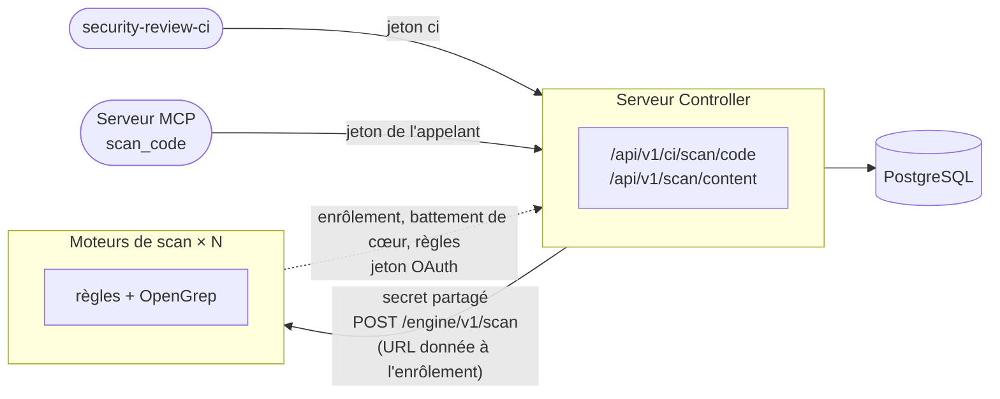

# Moteurs de scan

Avec de nombreux développeurs, les scans de code des pipelines (`security-review-ci scan-code`,
et [`start_codebase_scan`](../../review/analysis/code-scan.md#scan-lance-par-lagent-start_codebase_scan)
des agents) et les [fragments de `scan_code` délégués par le serveur MCP](../../review/analysis/opengrep.md#scans-de-fragments-scan_code)
prennent le processeur et la mémoire du serveur Controller : les règles internes tournent dans son
processus, OpenGrep dans ses sous-processus. Les **moteurs de scan** (`security-review-scan-engine`)
reprennent ce travail, avec autant de réplicas que nécessaire. Ils sont **facultatifs** : sans
eux, le serveur Controller scanne lui-même, comme avant.



| | Serveur Controller | Moteur de scan |
|---|---|---|
| Rôle | Authentification, tickets de scan, droits sur les projets, rapports, SARIF, verdict | Règles et OpenGrep sur les fichiers reçus, rien d'autre |
| Base de données | Lecture et écriture | **Aucune** : il lit les règles par l'API REST du serveur Controller |
| Règles et règles OpenGrep | Les gère et les sert aux moteurs | Les copie et cherche des règles plus récentes avant chaque scan |
| Identifiants | Enrôle les moteurs, émet leurs jetons d'accès | Secret partagé pour s'enrôler, puis son propre jeton d'accès OAuth |
| Adresses | Aucune à configurer : il envoie chaque scan à un moteur enrôlé et actif | Donne sa propre URL en s'enrôlant |
| Clients | Personnes, pipelines, serveur MCP | Le serveur Controller seulement |

Le scan des dépendances (`scan-deps`) reste sur le serveur Controller : il lit la base d'avis de
vulnérabilité.

## Activation

1. Générez un secret partagé par le serveur Controller et les moteurs :

    ```bash
    openssl rand -hex 32
    ```

2. Donnez-le au serveur Controller : il active les moteurs. **Aucune adresse des moteurs** n'est
   nécessaire, ni répartiteur de charge devant eux :

    ```bash
    SECREVIEW_SCAN_ENGINE_TOKEN=<secret>
    ```

3. Démarrez les moteurs avec le même secret, l'adresse interne du serveur Controller et les
   réglages OpenGrep (les `SECREVIEW_OPENGREP_*` s'appliquent désormais aux moteurs). Ils n'ont
   besoin d'**aucune base de données** :

    ```bash
    SECREVIEW_SCAN_ENGINE_TOKEN=<secret> \
    SECREVIEW_CONTROLLER_URL=http://controller:8000 \
    security-review-scan-engine --host 0.0.0.0 --port 8000
    ```

    Avec l'image : `docker run ... ghcr.io/cyr-ius/security-review:latest-opengrep scan-engine` ;
    avec Compose : `docker compose --profile scan-engine up -d --scale scan-engine=3` ; sur
    Kubernetes : `examples/kubernetes/scan-engine.yaml` (Deployment et NetworkPolicy, l'IP du pod
    donnée dans `SECREVIEW_SCAN_ENGINE_ADVERTISE_URL`).

Un moteur refuse de démarrer sans le secret ou sans `SECREVIEW_CONTROLLER_URL`. `SECREVIEW_PUBLIC_URL`, si elle est définie sur un moteur, l'emporte
sur `SECREVIEW_CONTROLLER_URL`.

| Variable | Défaut | Où | Rôle |
|---|---|---|---|
| `SECREVIEW_SCAN_ENGINE_TOKEN` | — | les deux | Secret partagé, 32 caractères au moins : les scans envoyés aux moteurs, et leur enrôlement. Défini sur le serveur Controller, il active les moteurs ; absent : le serveur Controller scanne lui-même |
| `SECREVIEW_SCAN_ENGINE_NETWORKS` | réseaux privés et de bouclage | Serveur Controller | Réseaux (CIDR) où les moteurs peuvent annoncer leur adresse : une adresse IP de l'un d'eux, jamais un nom d'hôte |
| `SECREVIEW_SCAN_ENGINE_TIMEOUT_SECONDS` | `660` | Serveur Controller | Durée maximale d'un scan par un moteur, au-delà de `SECREVIEW_OPENGREP_TIMEOUT_SECONDS` des moteurs |
| `SECREVIEW_SCAN_ENGINE_FALLBACK` | `refuse` | Serveur Controller | Quand aucun moteur ne répond : refuser le scan (`refuse`) ou scanner localement (`local`) |
| `SECREVIEW_SCAN_ENGINE_ACCESS_TOKEN_MINUTES` | `15` | Serveur Controller | Durée de validité du jeton d'accès OAuth d'un moteur (1 à 1440) |
| `SECREVIEW_SCAN_ENGINE_RETENTION_DAYS` | `7` | Serveur Controller | Un moteur absent depuis ce nombre de jours est supprimé (1 à 365) |
| `SECREVIEW_CONTROLLER_URL` | — | Moteur de scan | Adresse interne du serveur Controller, où le moteur s'enrôle et lit les règles (obligatoire) |
| `SECREVIEW_SCAN_ENGINE_ADVERTISE_URL` | adresse IP du nom d'hôte et port d'écoute | Moteur de scan | URL racine où le serveur Controller envoie les scans à ce moteur, donnée à son enrôlement (par ex. `http://10.42.0.17:8000`, l'IP du pod) |

## Enrôlement et jetons d'accès

Un moteur ne lit aucune base de données. À son démarrage, chaque réplica :

1. **s'enrôle** auprès du serveur Controller : `POST /engine/v1/enroll` avec le secret partagé,
   son nom (nom d'hôte), sa version et **son URL**, où le serveur Controller lui envoie les scans. Le serveur Controller lui attribue son propre client OAuth,
   un identifiant (`eng_…`) et un secret client, donnés une seule fois et gardés uniquement en
   mémoire par le moteur ;
2. obtient un **jeton d'accès** par le flux OAuth 2.0 `client_credentials`
   (`POST /engine/v1/token`, client authentifié en HTTP Basic), valable
   `SECREVIEW_SCAN_ENGINE_ACCESS_TOKEN_MINUTES`. Il le renouvelle avant son expiration, en tâche de
   fond, ce qui indique aussi au serveur Controller qu'il est actif ;
3. envoie un **battement de cœur** avec ses créneaux OpenGrep libres, sa capacité, les scans et
   fichiers en cours de traitement et ce qu'il a fait depuis son démarrage (scans de code,
   fragments, fichiers, échecs, scans refusés car occupé) (`POST /api/v1/engine/heartbeat`) :
   toutes les 30 secondes au repos, toutes les 5 secondes pendant un scan, et aussitôt (au plus une
   fois par seconde) quand un scan commence ou se termine ;
4. lit les règles avec ce jeton par l'API REST du serveur Controller (`/api/v1/engine/*`, voir
   [Règles](#regles)) ;
5. quand il s'arrête (`SIGTERM` : mise à jour progressive, nœud drainé, réduction du nombre de
   réplicas), une fois ses scans en cours terminés, **se retire** du serveur Controller
   (`DELETE /api/v1/engine/self` avec son jeton d'accès), qui l'oublie aussitôt. À son prochain
   démarrage, sur le même nœud ou sur un autre, il s'enrôle comme un nouveau moteur : les moteurs
   arrêtés ne s'accumulent pas sur la page **Moteurs de scan**.

## Comment les scans parviennent aux moteurs

Le serveur Controller n'a besoin d'aucune adresse des moteurs : il envoie chaque scan de code ou
fragment de `scan_code` à `POST /engine/v1/scan` à l'URL d'un moteur **actif**, dont le dernier
battement de cœur date de moins de 90 secondes, **celui qui a le plus de créneaux libres** pour ce
type de scan d'abord (ordre aléatoire entre égaux). Un moteur occupé ou injoignable est remplacé par
le suivant, jusqu'à 3 moteurs par scan. Plusieurs réplicas du serveur Controller partagent cette
liste (elle est en base).

L'URL d'un moteur doit avoir une **adresse IP** comme hôte, dans `SECREVIEW_SCAN_ENGINE_NETWORKS`
(réseaux privés et de bouclage par défaut), vérifiée à son enrôlement : les fichiers des scans de
code ne partent jamais vers un nom d'hôte, ni hors de ces réseaux. Sans
`SECREVIEW_SCAN_ENGINE_ADVERTISE_URL`, un moteur donne l'adresse IP de son nom d'hôte (l'IP de son
pod ou de son conteneur) et son port d'écoute, en `https` quand [TLS](../tls.md) y est activé.

Le jeton d'accès d'un moteur a le rôle `engine` : il n'atteint que les routes sous
`/api/v1/engine/`, et aucun autre identifiant (session, jeton `admin` ou `api`) ne les atteint.
Le secret partagé ne sert qu'à l'enrôlement et aux scans envoyés par le serveur Controller.

Si le serveur Controller est injoignable au démarrage d'un moteur, celui-ci s'enrôle à son premier
scan.

## Administration

Les moteurs enrôlés sont listés dans la page [**Moteurs de scan**](../../usage/index.md#pages)
(permission `settings.manage`) et par `security-review-controller engine list` : nom, version,
état (actif tant que son battement de cœur est récent), URL, créneaux libres, date d'enrôlement et
dernière activité, jamais un secret.

Au-dessus de la liste, le graphe **Activité** montre les scans de code en cours. Il s'affiche
même sans aucun moteur (moteurs désactivés, ou aucun enrôlé) : seulement les agents, les serveurs
MCP et le serveur Controller, qui indique **Scanne lui-même (moteurs désactivés)** quand les
moteurs sont désactivés :

- à gauche, les pipelines (`security-review-ci`, revues du dépôt) et les agents (fragments de
  `scan_code`), avec leurs créneaux occupés sur ceux des moteurs actifs ;
- sous les pipelines, un cercle par agent qui a envoyé une requête à un serveur MCP dans les
  5 dernières minutes, relié à ce serveur, avec ses appels `scan_code` depuis le battement de cœur
  précédent. Un agent est affiché par le nom de son client MCP (par exemple `claude-code`),
  jamais par le nom d'une personne ni d'un jeton ; au-delà de 6 agents, un cercle **+N** regroupe
  les autres. Sans aucun agent connu (serveurs MCP d'une version précédente), un seul cercle
  **Agents** les représente ;
- à côté des agents, un cercle jaune par serveur MCP en marche (transport HTTP), plus grand que
  ceux des agents, avec le plus grand
  nombre d'appels `scan_code` simultanés depuis son battement de cœur précédent. Les agents
  passent par lui pour atteindre le serveur Controller ; son lien vers le serveur Controller est en
  pointillés, avec **Scan local**, tant que la délégation de `scan_code` est désactivée : il scanne
  alors les fragments lui-même et ils n'atteignent jamais les moteurs. Les pipelines vont
  directement au serveur Controller. Les serveurs MCP en mode local (stdio) ont leur propre base
  et n'apparaissent jamais. Sans aucun serveur MCP en marche, les agents sont reliés directement au
  serveur Controller ;
- au centre, un cercle par processus du serveur Controller en marche. Chaque processus entretient
  un battement de cœur en base toutes les 5 secondes et disparaît après 30 secondes sans battement.
  Les réplicas partagent la base, leurs cercles montrent donc les mêmes nombres : moteurs actifs,
  fichiers en cours de traitement, et un anneau avec les scans de pipeline et les fragments en
  cours ;
- à droite, un cercle par moteur, avec ses créneaux OpenGrep occupés sur son total.

Des traits fins portent un point en mouvement pendant les scans, et chaque battement de cœur d'un
moteur envoie une impulsion verte vers le serveur Controller. Un moteur sans battement de cœur
récent est grisé. La page se recharge d'elle-même toutes les 2 secondes tant qu'elle est visible.
Le nombre de fragments actifs compte les requêtes `scan_code` simultanées, pas les agents
distincts. Le survol d'un cercle affiche son détail, dont les compteurs depuis le démarrage du
moteur (ils repartent de zéro quand il redémarre et s'enrôle de nouveau) ; la liste en dessous
donne les mêmes moteurs.

- **Révoquer** un moteur (page, ou `security-review-controller engine revoke <id>`) : son client et
  son jeton d'accès cessent aussitôt de fonctionner, il ne reçoit plus de scans, et ses scans
  échouent. Il ne se réenrôle pas
  de lui-même : il ne s'enrôle de nouveau qu'à son redémarrage. Pour écarter tous les moteurs,
  changez le secret partagé.
- Un moteur qui s'arrête normalement se retire de lui-même : il n'y a rien à révoquer.
- Un moteur absent depuis `SECREVIEW_SCAN_ENGINE_RETENTION_DAYS` (un réplica disparu sans se
  retirer : plantage, processus tué, nœud perdu, serveur Controller injoignable à son arrêt) est
  supprimé au prochain enrôlement ou à la prochaine consultation de la liste. D'ici là, il reste
  listé, inactif, et ne reçoit aucun scan.

Les enrôlements, révocations, retraits et suppressions sont inscrits au
[journal d'audit](../audit-log.md) (`scan_engine.enrolled`, `scan_engine.revoked`,
`scan_engine.left`, `scan_engine.expired`).

## Règles

Avant chaque scan, un moteur met à jour sa copie des règles du serveur Controller :

- **Règles internes** : `GET /api/v1/engine/rules` avec l'empreinte de sa copie (`If-None-Match`).
  Si rien n'a changé, le serveur Controller répond `304`. Sinon, il renvoie les règles actives
  (sans les règles désactivées), que le moteur valide de nouveau (expressions régulières comprises)
  avant de s'en servir.
- **Règles OpenGrep** (quand OpenGrep est activé sur le moteur) :
  `GET /api/v1/engine/opengrep-rules` renvoie le SHA-256 de chaque règle, ou `304` si rien n'a
  changé. Le moteur les compare à sa copie et ne télécharge **que les règles nouvelles ou
  modifiées** (`POST`, par lots de 20), vérifie chacune avec son empreinte et retire les règles
  supprimées. Il écrit cette nouvelle version des règles à côté de la précédente dans
  `SECREVIEW_OPENGREP_RULES_DIR` (un répertoire local, accessible en écriture au moteur) : les
  scans en cours gardent les règles avec lesquelles ils ont commencé, et la version précédente est
  supprimée à la fin du dernier d'entre eux.

Les règles modifiées sur le serveur Controller (interface web, CLI, propositions OpenGrep
approuvées) atteignent donc les moteurs **à leur scan suivant**. Quand le serveur Controller ne
répond pas, le moteur scanne avec la copie dont il dispose (et journalise un avertissement), sans
redemander pendant 10 secondes ; sans aucune copie, il ne peut pas scanner et le serveur Controller
le considère comme indisponible (voir plus bas).

## Quand un moteur ne répond pas

| Situation | Réponse au client |
|---|---|
| Moteur injoignable, en échec, révoqué, sans règles ou réponse inattendue, `SECREVIEW_SCAN_ENGINE_FALLBACK=refuse` (défaut) | `503` avec `Retry-After` : le serveur Controller reste déchargé |
| Idem, avec `SECREVIEW_SCAN_ENGINE_FALLBACK=local` | Le serveur Controller scanne lui-même (règles, et OpenGrep s'il y est activé) |
| Moteur occupé (tous ses créneaux OpenGrep pris) | `503` avec `Retry-After`, jamais de scan local |
| Fichiers au-delà des limites du moteur | `422` avec le motif |

Pour un fragment de `scan_code`, un `503` fait scanner le serveur MCP avec ses propres règles,
comme lorsque le serveur Controller ne peut pas répondre.

Les scans envoyés aux moteurs sont comptés par `secreview_scan_engine_requests_total` (voir
[Métriques Prometheus](../../reference/metrics.md)).

## Dimensionnement

Chaque moteur exécute `SECREVIEW_OPENGREP_MAX_CONCURRENT_SCANS` scans de dépôt et
`SECREVIEW_OPENGREP_MAX_CONCURRENT_FRAGMENT_SCANS` fragments en même temps, chacun avec
`SECREVIEW_OPENGREP_JOBS` cœurs et `SECREVIEW_OPENGREP_MAX_MEMORY_MB` de mémoire : ajoutez des
réplicas plutôt que d'augmenter ces valeurs. Un moteur ne garde aucun état : on peut ajouter ou
retirer des réplicas à tout moment (chaque nouveau réplica s'enrôle, un réplica disparu ne reçoit
plus de scans 90 secondes après son dernier battement de cœur). Chaque scan coûte au serveur
Controller deux requêtes courtes (`304` si les règles n'ont pas changé).

## Sécurité

- Le secret partagé part en jeton Bearer du serveur Controller vers l'URL d'un moteur enrôlé
  uniquement (une adresse IP de `SECREVIEW_SCAN_ENGINE_NETWORKS`),
  et d'un moteur vers `/engine/v1/enroll` uniquement, sans proxy ni redirection ; chaque côté en
  garde l'empreinte SHA-256, la compare en temps constant et refuse (`401`) une requête qui ne le
  porte pas **avant d'en lire le corps**. Seul `/healthz` répond sans lui sur un moteur.
- Un moteur s'authentifie auprès de l'API REST avec son propre jeton d'accès uniquement, de rôle
  `engine`, de courte durée et renouvelé ; le serveur Controller ne garde que les empreintes
  SHA-256 du secret client et du jeton d'accès en cours, comparées en temps constant. Un moteur
  révoqué est refusé aussitôt.
- Un moteur ne lit aucune base de données, ne sert aucune documentation ni autre route, n'écrit
  rien d'autre que sa copie des règles OpenGrep et ne charge aucun module du serveur Controller. Sa
  seule connexion sortante va vers `SECREVIEW_CONTROLLER_URL`, sans proxy ni redirection, avec une
  durée maximale ; les réponses sont bornées et validées (identifiants de règle seulement, qui
  deviennent des noms de fichier, chaque règle OpenGrep vérifiée avec son SHA-256, chaque règle
  interne validée de nouveau).
- L'enrôlement et le point d'émission des jetons ne sont servis qu'avec
  `SECREVIEW_SCAN_ENGINE_TOKEN`, en dehors des jetons du serveur Controller ; leurs corps sont
  bornés, et 1000 moteurs au plus sont enrôlés en même temps.
- Les requêtes sont bornées des deux côtés (`SECREVIEW_MAX_SCAN_REQUEST_MB`,
  `SECREVIEW_MAX_SCAN_FILES`, `SECREVIEW_MAX_SCAN_FILE_CHARS`, `SECREVIEW_MAX_CONTENT_CHARS`) ;
  la réponse d'un moteur est bornée en taille et validée (identifiants de règle, sévérités,
  correspondances par fichier) par le serveur Controller, qui masque à nouveau les secrets des
  extraits.
- Gardez les moteurs sur un réseau interne, joignables par le serveur Controller seulement
  (`NetworkPolicy` Kubernetes), ou activez [TLS](../tls.md) sur eux (`SECREVIEW_TLS_CERTFILE`), et
  utilisez une `SECREVIEW_CONTROLLER_URL` en `https` si ce réseau n'est pas de confiance.
- Le serveur MCP ne contacte jamais les moteurs : il passe toujours par le serveur Controller.
