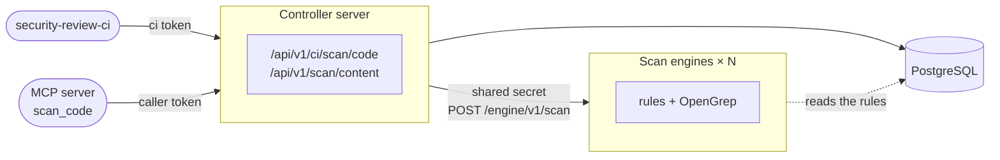

# Scan engines

With many developers, the code scans of the pipelines (`security-review-ci scan-code`, and
[`start_codebase_scan`](../../review/analysis/code-scan.md#scan-started-by-the-agent-start_codebase_scan)
of the agents) and the [`scan_code` fragments delegated by the MCP server](../../review/analysis/opengrep.md#fragment-scans-scan_code)
take the CPU and memory of the Controller server: the internal rules run in its process,
OpenGrep in its sub-processes. The **scan engines** (`security-review-scan-engine`) take this
work over, as many replicas as needed. They are **optional**: without them, the Controller server
scans itself, as before.



| | Controller server | Scan engine |
|---|---|---|
| Does | Authentication, scan tickets, project rights, reports, SARIF, verdict | Rules and OpenGrep on the files received, nothing else |
| Database | Reads and writes | Reads the rules only (a read-only account is enough), never migrates |
| OpenGrep rules | Installs and manages them | Reads the same directory (volume mounted read-only) |
| Clients | People, pipelines, MCP server | The Controller server only |

The dependency scan (`scan-deps`) stays on the Controller server: it reads the advisory
database.

## Enabling

1. Generate a secret shared by the Controller server and the engines:

    ```bash
    openssl rand -hex 32
    ```

2. Start the engines with this secret, the database and the OpenGrep settings
   (`SECREVIEW_OPENGREP_*` apply to the engines from now on):

    ```bash
    SECREVIEW_SCAN_ENGINE_TOKEN=<secret> \
    SECREVIEW_DATABASE_URL=postgresql+psycopg2://secreview_ro:...@db:5432/secreview \
    security-review-scan-engine --host 0.0.0.0 --port 8000
    ```

    With the image: `docker run ... ghcr.io/cyr-ius/security-review:latest-opengrep scan-engine`;
    on Kubernetes: `examples/kubernetes/scan-engine.yaml` (Deployment, Service, NetworkPolicy, and
    the shared volume of the OpenGrep rules).

3. Point the Controller server at them, behind one address (Kubernetes `Service`, Compose service
   with replicas, load balancer):

    ```bash
    SECREVIEW_SCAN_ENGINE_URL=http://scan-engine:8000
    SECREVIEW_SCAN_ENGINE_TOKEN=<secret>
    ```

The Controller server refuses to start with `SECREVIEW_SCAN_ENGINE_URL` but without
`SECREVIEW_SCAN_ENGINE_TOKEN`; an engine refuses to start without the secret.

| Variable | Default | Where | Role |
|---|---|---|---|
| `SECREVIEW_SCAN_ENGINE_URL` | — | Controller server | Root URL of the engines; unset: the Controller server scans itself |
| `SECREVIEW_SCAN_ENGINE_TOKEN` | — | both | Shared secret, at least 32 characters |
| `SECREVIEW_SCAN_ENGINE_TIMEOUT_SECONDS` | `660` | Controller server | Time limit of a scan by an engine, above `SECREVIEW_OPENGREP_TIMEOUT_SECONDS` of the engines |
| `SECREVIEW_SCAN_ENGINE_FALLBACK` | `refuse` | Controller server | When no engine answers: `refuse` the scan, or scan `local`ly |

## When an engine does not answer

| Situation | Answer to the client |
|---|---|
| Engine unreachable, failed or unexpected answer, `SECREVIEW_SCAN_ENGINE_FALLBACK=refuse` (default) | `503` with `Retry-After`: the Controller server stays unloaded |
| Same, with `SECREVIEW_SCAN_ENGINE_FALLBACK=local` | The Controller server scans itself (rules, and OpenGrep when it is enabled on it) |
| Engine busy (all its OpenGrep slots taken) | `503` with `Retry-After`, never a local scan |
| Files above the bounds of the engine | `422` with the reason |

For a `scan_code` fragment, a `503` makes the MCP server scan with its own rules, as when the
Controller server cannot answer.

The scans sent to the engines are counted by `secreview_scan_engine_requests_total` (see
[Prometheus metrics](../../reference/metrics.md)).

## Sizing

Each engine runs `SECREVIEW_OPENGREP_MAX_CONCURRENT_SCANS` codebase scans and
`SECREVIEW_OPENGREP_MAX_CONCURRENT_FRAGMENT_SCANS` fragments at the same time, each with
`SECREVIEW_OPENGREP_JOBS` cores and `SECREVIEW_OPENGREP_MAX_MEMORY_MB` of memory: add replicas
rather than raising these values. An engine keeps no state: replicas can be added or removed at
any time. The internal rules changed in the web interface reach the engines within a few seconds
(as for the MCP server); the OpenGrep rules are read from the shared directory at each scan.

## Security

- The secret goes as a bearer token from the Controller server to the URL configured only, without
  proxy nor redirect; an engine keeps its SHA-256 digest, compares it in constant time, and
  refuses (`401`) any request without it **before reading its body**. Only `/healthz` answers
  without the secret.
- An engine serves no documentation, no other route, opens no outgoing connection, writes
  nothing, and loads none of the modules of the Controller server.
- The requests are bounded on both sides (`SECREVIEW_MAX_SCAN_REQUEST_MB`,
  `SECREVIEW_MAX_SCAN_FILES`, `SECREVIEW_MAX_SCAN_FILE_CHARS`, `SECREVIEW_MAX_CONTENT_CHARS`);
  the answer of an engine is bounded in size and validated (rule ids, severities, matches per
  file) by the Controller server, which masks the secrets of the excerpts again.
- Keep the engines on an internal network, reachable from the Controller server only (Kubernetes
  `NetworkPolicy`), or enable [TLS](../tls.md) on them (`SECREVIEW_TLS_CERTFILE`).
- The MCP server never contacts the engines: it keeps going through the Controller server.
