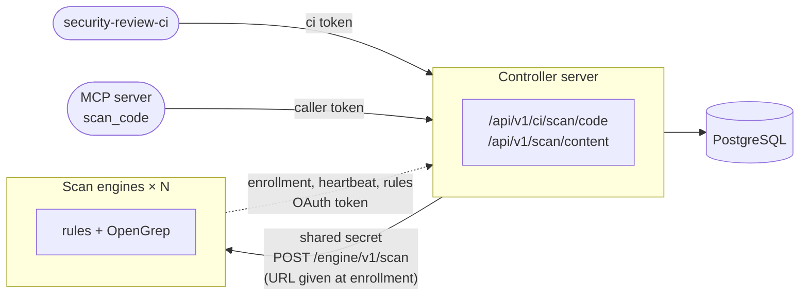

# Scan engines

With many developers, the code scans of the pipelines (`security-review-ci scan-code`, and
[`start_codebase_scan`](../../review/analysis/code-scan.md#scan-started-by-the-agent-start_codebase_scan)
of the agents) and the [`scan_code` fragments delegated by the MCP server](../../review/analysis/opengrep.md#fragment-scans-scan_code)
take the CPU and memory of the Controller server: the internal rules run in its process,
OpenGrep in its sub-processes. The **scan engines** (`security-review-scan-engine`) take this
work over, as many replicas as needed. They are **optional**: without them, the Controller server
scans itself, as before.



| | Controller server | Scan engine |
|---|---|---|
| Does | Authentication, scan tickets, project rights, reports, SARIF, verdict | Rules and OpenGrep on the files received, nothing else |
| Database | Reads and writes | **None**: it reads the rules through the REST API of the Controller server |
| Rules and OpenGrep rules | Manages them, serves them to the engines | Copies them and checks for newer ones before each scan |
| Credentials | Enrolls the engines, issues their access tokens | Shared secret to enroll, then its own OAuth access token |
| Addresses | Needs none: it sends each scan to an enrolled, active engine | Gives its own URL when it enrolls |
| Clients | People, pipelines, MCP server | The Controller server only |

The dependency scan (`scan-deps`) stays on the Controller server: it reads the advisory
database.

## Enabling

!!! tip "Ready-to-use examples"
    - **Docker Compose**: [`docker-compose.scan-engines.yml`](https://github.com/cyr-ius/security-review/blob/{{ release_tag }}/examples/docker/docker-compose.scan-engines.yml),
      the complete deployment with two engines. See [Docker: scan engines](../deployment/docker.md#scan-engines).
    - **Kubernetes**: [`scan-engine.yaml`](https://github.com/cyr-ius/security-review/blob/{{ release_tag }}/examples/kubernetes/scan-engine.yaml), two replicas.
      See [Kubernetes: scan engines](../deployment/kubernetes.md#scan-engines).

1. Generate a secret shared by the Controller server and the engines:

    ```bash
    openssl rand -hex 32
    ```

2. Give it to the Controller server: it turns the engines on. **No address of the engines** is
   needed, nor a load balancer in front of them:

    ```bash
    SECREVIEW_SCAN_ENGINE_TOKEN=<secret>
    ```

3. Start the engines with the same secret, the internal address of the Controller server and the
   OpenGrep settings (`SECREVIEW_OPENGREP_*` apply to the engines from now on). They need **no
   database**:

    ```bash
    SECREVIEW_SCAN_ENGINE_TOKEN=<secret> \
    SECREVIEW_CONTROLLER_URL=http://controller:8000 \
    security-review-scan-engine --host 0.0.0.0 --port 8000
    ```

    With the image: `docker run ... ghcr.io/cyr-ius/security-review:latest-opengrep scan-engine`;
    with Compose: the file [`examples/docker/docker-compose.scan-engines.yml`](https://github.com/cyr-ius/security-review/blob/{{ release_tag }}/examples/docker/docker-compose.scan-engines.yml), the complete
    deployment with two engines (see [Docker](../deployment/docker.md#scan-engines)); on
    Kubernetes: [`examples/kubernetes/scan-engine.yaml`](https://github.com/cyr-ius/security-review/blob/{{ release_tag }}/examples/kubernetes/scan-engine.yaml) (two replicas, Deployment and
    NetworkPolicy, the pod IP given in `SECREVIEW_SCAN_ENGINE_ADVERTISE_URL`, see
    [Kubernetes](../deployment/kubernetes.md#scan-engines)).

4. The engines get the OpenGrep rules from the database of the Controller server: the default
   rules are installed there at its start, whatever its image. Run it with the **`-opengrep`
   image**, of the same version as the engines, to create or edit OpenGrep rules in the web
   interface (they are validated with OpenGrep first).

An engine refuses to start without the secret or without `SECREVIEW_CONTROLLER_URL`. `SECREVIEW_PUBLIC_URL`, when set on an engine, takes precedence over
`SECREVIEW_CONTROLLER_URL`.

| Variable | Default | Where | Role |
|---|---|---|---|
| `SECREVIEW_SCAN_ENGINE_TOKEN` | — | both | Shared secret, at least 32 characters: the scans sent to the engines, and their enrollment. Set on the Controller server, it turns the engines on; unset: the Controller server scans itself |
| `SECREVIEW_SCAN_ENGINE_NETWORKS` | private and loopback networks | Controller server | Networks (CIDR) where the engines may advertise their address: an IP address in one of them, never a host name |
| `SECREVIEW_SCAN_ENGINE_TIMEOUT_SECONDS` | `660` | Controller server | Time limit of a scan by an engine, above `SECREVIEW_OPENGREP_TIMEOUT_SECONDS` of the engines |
| `SECREVIEW_SCAN_ENGINE_FALLBACK` | `refuse` | Controller server | When no engine answers: `refuse` the scan, or scan `local`ly |
| `SECREVIEW_SCAN_ENGINE_ACCESS_TOKEN_MINUTES` | `15` | Controller server | Validity of the OAuth access token of an engine (1 to 1440) |
| `SECREVIEW_SCAN_ENGINE_RETENTION_DAYS` | `7` | Controller server | An engine not seen for this many days is deleted (1 to 365) |
| `SECREVIEW_CONTROLLER_URL` | — | Scan engine | Internal address of the Controller server, where the engine enrolls and reads the rules (required) |
| `SECREVIEW_SCAN_ENGINE_ADVERTISE_URL` | IP address of the host name and listening port | Scan engine | Root URL where the Controller server sends the scans to this engine, given at its enrollment (e.g. `http://10.42.0.17:8000`, the pod IP) |

## Enrollment and access tokens

An engine reads no database. At its start, each replica:

1. **enrolls** with the Controller server: `POST /engine/v1/enroll` with the shared secret, its
   name (host name), its version and **its URL**, where the Controller server sends it the scans. The Controller server gives it its own OAuth client, a
   client id (`eng_…`) and a client secret, given once and kept in the memory of the engine only;
2. gets an **access token** with the OAuth 2.0 `client_credentials` grant
   (`POST /engine/v1/token`, client authenticated by HTTP Basic), valid
   `SECREVIEW_SCAN_ENGINE_ACCESS_TOKEN_MINUTES`. It renews it before it expires, in the
   background, which also tells the Controller server it is alive;
3. sends a **heartbeat** with its free OpenGrep slots, its capacity, the scans and files it is
   processing now, and what it did since it started (code scans, fragments, files, failures,
   scans refused when busy) (`POST /api/v1/engine/heartbeat`): every 30 seconds when idle, every
   5 seconds while it scans, and at once (at most once a second) when a scan starts or ends;
4. reads the rules with this token through the REST API of the Controller server
   (`/api/v1/engine/*`, see [Rules](#rules));
5. when it stops (`SIGTERM`: rolling update, node drained, scale down), once its scans in
   progress are over, **leaves** the Controller server (`DELETE /api/v1/engine/self` with its
   access token), which forgets it at once. At its next start, on the same node or another one,
   it enrolls as a new engine: the stopped engines do not pile up on the **Activity** page.

## How the scans reach the engines

The Controller server needs no address of the engines: it sends each code scan or `scan_code`
fragment to `POST /engine/v1/scan` at the URL of an **active** engine, one whose heartbeat is less
than 90 seconds old, **the one with the most free slots** of the kind of scan first (random order
among equals). A busy or unreachable engine is replaced by the next one, up to 3 engines per scan.
Several Controller server replicas share this list (it is in the database).

The URL of an engine must have an **IP address** as host, in `SECREVIEW_SCAN_ENGINE_NETWORKS`
(private and loopback networks by default), checked at its enrollment: the files of the code
scans never go to a host name, nor outside these networks. Without
`SECREVIEW_SCAN_ENGINE_ADVERTISE_URL`, an engine gives the IP address of its host name (the IP of
its pod or container) and its listening port, `https` when [TLS](../tls.md) is enabled on it.

The access token of an engine has the `engine` role: it reaches the routes under
`/api/v1/engine/` only, and no other credential (session, `admin` or `api` token) reaches them.
The shared secret only serves the enrollment and the scans sent by the Controller server.

If the Controller server cannot be reached at the start of an engine, it enrolls at its first
scan.

## Administration

The enrolled engines are listed and revoked in the **Scan engines** section of the
[**Activity**](../../usage/activity.md) page (permission `settings.manage`), which also shows the
[activity diagram](../../usage/activity.md#activity-diagram), and by `security-review-controller engine list`: name, version,
state (active while its heartbeat is recent), URL, free slots, enrollment date and last activity,
never a secret.

- **Revoke** an engine (page, or `security-review-controller engine revoke <id>`): its client and
  its access token stop working at once, it receives no more scans, and its scans fail. It does not enroll again by itself:
  it enrolls again only when it restarts. To shut every engine out, change the shared secret.
- An engine that stops normally leaves by itself: there is nothing to revoke.
- An engine not seen for `SECREVIEW_SCAN_ENGINE_RETENTION_DAYS` (a replica gone without leaving:
  crash, killed process, lost node, Controller server out of reach when it stopped) is deleted
  at the next enrollment or listing. Until then it stays listed, inactive, and receives no scans.

The enrollments, revocations, departures and deletions are recorded in the
[audit log](../audit-log.md) (`scan_engine.enrolled`, `scan_engine.revoked`,
`scan_engine.left`, `scan_engine.expired`).

## Rules

Before each scan, an engine brings its copy of the rules of the Controller server up to date:

- **Internal rules**: `GET /api/v1/engine/rules` with the digest of its copy (`If-None-Match`).
  Unchanged, the Controller server answers `304`. Otherwise it answers the active rules (disabled
  rules left out), which the engine validates again (regular expressions included) before using
  them.
- **OpenGrep rules** (when OpenGrep is enabled on the engine): `GET /api/v1/engine/opengrep-rules`
  answers the SHA-256 of each rule, or `304` when unchanged. The engine compares them with its
  copy and downloads **only the new and changed rules** (`POST`, by batches of 20), checks each one
  against its digest, and drops the deleted ones. It writes this new version of the rules beside
  the previous one in `SECREVIEW_OPENGREP_RULES_DIR` (a local cache, writable by the engine):
  the scans already running keep the rules they started with, and the previous version is
  deleted when the last of them ends.

The rules changed on the Controller server (web interface, CLI, approved OpenGrep proposals) thus
reach the engines **at their next scan**. When the Controller server does not answer, the engine
scans with the copy it has (and logs a warning), without asking again for 10 seconds; without any
copy yet, it cannot scan and the Controller server treats it as unavailable (see below).

## When an engine does not answer

| Situation | Answer to the client |
|---|---|
| Engine unreachable, failed, revoked, without rules, or unexpected answer, `SECREVIEW_SCAN_ENGINE_FALLBACK=refuse` (default) | `503` with `Retry-After`: the Controller server stays unloaded |
| Same, with `SECREVIEW_SCAN_ENGINE_FALLBACK=local` | The Controller server scans itself (rules, and OpenGrep when it is enabled on it) |
| Engine busy (all its OpenGrep slots taken) | `503` with `Retry-After`, never a local scan |
| Files above the bounds of the engine | `422` with the reason |

For a `scan_code` fragment, a `503` makes the MCP server scan with its own rules, as when the
Controller server cannot answer.

The scans sent to the engines are counted by `secreview_scan_engine_requests_total` (see
[Prometheus metrics](../../reference/metrics.md)).

## Sizing

Each engine runs `SECREVIEW_OPENGREP_MAX_CONCURRENT_SCANS` codebase scans and
`SECREVIEW_OPENGREP_MAX_CONCURRENT_FRAGMENT_SCANS` fragments at the same time, each with
`SECREVIEW_OPENGREP_JOBS` cores and `SECREVIEW_OPENGREP_MAX_MEMORY_MB` of memory: add replicas
rather than raising these values. An engine keeps no state: replicas can be added or removed at
any time (each new one enrolls, one gone stops receiving scans 90 seconds after its last
heartbeat). Each scan costs the Controller server two short requests (`304` when the rules did
not change).

## Security

- The shared secret goes as a bearer token from the Controller server to the URL of an enrolled
  engine only (an IP address of `SECREVIEW_SCAN_ENGINE_NETWORKS`), and from an engine to `/engine/v1/enroll` only, without proxy nor redirect; each side
  keeps its SHA-256 digest, compares it in constant time, and refuses (`401`) a request without
  it **before reading its body**. Only `/healthz` answers without it on an engine.
- An engine authenticates to the REST API with its own access token only, of the `engine` role,
  short-lived and renewed; the Controller server keeps the SHA-256 digests of the client secret and
  of the current access token only, compared in constant time. A revoked engine is refused at
  once.
- An engine reads no database, serves no documentation nor other route, writes nothing but its
  copy of the OpenGrep rules, and loads none of the modules of the Controller server. Its only
  outgoing connection is to `SECREVIEW_CONTROLLER_URL`, without proxy nor redirect, with a time
  limit; the answers are bounded and validated (rule ids only, which become file names, each
  OpenGrep rule checked against its SHA-256, each internal rule validated again).
- The enrollment and the token endpoint are served only with `SECREVIEW_SCAN_ENGINE_TOKEN`, outside
  the tokens of the Controller server; their bodies are bounded, and at most 1000 engines are
  enrolled at the same time.
- The requests are bounded on both sides (`SECREVIEW_MAX_SCAN_REQUEST_MB`,
  `SECREVIEW_MAX_SCAN_FILES`, `SECREVIEW_MAX_SCAN_FILE_CHARS`, `SECREVIEW_MAX_CONTENT_CHARS`);
  the answer of an engine is bounded in size and validated (rule ids, severities, matches per
  file) by the Controller server, which masks the secrets of the excerpts again.
- Keep the engines on an internal network, reachable from the Controller server only (Kubernetes
  `NetworkPolicy`), or enable [TLS](../tls.md) on them (`SECREVIEW_TLS_CERTFILE`), and use an
  `https` `SECREVIEW_CONTROLLER_URL` when that network is not trusted.
- The MCP server never contacts the engines: it keeps going through the Controller server.
