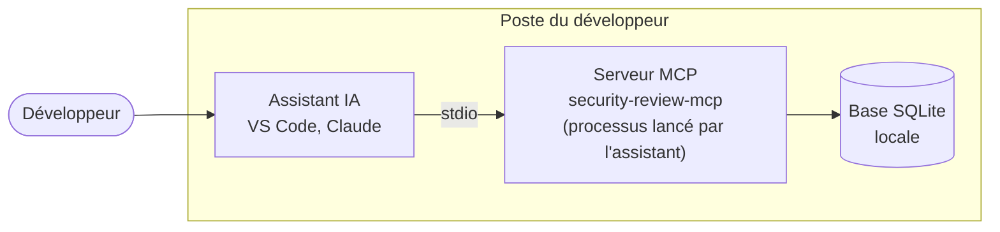

# Mode local (stdio)

En **mode local**, l'hôte (VS Code, Claude…) lance lui-même `security-review-mcp local` sur le
poste du développeur et dialogue avec lui par stdin / stdout : pas de réseau, pas de jeton, pas de
serveur Controller.



!!! warning "Réservé à des cas précis"
    Les rapports sont enregistrés dans une base SQLite **locale** que personne d'autre ne voit,
    il n'y a pas d'interface web pour les trier, et chaque poste garde ses propres règles. Pour
    une équipe, utilisez plutôt le [mode partagé (HTTP)](deploy.md). Le mode
    local sert à essayer les prompts seul, sur un poste hors ligne, ou pour un usage personnel.

## Installation

Le serveur est publié sur PyPI sous le nom de paquet `security-review` (Python 3.14). Il installe
la commande `security-review-mcp`, lancée par l'hôte, et `security-review-controller`, dont le mode
local n'a pas besoin. Installez-le dans un environnement virtuel dédié :

```bash
uv venv --python 3.14 /opt/security-review-mcp/venv
uv pip install --python /opt/security-review-mcp/venv security-review
```

!!! note "Anciennement `security-review-mcp`"
    Jusqu'à la version 2.0.0, le paquet était publié sur PyPI sous le nom `security-review-mcp`.
    Les deux paquets installent les mêmes commandes et le même module Python : désinstallez
    d'abord l'ancien (`uv pip uninstall --python /opt/security-review-mcp/venv security-review-mcp`),
    puis installez `security-review`. Les commandes, les paramètres et la base restent les mêmes.

Sans accès Internet, ou depuis les sources : voir [Installation : autres cas](../advanced/deployment/installation.md).

## Lancement

```bash
security-review-mcp local   # lancé par l'hôte, pas à la main
```

Une base SQLite est créée localement (`~/.local/share/security-review-mcp/security_reports.db`,
ou sous `$XDG_DATA_HOME` quand elle est définie).
C'est le seul fichier écrit par le serveur : supprimez-le pour effacer toute trace.
Pour le placer ailleurs, ajoutez `--database-url` à la commande (SQLite uniquement, chemin absolu
après `sqlite:///`) :

```bash
security-review-mcp local --database-url sqlite:////home/me/data/security_reports.db
```

!!! note "`serve --transport stdio`"
    `security-review-mcp serve --transport stdio` lance aussi le serveur en stdio, mais il lit
    `SECREVIEW_DATABASE_URL` (ou `--database-url`) et n'accepte que SQLite : il refuse de démarrer
    (code `2`) quand l'URL désigne une autre base (PostgreSQL...). Le mode local n'a pas de jeton, et une base
    partagée lui permettrait d'écrire dans tous les projets et de migrer le schéma de l'équipe.
    Pour travailler avec cette base, utilisez le [mode partagé (HTTP)](deploy.md).

## Configuration de l'hôte

En transport **stdio**, l'hôte (VS Code, Claude…) lance lui-même le processus du serveur.
Indiquez le chemin de l'exécutable, la commande `local` et, si besoin, les variables `SECREVIEW_*`
(voir [Configuration](../reference/configuration.md#serveur-mcp)).

VS Code, GitHub Copilot et Claude lisent le même fichier `.mcp.json` à la racine du dépôt :

```json
{
  "mcpServers": {
    "security-review": {
      "type": "stdio",
      "command": "uvx",
      "args": ["--from","security-review==4.0.0","security-review-mcp","local"]
    }
  }
}
```

Pour lancer le serveur depuis un conteneur, voir [Docker](../advanced/deployment/docker.md).
