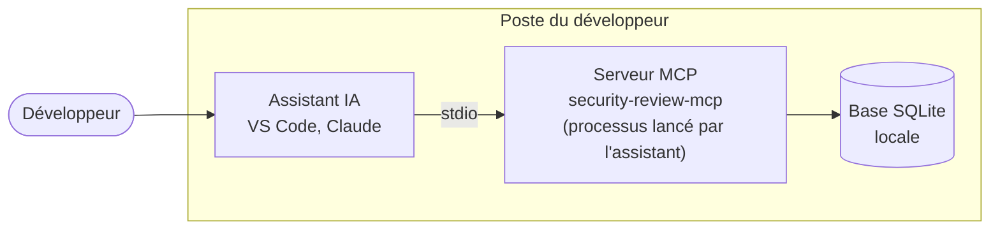

# Mode local (stdio)

En **mode local**, l'hôte (VS Code, Claude…) lance lui-même `security-review-mcp local` sur le
poste du développeur et dialogue avec lui par stdin / stdout : pas de réseau, pas de jeton, pas de
serveur Controller.



!!! warning "Réservé à des cas précis"
    Les rapports sont enregistrés dans une base SQLite **locale** que personne d'autre ne voit,
    il n'y a pas d'interface web pour les trier (le développeur
    [confirme les décisions dans l'hôte](#triage-en-mode-local) à la place), et chaque poste garde ses propres règles. Pour
    une équipe, utilisez plutôt le [mode partagé (HTTP)](deploy.md). Le mode
    local sert à essayer les prompts seul, sur un poste hors ligne, ou pour un usage personnel.

## Configuration de l'hôte

C'est la seule étape : avec [uv](https://docs.astral.sh/uv/getting-started/installation/) sur le
poste, il n'y a rien à installer ni à lancer à la main. À son premier démarrage, l'hôte
télécharge le paquet `security-review` depuis PyPI avec `uvx` (Python 3.14 compris si besoin),
puis lance lui-même le serveur chaque fois qu'il en a besoin.

VS Code, GitHub Copilot et Claude lisent le même fichier `.mcp.json` à la racine du dépôt :

```json
{
  "mcpServers": {
    "security-review": {
      "type": "stdio",
      "command": "uvx",
      "args": ["--from", "security-review=={{ release_version }}", "security-review-mcp", "local"]
    }
  }
}
```

La version est épinglée : pour mettre à jour, changez-la dans le fichier. Pour modifier un
réglage, ajoutez des variables `SECREVIEW_*` dans un objet `env` à côté de `args` (voir
[Configuration](../reference/configuration.md#serveur-mcp)).

Ouvrez ensuite le chat de l'hôte et lancez le prompt `security-review`.

## Base de données

Le serveur crée une base SQLite sur le poste
(`~/.local/share/security-review-mcp/security_reports.db`, ou sous `$XDG_DATA_HOME` quand elle
est définie). C'est le seul fichier écrit par le serveur : supprimez-le pour effacer toute trace.
Pour la placer ailleurs, ajoutez `--database-url` après `local` dans `args` (SQLite uniquement,
chemin absolu après `sqlite:///`) :

```json
"args": ["--from", "security-review=={{ release_version }}", "security-review-mcp", "local",
         "--database-url", "sqlite:////home/me/data/security_reports.db"]
```

!!! note "`serve --transport stdio`"
    `security-review-mcp serve --transport stdio` lance aussi le serveur en stdio, mais il lit
    `SECREVIEW_DATABASE_URL` (ou `--database-url`) et n'accepte que SQLite : il refuse de démarrer
    (code `2`) quand l'URL désigne une autre base (PostgreSQL...). Le mode local n'a pas de jeton, et une base
    partagée lui permettrait d'écrire dans tous les projets et de migrer le schéma de l'équipe.
    Pour travailler avec cette base, utilisez le [mode partagé (HTTP)](deploy.md).

## Sans uvx : paquet installé

Seulement si vous préférez ne pas utiliser `uvx` (poste hors ligne, index de paquets interne,
environnement virtuel figé). Installez le paquet dans un environnement virtuel dédié :

```bash
uv venv --python 3.14 /opt/secreview/venv
uv pip install --python /opt/secreview/venv security-review
```

Indiquez ensuite le chemin de la commande dans `.mcp.json`, à la place de `uvx` :

```json
{
  "mcpServers": {
    "security-review": {
      "type": "stdio",
      "command": "/opt/secreview/venv/bin/security-review-mcp",
      "args": ["local"]
    }
  }
}
```

!!! note "Anciennement `security-review-mcp`"
    Jusqu'à la version 2.0.0, le paquet était publié sur PyPI sous le nom `security-review-mcp`.
    Les deux paquets installent les mêmes commandes et le même module Python : désinstallez
    d'abord l'ancien (`uv pip uninstall --python /opt/secreview/venv security-review-mcp`),
    puis installez `security-review`. Les commandes, les paramètres et la base restent les mêmes.

Sans accès Internet, ou depuis les sources : voir [Installation : autres cas](../advanced/deployment/installation.md).
Pour lancer le serveur depuis un conteneur (commande `mcp` avec `SECREVIEW_TRANSPORT=stdio`), voir
[Docker : choisir le processus](../advanced/deployment/docker.md#choisir-le-processus).

## Rapport des findings (SECURITY_REPORT.md)

Sans interface web, demandez à l'assistant les findings du projet, par exemple *« Montre-moi
les findings de sécurité de ce projet »* ou *« Écris les findings de sécurité dans
SECURITY_REPORT.md »*. Il appelle l'outil `export_findings_report`, qui renvoie un document
Markdown : findings ouverts par sévérité, puis les findings, le plus grave d'abord. Deux niveaux
de détail :

| `detail` | Contenu de chaque finding | Taille |
|---|---|---|
| `compact` (par défaut) | Une ligne : sévérité, titre, emplacement, identifiant et statut | Réduite : quelques tokens par finding |
| `full` | Son rapport (identifiant, date, branche, commit), sa description, sa preuve masquée et sa recommandation | Bien plus grande : à demander seulement quand vous avez besoin du détail |

Avec `include_resolved`, les findings corrigés, acceptés et faux positifs sont listés aussi.

Le serveur renvoie seulement le texte et n'écrit jamais sur le disque : l'assistant l'affiche,
ou écrit `SECURITY_REPORT.md` à la racine du dépôt avec ses propres outils (l'hôte vous demande
d'approuver l'écriture). L'outil fonctionne aussi en mode partagé (HTTP), sur les projets
qu'atteint le jeton. Le fichier contient des extraits de code des findings : ajoutez-le au
`.gitignore` s'il ne doit pas être commité.

## Triage en mode local

Donnez votre décision à l'assistant avec vos mots, par exemple *« La ligne 12 de app/db.py est
un faux positif : la requête est paramétrée »* ou *« Accepte le risque du #42 jusqu'au 30 juin :
outil interne »*. Il appelle `decide_finding_status`, et votre hôte vous affiche une
confirmation avec les findings, le statut, le motif et la date d'expiration : le statut ne
change que si vous confirmez, et vous êtes enregistré comme approbateur. Refusez une
confirmation que vous n'avez pas demandée. L'hôte doit gérer l'elicitation MCP (Claude Code,
VS Code) ; sinon l'assistant peut seulement proposer un statut. Détails : [décision du
développeur en mode local](../review/prompts-tools.md#decision-du-developpeur-en-mode-local).
