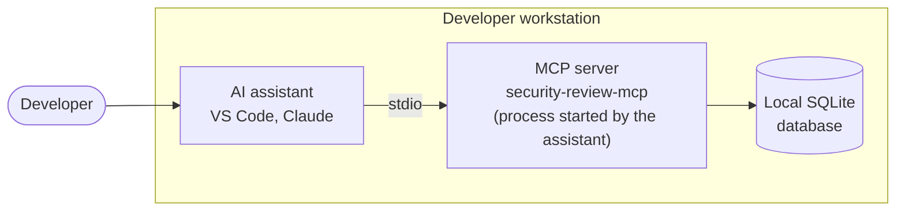

# Local mode (stdio)

In **local mode**, the host (VS Code, Claude…) starts `security-review-mcp local` itself on the
developer workstation and talks to it through stdin / stdout: no network, no token, no
controller.



!!! warning "For specific cases only"
    The reports are saved in a **local** SQLite database that nobody else sees, there is no web
    interface to triage them, and every workstation keeps its own rules. For a team, use the
    [shared mode (HTTP)](../getting-started/deploy.md) instead. Local mode is useful to try the
    prompts alone, on an offline workstation, or for a personal use.

## Installation

The server is published on PyPI as the `security-review` package (Python 3.14). It installs the
`security-review-mcp` command started by the host, and `security-review-controller`, which local
mode does not need. Install it in a dedicated virtual environment:

```bash
uv venv --python 3.14 /opt/security-review-mcp/venv
uv pip install --python /opt/security-review-mcp/venv security-review
```

!!! note "Formerly `security-review-mcp`"
    Up to version 2.0.0, the package was published on PyPI as `security-review-mcp`. Both
    packages install the same commands and the same Python module: uninstall the old one first
    (`uv pip uninstall --python /opt/security-review-mcp/venv security-review-mcp`), then install
    `security-review`. The commands, the settings and the database stay the same.

Without Internet access, or from the sources: see [Installation: other cases](../advanced/installation.md).

## Running

```bash
security-review-mcp local   # started by the host, not by hand
```

A SQLite database is created locally (`~/.local/share/security-review-mcp/security_reports.db`,
or under `$XDG_DATA_HOME` when it is set).
This is the only file written by the server; delete it to remove all traces. `local` ignores
remote databases, hence [`SECREVIEW_DATABASE_URL`](../reference/configuration.md#database): a
development container that points it to PostgreSQL does not change the database of the local
mode.

!!! note "`serve --transport stdio`"
    `security-review-mcp serve --transport stdio` also runs the server in stdio, but it reads
    `SECREVIEW_DATABASE_URL` and accepts SQLite only: it refuses to start (code `2`) when the
    variable points to another database (PostgreSQL...). Local mode has no token, and a shared
    database would let it write to every project and migrate the schema of the team. To work
    with that database, use the [shared mode (HTTP)](../getting-started/deploy.md).

## Host configuration

With the **stdio** transport, the host (VS Code, Claude…) starts the server process itself.
Give the path of the executable, the `local` command and, if needed, the `SECREVIEW_*` variables
(see [Configuration](../reference/configuration.md#mcp-server)).

VS Code, GitHub Copilot and Claude read the same `.mcp.json` file at the root of the
repository:

```json
{
  "mcpServers": {
    "security-review": {
      "type": "stdio",
      "command": "uvx",
      "args": ["--from","security-review==4.0.0","security-review-mcp","local"]
    }
  }
}
```

To run the server from a container, see [Docker](../advanced/docker.md).
