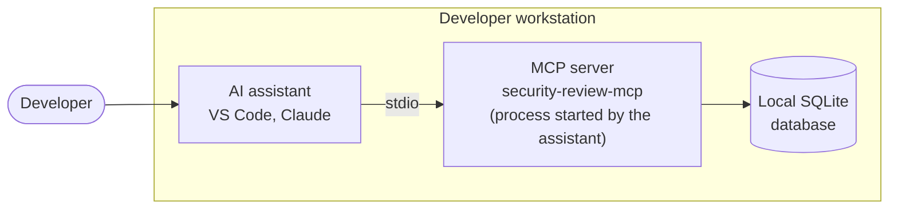

# Local mode (stdio)

In **local mode**, the host (VS Code, Claude…) starts `security-review-mcp local` itself on the
developer workstation and talks to it through stdin / stdout: no network, no token, no
Controller server.



!!! warning "For specific cases only"
    The reports are saved in a **local** SQLite database that nobody else sees, there is no web
    interface to triage them (the developer
    [confirms decisions in the host](#triage-in-local-mode) instead), and every workstation keeps its own rules. For a team, use the
    [shared mode (HTTP)](deploy.md) instead. Local mode is useful to try the
    prompts alone, on an offline workstation, or for a personal use.

## Configuring the host

This is the only step: with [uv](https://docs.astral.sh/uv/getting-started/installation/) on the
workstation, there is nothing to install and nothing to start by hand. At its first start, the
host downloads the `security-review` package from PyPI with `uvx` (Python 3.14 included if
needed), then starts the server itself each time it needs it.

VS Code, GitHub Copilot and Claude read the same `.mcp.json` file at the root of the
repository:

```json
{
  "mcpServers": {
    "security-review": {
      "type": "stdio",
      "command": "uvx",
      "args": ["--from", "security-review=={{ release_version }}", "security-review-mcp", "local"]
    }
  }
}
```

The version is pinned: to upgrade, change it in the file. To change a setting, add `SECREVIEW_*`
variables in an `env` object next to `args` (see
[Configuration](../reference/configuration.md#mcp-server)).

Then open the chat of the host and run the `security-review` prompt.

## Database

The server creates a SQLite database on the workstation
(`~/.local/share/security-review-mcp/security_reports.db`, or under `$XDG_DATA_HOME` when it is
set). This is the only file written by the server; delete it to remove all traces.
To put it elsewhere, add `--database-url` after `local` in `args` (SQLite only, absolute path
after `sqlite:///`):

```json
"args": ["--from", "security-review=={{ release_version }}", "security-review-mcp", "local",
         "--database-url", "sqlite:////home/me/data/security_reports.db"]
```

!!! note "`serve --transport stdio`"
    `security-review-mcp serve --transport stdio` also runs the server in stdio, but it reads
    `SECREVIEW_DATABASE_URL` (or `--database-url`) and accepts SQLite only: it refuses to start
    (code `2`) when the URL points to another database (PostgreSQL...). Local mode has no token, and a shared
    database would let it write to every project and migrate the schema of the team. To work
    with that database, use the [shared mode (HTTP)](deploy.md).

## Without uvx: installed package

Only if you would rather not use `uvx` (offline workstation, internal package index, fixed
virtual environment). Install the package in a dedicated virtual environment:

```bash
uv venv --python 3.14 /opt/secreview/venv
uv pip install --python /opt/secreview/venv security-review
```

Then give the path of the command in `.mcp.json`, instead of `uvx`:

```json
{
  "mcpServers": {
    "security-review": {
      "type": "stdio",
      "command": "/opt/secreview/venv/bin/security-review-mcp",
      "args": ["local"]
    }
  }
}
```

!!! note "Formerly `security-review-mcp`"
    Up to version 2.0.0, the package was published on PyPI as `security-review-mcp`. Both
    packages install the same commands and the same Python module: uninstall the old one first
    (`uv pip uninstall --python /opt/secreview/venv security-review-mcp`), then install
    `security-review`. The commands, the settings and the database stay the same.

Without Internet access, or from the sources: see [Installation: other cases](../advanced/deployment/installation.md).
To run the server from a container (`mcp` command with `SECREVIEW_TRANSPORT=stdio`), see
[Docker: choosing the process](../advanced/deployment/docker.md#choosing-the-process).

## Findings report (SECURITY_REPORT.md)

Without the web interface, ask the assistant for the findings of the project, for example
*"Show me the security findings of this project"* or *"Write the security findings to
SECURITY_REPORT.md"*. It calls the `export_findings_report` tool, which returns one Markdown
document: open findings by severity, then the findings, worst first. Two levels of detail:

| `detail` | Content of each finding | Size |
|---|---|---|
| `compact` (default) | One line: severity, title, location, id and status | Small: a few tokens per finding |
| `full` | Its report (id, date, branch, commit), description, masked evidence and recommendation | Much larger: ask for it only when you need the details |

With `include_resolved`, fixed, accepted and false-positive findings are listed too.

The server only returns the text and never writes to disk: the assistant shows it, or writes
`SECURITY_REPORT.md` at the root of the repository with its own tools (the host asks you to
approve the write). The tool also works with the shared mode (HTTP), on the projects the token
reaches. The file holds code excerpts of the findings: add it to `.gitignore` if it should not
be committed.

## Triage in local mode

Tell the assistant your decision in your own words, for example *"Line 12 of app/db.py is a
false positive: the query is bound"* or *"Accept the risk of #42 until June 30: internal tool"*.
It calls `decide_finding_status`, and your host shows you a confirmation with the findings, the
status, the reason and the expiry date: the status changes only when you confirm, and you are
recorded as the approver. Decline a confirmation you did not ask for. The host must support MCP
elicitation (Claude Code, VS Code); otherwise the assistant can only propose a status. Details:
[decision of the developer in local mode](../review/prompts-tools.md#decision-of-the-developer-in-local-mode).
