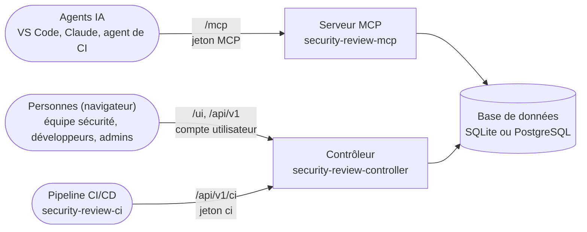
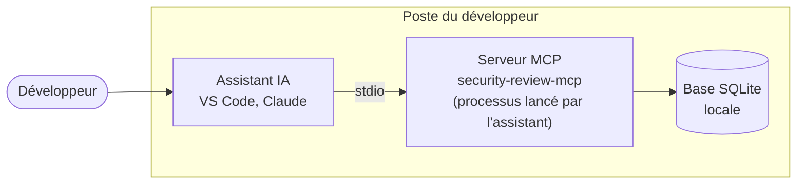
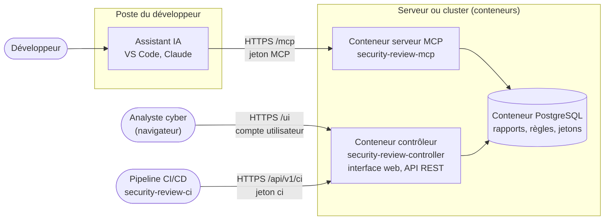

# Security Review

**Security Review fait des assistants IA de vos développeurs des relecteurs sécurité qui
appliquent vos règles, et donne à votre équipe sécurité une vue centrale de tout ce qu'ils
trouvent.**

Vos équipes écrivent déjà du code avec des assistants IA (GitHub Copilot, Claude, Cursor...).
Security Review se branche sur ces assistants par **MCP** (Model Context Protocol, le standard
ouvert qui permet à un assistant d'utiliser des outils externes). Chaque changement peut alors
être relu pour détecter les failles et les mauvaises configurations **au moment où le code est
écrit**, et chaque résultat est enregistré au même endroit, où votre équipe sécurité le lit, le
trie et en assure le suivi.

## Pourquoi l'adopter

- **La sécurité dès la première ligne de code.** Les failles sont trouvées dans l'éditeur, par
  le développeur, quand leur correction coûte le moins cher, et non des semaines plus tard lors
  d'un audit ou en production.
- **Vos exigences, appliquées par chaque assistant.** L'équipe sécurité gère au même endroit les
  [règles de scan](usage/rules.md), les [checklists de revue](usage/checklists.md) et les [normes de développement](usage/standards.md) ; chaque assistant de
  chaque projet reçoit les mêmes, sans former chaque développeur.
- **Une vue centrale et durable.** Les rapports sont conservés dans une base de données (SQLite
  ou PostgreSQL). L'[interface web](usage/web-interface.md) montre, pour chaque projet, les findings ouverts, la posture
  de sécurité et son évolution dans le temps ([rapport de tendance](advanced/ci.md#rapport-de-tendance)).
- **Les personnes décident, pas l'IA.** Un assistant peut seulement *proposer* de clore un
  finding. Une acceptation de risque ou un faux positif est décidé par une personne connectée,
  enregistrée comme approbateur ; une acceptation de risque porte aussi un motif et une date
  d'expiration, selon votre politique : chaque décision est traçable pour un
  audit ([triage des findings](usage/triage.md)).
- **Intégré à votre chaîne de livraison.** Une [gate](usage/gate.md) bloque un déploiement tant que des findings
  graves restent ouverts ; les résultats s'exportent en [SARIF](advanced/sarif.md) (GitHub code scanning, Jenkins) ;
  les [dépendances](advanced/dependencies.md) sont vérifiées avec une base de vulnérabilités OSV, même sans accès Internet.
- **Relié aux outils de l'entreprise.** [Authentification unique (OIDC)](advanced/sso.md) avec votre fournisseur
  d'identité, [groupes et rôles](advanced/access-control.md), envoi des findings vers
  [Jira ou ServiceNow](connectors/index.md),
  [journal d'audit transmis à syslog, métriques Prometheus](advanced/audit-metrics.md).
- **Votre code reste chez vous.** Le produit est auto-hébergé : le serveur MCP n'établit aucune
  connexion sortante, les secrets sont masqués avant stockage, et il s'installe hors ligne. Il
  est open source (licence Apache 2.0). Voir [Sécurité et limites](reference/security.md).
- **Une large couverture.** Des règles pour Python (FastAPI), Java (Spring), TypeScript /
  Node.js, Angular, Go, C#, Rust, les fichiers de configuration et les pipelines CI (GitLab CI,
  Jenkins...), ainsi que la détection d'instructions cachées destinées aux assistants IA.

## Comment ça marche, en trois étapes

1. **Le développeur demande une revue** (« relis mes changements côté sécurité »). L'assistant
   suit la méthode de revue du serveur : prompts, checklists, scan par motifs.
2. **L'assistant enregistre son rapport** : chaque finding avec sa sévérité, son fichier, sa
   preuve et une recommandation.
3. **L'équipe sécurité trie** les findings dans l'interface web, et le pipeline vérifie avec la
   gate qu'aucun finding grave ne reste ouvert avant de déployer.

## Ce que contient le produit

Un serveur MCP pour la **revue de code orientée sécurité** (failles et mauvaises
configurations). Il fournit à l'hôte (VS Code, Copilot, Claude, agent CI/CD) :

- des **prompts** structurés pour lancer une revue ;
- des **outils** : checklists, scan rapide par motifs, enregistrement et consultation de rapports ;
- une **base de données** (SQLite par défaut, PostgreSQL possible) qui stocke les rapports et
  leurs findings.

via la commande `security-review-mcp`

Un serveur Controller qui permet l'**administration et la gestion des contrôles** (le Controller est facultatif)
Il fournit aux administrateurs et analyste en cybersécurité :

 - la **consultation des rapports** d'analyse de sécurité
 - la possibilité d'effectuer des **revues de sécurités** et d'**acceptation de risque**
 - l'ajout, modification et suppressions des **règles et de  checklist**
 - l'ajout de **standard de développement**
 - la **gestion** de vos communautés de développeurs
 - des **connecteurs** tiers pour assurer une suivi (Jira, Service Now, ...)

via la commande `security-review-controller`

Il s'accompagne CLI pour l'injection dans les pipelines (tel que Jenkins, etc.) et permet :
 - **scan du dépôt** complet
 - **gate** de déploiement avec blocage si des findings sont ouvertes
 - export SARIF et **rapport** de tendance
 - **analyse des dépendances**

via la commande `security-review-ci`

## Trois services, trois rôles

L'ensemble des produits est installés par le même paquet PyPI, `security-review`, et livrés dans la même image Docker.
Le serveur MCP et le contrôleur ne s'appellent jamais entre eux : ils partagent la même **base
de données**, où sont stockés les rapports, les règles et les jetons. Le client de pipeline
`security-review-ci` n'a pas accès à la base : il appelle l'API REST du contrôleur.



| | Serveur MCP | Contrôleur | Client de pipeline |
|---|---|---|---|
| Commande | `security-review-mcp` | `security-review-controller` | `security-review-ci` |
| Utilisé par | les agents IA (dans l'éditeur ou dans un pipeline) | les personnes : équipe sécurité, développeurs, administrateurs | les pipelines CI/CD |
| Ce qu'il fait | fournit à l'agent les prompts de revue, les checklists, le scan par motifs, et enregistre ses rapports | affiche et trie les rapports dans l'**interface web** (`/ui/`), sert l'API REST, crée le schéma, gère les jetons et les comptes utilisateurs | envoie les fichiers du dépôt au contrôleur, qui les scanne ; gate, export SARIF, tendances |
| Exposition | aux agents (endpoint `/mcp`) | aux personnes et aux pipelines (HTTPS) | aucune : il tourne dans le pipeline |

En résumé : **l'agent parle au serveur MCP, les personnes et les pipelines utilisent le
contrôleur.** Pour une
équipe, on déploie **les deux** : sans contrôleur, personne ne peut lire les rapports dans un
navigateur, décider d'un finding, ni créer les jetons des agents.

### Serveur MCP

En mode local, le serveur MCP crée sa propre base SQLite. En mode partagé, il utilise la base
du contrôleur, PostgreSQL dès que les deux processus tournent sur des machines différentes (le
pilote est dans l'image).

Bien que vous puissiez installer le serveur MCP en **mode local (stdio)** sur un poste de
développeur (voir [Mode local (stdio)](getting-started/stdio.md)), nous recommandons le
**mode partagé (HTTP)** : son déploiement sur un serveur ou dans un conteneur associé à une base
de données PostgreSQL.

Vous n'avez ainsi aucune adhérence à la technologie du MCP : il suffit de paramétrer votre IDE
sur le serveur MCP en HTTP. Voir [Transport HTTP](getting-started/host.md#transport-http).

Pour des raisons de sécurité, il est nécessaire de soumettre un jeton d'authentification pour
échanger avec le serveur. En l'absence de jeton, le serveur MCP indique à votre agent IA la
démarche à suivre pour en obtenir un ([enrôlement](advanced/mcp-server.md#enrolement-demander-le-projet)).

Ses routes, ses transports, son démarrage et ses garanties : voir [Serveur MCP](advanced/mcp-server.md).

### Serveur Contrôleur

Si vous exécutez la commande `security-review-controller`, celle-ci démarre un serveur
d'application qui vous permet de vous connecter à la base de données via une interface web.
Grâce à cette application, vous pourrez :

- consulter les rapports émis par les agents de vos développeurs ;
- proposer de nouvelles [règles](usage/rules.md) et [checklists](usage/checklists.md) ;
- partager vos [normes de développement](usage/standards.md) avec les agents ;
- suivre les vulnérabilités, faire des revues de sécurité et gérer les acceptations de risque
  (voir le [triage des findings](usage/triage.md)).

Ses routes, son démarrage, ses tâches de fond et son exposition : voir
[Contrôleur](advanced/controller.md).

### Design

**Mode local (stdio)** : tout se passe sur le poste du développeur. L'assistant lance lui-même
le serveur MCP, et les rapports restent dans une base locale.



**Mode partagé (HTTP)** : les assistants de tous les postes appellent le serveur MCP déployé
dans un conteneur ; l'analyste cyber travaille dans l'interface web du contrôleur, que les
pipelines appellent aussi. Les deux conteneurs partagent la même base PostgreSQL.



!!! tip "Quel mode choisir ?"
    - **Mode partagé (HTTP)**, le cas recommandé : le serveur MCP et le contrôleur tournent
      sur une machine ou dans des conteneurs, chaque développeur et chaque pipeline s'y
      connecte avec un jeton, et les rapports sont centralisés. Commencez par là.
    - **Mode local (stdio)**, réservé à des cas précis : l'hôte (VS Code, Claude) lance
      lui-même `security-review-mcp` sur le poste du développeur, sans réseau, sans jeton ni
      contrôleur. Pratique pour essayer les prompts seul ou hors ligne, mais les rapports
      restent dans une base locale que personne d'autre ne voit. Voir
      [Mode local (stdio)](getting-started/stdio.md).

## Démarrage rapide (mode partagé)

Sur un serveur avec Docker, un seul bloc démarre tout (PostgreSQL, contrôleur, serveur MCP) et
donne le mot de passe du compte `admin` et un jeton pour votre agent :

```bash
mkdir security-review-mcp && cd security-review-mcp
curl -fsSLO https://raw.githubusercontent.com/cyr-ius/security-review/{{ release_tag }}/examples/docker/docker-compose.yml
(umask 077 && printf 'POSTGRES_PASSWORD=%s\nSECREVIEW_SECRET_KEY=%s\n' "$(openssl rand -hex 24)" "$(openssl rand -hex 32)" > .env)
docker compose up -d --wait
docker compose exec controller security-review-controller user reset-password admin   # mot de passe affiché une fois
docker compose exec controller security-review-controller token create --label alice   # jeton mcp, affiché une fois
# interface web : http://127.0.0.1:8080/ui/   endpoint MCP : http://127.0.0.1:8000/mcp
```

Sans Docker, voir [Installation manuelle (sans conteneur)](advanced/manual-install.md).

Déclarez ensuite le serveur MCP dans votre hôte, par exemple dans VS Code avec
`.vscode/mcp.json` (le seul fichier où VS Code peut demander le jeton), et collez le jeton
quand VS Code le demande :

```json
{
  "servers": {
    "security-review": {
      "type": "http",
      "url": "http://127.0.0.1:8000/mcp",
      "headers": { "Authorization": "Bearer ${input:secreview-token}" }
    }
  },
  "inputs": [
    { "id": "secreview-token", "type": "promptString", "description": "Token", "password": true }
  ]
}
```

Dans le chat, lancez le prompt `security-review` (ou `codebase-review` pour tout le dépôt) :
l'agent lit le code, s'appuie sur les checklists et enregistre son rapport avec
`save_security_report`. Connectez-vous à l'interface web avec le compte `admin` pour le
consulter et le trier.

Les ports sont ouverts sur toutes les interfaces du serveur, en HTTP simple. Avant que l'équipe
s'en serve (TLS, Kubernetes, jetons pour chaque développeur), suivez
[Mise en service du serveur](getting-started/deploy.md).

## Par où continuer

La documentation suit l'ordre d'une mise en œuvre. **Démarrage**, **Revue de sécurité** et
**Application** contiennent ce qu'il faut pour travailler ; **Avancé** regroupe les détails et les fonctions facultatives.

| Étape | Page |
|---|---|
| 1. Déployer le contrôleur et le serveur MCP (Docker Compose ou Kubernetes), créer les premiers comptes | [Mise en service du serveur](getting-started/deploy.md) |
| 2. Connecter VS Code ou Claude, obtenir un jeton | [Connexion de l'hôte](getting-started/host.md) |
| 3. Lancer une revue | [Fonctionnement d'une revue](usage/how-it-works.md) (règles, checklists, `AGENTS.md`), [Prompts et outils](usage/prompts-tools.md) |
| 4. Consulter et trier les rapports | [Interface web](usage/web-interface.md) |
| 5. Bloquer un déploiement sur des findings ouverts | [Gate](usage/gate.md) |

| Pour aller plus loin (Avancé) | Page |
|---|---|
| Docker, Kubernetes, PostgreSQL, sans conteneur | [Architecture](advanced/architecture.md), [Docker](advanced/docker.md), [Kubernetes](advanced/kubernetes.md), [Installation manuelle](advanced/manual-install.md) |
| Jetons restreints à un projet, enrôlement, renouvellement, TLS | [Jetons Bearer](advanced/bearer-tokens.md), [Enrôlement](advanced/mcp-server.md#enrolement-demander-le-projet), [TLS](advanced/tls.md) |
| Se connecter avec le fournisseur d'identité de l'entreprise | [Connexion OIDC](advanced/sso.md) |
| Scanner tout un dépôt, les dépendances, ajouter les règles de mon entreprise | [Scan du code complet](advanced/code-scan.md), [Analyse des dépendances](advanced/dependencies.md), [Règles](usage/rules.md) |
| SARIF, tendances, journal d'audit, Prometheus | [Export SARIF](advanced/sarif.md), [Rapport de tendance](advanced/ci.md#rapport-de-tendance), [Journal d'audit](advanced/audit-metrics.md), [Métriques Prometheus](reference/metrics.md) |

!!! warning "Ce n'est pas un SAST"
    Le scan par motifs produit des **pistes** et des faux positifs. Il ne remplace ni un SAST,
    ni une analyse SCA complète, ni une relecture humaine. Voir
    [Sécurité et limites](reference/security.md).
