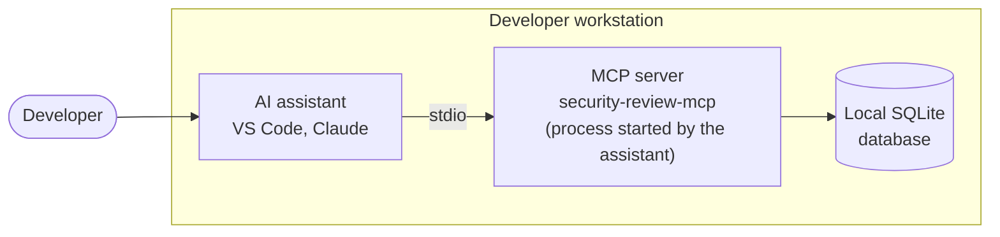
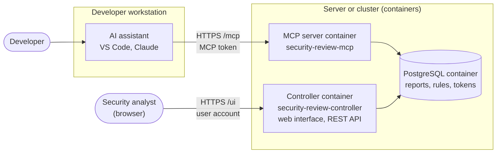

# security-review-mcp

**Security Review MCP turns the AI assistants of your developers into security reviewers that
follow your rules, and gives your security team a central view of everything they find.**

Your teams already write code with AI assistants (GitHub Copilot, Claude, Cursor...). Security
Review MCP plugs into these assistants through **MCP** (Model Context Protocol, the open standard
that lets an assistant use external tools). Every change can then be reviewed for
vulnerabilities and misconfigurations **while the code is being written**, and every result is
recorded in one place, where your security team reads it, triages it and follows it up.

## Why adopt it

- **Security from the first line of code.** Flaws are found in the editor, by the developer,
  when fixing them costs the least, not weeks later during an audit or in production.
- **Your requirements, applied by every assistant.** The security team manages the [scan
  rules](usage/rules.md), the [review checklists](usage/checklists.md) and the [development standards](usage/standards.md) in one place; every assistant of
  every project receives the same ones, without training each developer.
- **A central and lasting view.** Reports are stored in a database (SQLite or PostgreSQL). The
  [web interface](usage/web-interface.md) shows, for each project, the open findings, the security posture and its trend
  over time ([trend report](advanced/trends.md)).
- **People decide, not the AI.** An assistant can only *propose* to close a finding. A risk
  acceptance or a false positive is decided by a signed-in person, recorded as the approver; a
  risk acceptance also carries a reason and an expiry date, according to your policy: every decision can be traced for an audit
  ([triage of findings](usage/web-interface.md#triage-of-findings)).
- **Built into your delivery chain.** A [gate](usage/gate.md) blocks a deployment while serious findings remain
  open; the results are exported in [SARIF](advanced/sarif.md) (GitHub code scanning, Jenkins); the [dependencies](advanced/dependencies.md) are
  checked against an OSV vulnerability database, even without Internet access.
- **Connected to your company tools.** [Single sign-on (OIDC)](advanced/sso.md) with your identity provider,
  [groups and roles](advanced/access-control.md), findings sent to
  [Jira or ServiceNow](connectors/index.md),
  [audit log forwarded to syslog, Prometheus metrics](advanced/audit-metrics.md).
- **Your code stays with you.** The product is self-hosted: the MCP server makes no outgoing
  connection, secrets are masked before being stored, and it installs offline. It is open
  source (Apache 2.0 license). See [Security and limits](reference/security.md).
- **A broad coverage.** Rules for Python (FastAPI), Java (Spring), TypeScript / Node.js,
  Angular, Go, C#, Rust, configuration files and CI pipelines (GitLab CI, Jenkins...), plus the
  detection of hidden instructions aimed at AI assistants.

## How it works, in three steps

1. **The developer asks for a review** ("review my changes for security"). The assistant
   follows the review method of the server: prompts, checklists, pattern scan.
2. **The assistant saves its report**: each finding with its severity, its file, its evidence
   and a recommendation.
3. **The security team triages** the findings in the web interface, and the pipeline checks
   with the gate that no serious finding remains open before deploying.

## What the product contains

An MCP server for **security-focused code review** (identifying vulnerabilities and misconfigurations). It provides the host (VS Code, Copilot, Claude, CI/CD agent, etc.) with:

- Structured **prompts** to initiate a review;
- **Tools**, including checklists, pattern-based quick scans, and the ability to save and retrieve reports;
- A **database** (SQLite by default, with support for PostgreSQL) to store reports and their associated findings.

Accessed via the `security-review-mcp` command.

A Controller server for **administration and control management** (the Controller is optional). It provides administrators and cybersecurity analysts with:

- Access to security analysis **reports**;
- The ability to conduct **security reviews** and manage **risk acceptance**;
- Options to add, modify, or delete **rules and checklists**;
- The ability to incorporate **development standards**;
- **Management** of developer communities;
- Third-party **connectors** for tracking and integration (Jira, ServiceNow, etc.).

Accessed via the `security-review-controller` command.

It includes a CLI for integration into pipelines (such as Jenkins, etc.), enabling:

- Full **repository scanning**;
- Deployment **gates** that block releases if open findings exist;
- SARIF export and **trend reporting**;
- **Dependency analysis**.

Accessed via the `security-review-ci` command.

## Three services, three roles

All the products are installed via the same PyPI package, `security-review`, and delivered within the same Docker image.
They never call one another. They share the same **database**, where reports, rules, and tokens are stored.

```text
 agents (VS Code, Claude), CI ─────▶ serveur MCP ──┐
                                                   |
 personnes (navigateur), admins ──▶ contrôleur ────┘──▶ base de données (SQLite ou PostgreSQL)
                                                   |
 CI / CD ────▶  CLI (security-review-ci)   ────────┘
```

| | MCP server | Controller |
|---|---|---|
| Command | `security-review-mcp` | `security-review-controller` |
| Used by | the AI agents and the CI pipelines | the people: security team, developers, administrators |
| What it does | gives the agent the review prompts, the checklists, the pattern scan, and saves its reports | shows and triages the reports in the **web interface** (`/ui/`), serves the REST API, creates the schema, manages the tokens and the user accounts |
| Exposure | to the agents and to the CI (`/mcp` endpoint) | preferably on an internal network |

In short: **the agent talks to the MCP server, people use the controller.** For a team, you
deploy **both**: without the controller, nobody can read the reports in a browser, decide on a
finding, nor create the tokens of the agents.

### MCP server

When the MCP server starts, an SQLite database is created to store the reports. With the
`postgres` variant, you can specify a PostgreSQL database instead (required as soon as the two
processes run on different machines).

Although you can install the MCP server in **local mode (stdio)** on a developer's workstation
(see [Local mode (stdio)](getting-started/stdio.md)), we recommend the **shared mode (HTTP)**:
deploying it on a server or within a container connected to a PostgreSQL database.

This approach ensures there is no tight coupling to the underlying MCP technology: you simply
need to configure your IDE to connect to the MCP server via HTTP. See
[HTTP transport](getting-started/host.md#http-transport).

For security reasons, an authentication token must be provided to interact with the server. If
no token is present, the MCP server informs your AI agent about the steps required to obtain
one ([enrollment](advanced/http.md#enrollment-request-the-project)).

### Controller server

Running the `security-review-controller` command launches an application server, allowing you
to access the database via a web interface. With this application, you can:

- view the reports generated by the agents of your developers;
- propose new [rules](usage/rules.md) and [checklists](usage/checklists.md);
- share your [development standards](usage/standards.md) with the agents;
- track the vulnerabilities, conduct security reviews and manage the risk acceptances (see
  [triage of findings](usage/web-interface.md#triage-of-findings)).

### Design

**Local mode (stdio)**: everything runs on the workstation of the developer. The assistant
starts the MCP server itself, and the reports stay in a local database.



**Shared mode (HTTP)**: the assistants of every workstation call the MCP server deployed in a
container; the security analyst works in the web interface of the controller. Both
containers share the same PostgreSQL database.



!!! tip "Which mode to choose?"
    - **Shared mode (HTTP)**, the recommended case: the MCP server and the controller run on
      a machine or in containers, every developer and every pipeline connects to it with a
      token, and the reports are centralized. Start here.
    - **Local mode (stdio)**, for specific cases only: the host (VS Code, Claude) starts
      `security-review-mcp` itself on the developer workstation, without a network, a token,
      nor a controller. Handy to try the prompts alone or offline, but the reports stay in a
      local database that nobody else sees. See
      [Local mode (stdio)](getting-started/stdio.md).

## Quick start (shared mode)

On a server with Docker, one block starts everything (PostgreSQL, controller, MCP server) and
gives the password of the `admin` account and a token for your agent:

```bash
mkdir security-review-mcp && cd security-review-mcp
curl -fsSLO https://raw.githubusercontent.com/cyr-ius/security-review/{{ release_tag }}/examples/docker/docker-compose.yml
(umask 077 && printf 'POSTGRES_PASSWORD=%s\nSECREVIEW_SECRET_KEY=%s\n' "$(openssl rand -hex 24)" "$(openssl rand -hex 32)" > .env)
docker compose up -d --wait
docker compose exec controller security-review-controller user reset-password admin   # password shown once
docker compose exec controller security-review-controller token create --label alice   # mcp token, shown once
# web interface: http://127.0.0.1:8080/ui/   MCP endpoint: http://127.0.0.1:8000/mcp
```

Without Docker, see [Manual installation (without containers)](advanced/manual-install.md).

Then declare the MCP server in your host, for example in VS Code with `.vscode/mcp.json` (the
only file where VS Code can ask for the token), and paste the token when VS Code asks for it:

```json
{
  "servers": {
    "security-review": {
      "type": "http",
      "url": "http://127.0.0.1:8000/mcp",
      "headers": { "Authorization": "Bearer ${input:secreview-token}" }
    }
  },
  "inputs": [
    { "id": "secreview-token", "type": "promptString", "description": "Token", "password": true }
  ]
}
```

In the chat, run the `security-review` prompt (or `codebase-review` for the whole repository):
the agent reads the code, relies on the checklists and saves its report with
`save_security_report`. Log in to the web interface with the `admin` account to read and
triage it.

The ports are open on every interface of the server, in plain HTTP. Before the team uses it
(TLS, Kubernetes, tokens for every developer), follow [Deploying the server](getting-started/deploy.md).

## Where to go next

The documentation follows the order of a set-up. **Getting started**, **Usage** and **Security review**
hold what you need to work; **Advanced** gathers the details and the optional features.

| Step | Page |
|---|---|
| 1. Deploy the controller and the MCP server (Docker Compose or Kubernetes), create the first accounts | [Deploying the server](getting-started/deploy.md) |
| 2. Connect VS Code or Claude, get a token | [Connecting the host](getting-started/host.md) |
| 3. Run a review | [How a review works](usage/how-it-works.md) (rules, checklists, `AGENTS.md`), [Prompts and tools](usage/prompts-tools.md) |
| 4. Read and triage the reports | [Web interface](usage/web-interface.md) |
| 5. Block a deployment on open findings | [Gate](usage/gate.md) |

| Going further (Advanced) | Page |
|---|---|
| Docker, Kubernetes, PostgreSQL, without containers | [Architecture and deployment](advanced/architecture.md), [Docker](advanced/docker.md), [Kubernetes](advanced/kubernetes.md), [Manual installation](advanced/manual-install.md) |
| Tokens restricted to a project, enrollment, rotation, TLS | [HTTP server, authentication and TLS](advanced/http.md) |
| Log in with the company identity provider | [OIDC login](advanced/sso.md) |
| Scan a whole repository, the dependencies, add my company's rules | [Whole codebase scan](advanced/code-scan.md), [Dependency analysis](advanced/dependencies.md), [Rules](usage/rules.md) |
| SARIF, trends, audit log, Prometheus | [SARIF export](advanced/sarif.md), [Trend report](advanced/trends.md), [Audit log and metrics](advanced/audit-metrics.md) |

!!! warning "This is not a SAST"
    The pattern scan produces **leads** and false positives. It replaces neither a SAST, nor a
    full SCA analysis, nor a human review. See [Security and limits](reference/security.md).
