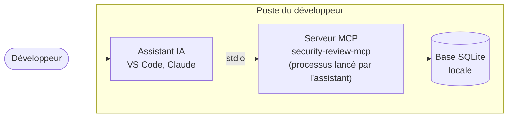
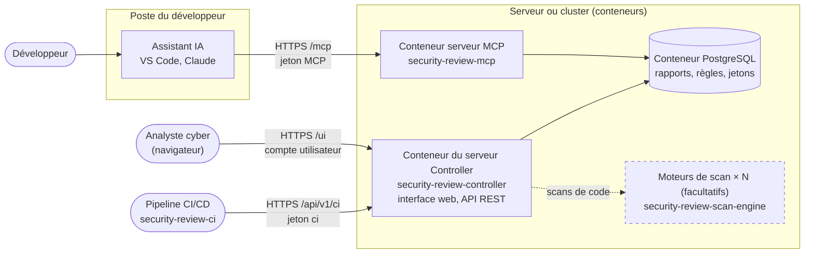

# Quatre services, quatre rôles

Tous les composants sont installés par le même paquet PyPI, `security-review`, et livrés dans
la même image Docker. Ils s'assemblent de deux façons : une installation sur le poste du
développeur, ou une installation partagée par toute l'équipe.

## Deux installations

### Mode local

Tout se passe sur le poste du développeur. L'assistant lance lui-même
le serveur MCP, et les rapports restent dans une base locale. Voir
[Mode local (stdio)](getting-started/stdio.md).

!!! warning "Ce que le mode local ne fait pas"
    - Pas de recherche de vulnérabilités dans les dépendances : aucune base d’avis par défaut.
    - Pas de revue complète du dépôt (`start_codebase_scan`).
    - Pas d'analyse OpenGrep : seulement les règles par motifs.

### Mode partagé

Les assistants de tous les postes appellent le serveur MCP déployé
dans un conteneur ; l'analyste cyber travaille dans l'interface web du serveur Controller, que les
pipelines appellent aussi. Les deux conteneurs partagent la même base PostgreSQL. Avec
beaucoup de développeurs, des moteurs de scan facultatifs déchargent le serveur Controller. Voir
[Mode partagé](getting-started/deploy.md).

!!! tip "Quel mode choisir ?"
    - **Mode partagé (HTTP)**, le cas recommandé : le serveur MCP et le serveur Controller tournent
      sur une machine ou dans des conteneurs, chaque développeur et chaque pipeline s'y
      connecte avec un jeton, et les rapports sont centralisés. Commencez par là.
    - **Mode local (stdio)** : l'hôte (VS Code, Claude) lance
      lui-même `security-review-mcp` sur le poste du développeur, sans réseau, sans jeton ni
      serveur Controller. Pratique pour essayer les prompts seul ou hors ligne, mais les rapports
      restent dans une base locale que personne d'autre ne voit.

## Les composants

Quatre composants, qui ne participent pas tous aux deux installations. Le serveur MCP et le
serveur Controller ne s'appellent jamais entre eux : ils partagent la même **base de données**,
où sont stockés les rapports, les règles et les jetons. Le client de pipeline n'a pas accès à la
base : il appelle l'API REST du serveur Controller. Les moteurs de scan non plus : ils ne parlent
qu'au serveur Controller.

| | Serveur MCP | Serveur Controller | Client de pipeline | Moteur de scan |
|---|---|---|---|---|
| Mode local | oui (base SQLite du poste) | non | non | non |
| Mode partagé | oui | oui | oui | facultatif |
| Commande | `security-review-mcp` | `security-review-controller` | `security-review-ci` | `security-review-scan-engine` |
| Utilisé par | les agents IA (dans l'éditeur ou dans un pipeline) | les personnes : équipe sécurité, développeurs, administrateurs | les pipelines CI/CD | le serveur Controller |
| Ce qu'il fait | fournit à l'agent les prompts de revue, les checklists, le scan par motifs, et enregistre ses rapports | affiche et trie les rapports dans l'**interface web** (`/ui/`), sert l'API REST, crée le schéma, gère les jetons et les comptes utilisateurs, scanne le code et les dépendances | envoie les fichiers du dépôt au serveur Controller, qui les scanne ; gate, export SARIF, tendances | exécute les règles et OpenGrep des scans de code à la place du serveur Controller, avec autant de réplicas que nécessaire |
| Exposition | aux agents (endpoint `/mcp`) | aux personnes et aux pipelines (HTTPS) | aucune : il tourne dans le pipeline | au serveur Controller seulement (réseau privé) |

En résumé : **l'agent parle au serveur MCP, les personnes et les pipelines utilisent le
serveur Controller.** Pour une
équipe, on déploie **les deux** : sans serveur Controller, personne ne peut lire les rapports dans un
navigateur, décider d'un finding, ni créer les jetons des agents.

### Serveur MCP — mode local et mode partagé

En mode local, le serveur MCP crée sa propre base SQLite. En mode partagé, il utilise la base
du serveur Controller.

Bien que vous puissiez installer le serveur MCP en **mode local (stdio)** sur un poste de
développeur (voir [Mode local (stdio)](getting-started/stdio.md)), nous recommandons le
**mode partagé (HTTP)**.

Ainsi vous n'avez aucune adhérence sur la technologie employée par le MCP : il suffit de paramétrer votre IDE
pour utiliser le serveur MCP en mode Streamable-HTTP. Voir [Transport HTTP](getting-started/host.md#transport-http).

Ses routes, ses transports, son démarrage et ses garanties : voir [Serveur MCP](advanced/architecture/mcp-server.md).

### Serveur Controller — mode partagé

Si vous exécutez la commande `security-review-controller`, celle-ci démarre un serveur
d'application qui vous permet de vous connecter à la base de données via une interface web.

Grâce à cette application, vous pourrez :

- consulter les rapports émis par les agents de vos développeurs ;
- proposer de nouvelles [règles](review/rules.md) et [checklists](review/checklists.md) ;
- partager vos [normes de développement](review/standards.md) avec les agents ;
- suivre les vulnérabilités, faire des revues de sécurité et gérer les acceptations de risque
  (voir le [triage des findings](usage/triage.md)).

Il fait aussi les **scans** :

- **du code** : les fichiers envoyés par `security-review-ci` (pipelines, `start_codebase_scan`)
  et les fragments de `scan_code` délégués par le serveur MCP. Il les analyse avec ses règles et
  [OpenGrep](review/analysis/opengrep.md), ou les confie aux moteurs de scan quand il y en a ;
- **des dépendances** : il compare les manifestes et lockfiles reçus à sa base d'avis de
  vulnérabilités ([analyse des dépendances](review/analysis/dependencies.md)).

Le serveur Controller est entièrement paramétrable via des variables d'environnement ou via son CLI

Ses routes, son démarrage, ses tâches de fond et son exposition : voir [Serveur Controller](advanced/architecture/controller.md).

### Client de pipeline (CI/CD) — mode partagé

Vous avez une chaîne CI/CD et souhaitez mettre en œuvre un gate d'acceptation ?
C'est possible avec le client `security-review-ci` (un seul fichier Python, sans dépendance) :
voir [CI](advanced/architecture/ci.md).

Ce même client peut être utilisé dans vos hooks de pre-commit (ou prek) afin d'effectuer
vos revues de sécurité ou analyses de dépendances directement depuis votre IDE. Voir [Hooks de pre-commit](advanced/commit-hooks.md).

### Moteur de scan — mode partagé, facultatif

Avec de nombreux développeurs, les scans de code (pipelines, `start_codebase_scan` et `scan_code`
délégué) chargent le serveur Controller. Les moteurs de scan reprennent ce travail : le serveur
Controller leur envoie les fichiers, ils exécutent les règles et OpenGrep, et renvoient les
résultats. Ils n'ont accès à aucune base de données.

Sans moteur, le serveur Controller scanne lui-même. Voir [Moteurs de scan](advanced/architecture/scan-engine.md).
