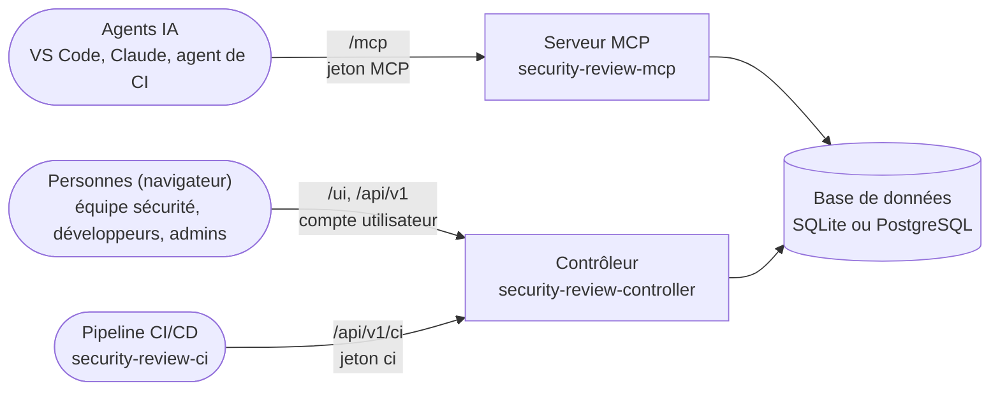
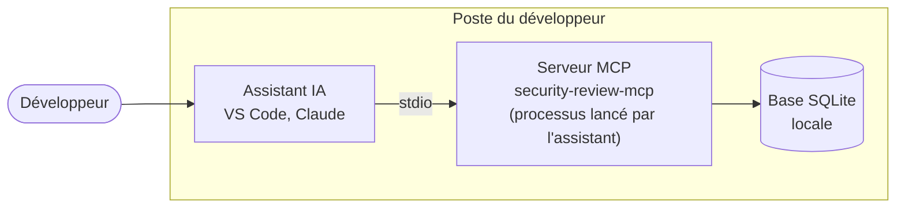
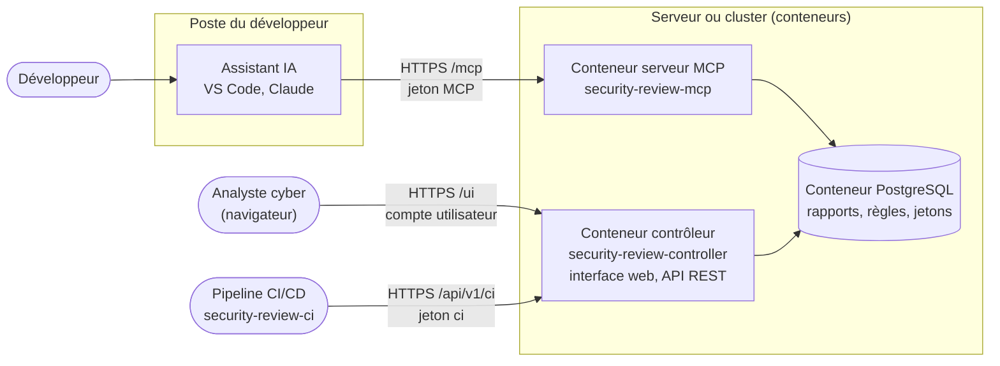

# Trois services, trois rôles

L'ensemble des produits est installé par le même paquet PyPI, `security-review`, et livré dans la même image Docker.
Le serveur MCP et le contrôleur ne s'appellent jamais entre eux : ils partagent la même **base
de données**, où sont stockés les rapports, les règles et les jetons. Le client de pipeline
`security-review-ci` n'a pas accès à la base : il appelle l'API REST du contrôleur.

| | Serveur MCP | Contrôleur | Client de pipeline |
|---|---|---|---|
| Commande | `security-review-mcp` | `security-review-controller` | `security-review-ci` |
| Utilisé par | les agents IA (dans l'éditeur ou dans un pipeline) | les personnes : équipe sécurité, développeurs, administrateurs | les pipelines CI/CD |
| Ce qu'il fait | fournit à l'agent les prompts de revue, les checklists, le scan par motifs, et enregistre ses rapports | affiche et trie les rapports dans l'**interface web** (`/ui/`), sert l'API REST, crée le schéma, gère les jetons et les comptes utilisateurs | envoie les fichiers du dépôt au contrôleur, qui les scanne ; gate, export SARIF, tendances |
| Exposition | aux agents (endpoint `/mcp`) | aux personnes et aux pipelines (HTTPS) | aucune : il tourne dans le pipeline |

En résumé : **l'agent parle au serveur MCP, les personnes et les pipelines utilisent le
contrôleur.** Pour une
équipe, on déploie **les deux** : sans contrôleur, personne ne peut lire les rapports dans un
navigateur, décider d'un finding, ni créer les jetons des agents.

## Serveur MCP

En mode local, le serveur MCP crée sa propre base SQLite. En mode partagé, il utilise la base
du contrôleur.

Bien que vous puissiez installer le serveur MCP en **mode local (stdio)** sur un poste de
développeur (voir [Mode local (stdio)](getting-started/stdio.md)), nous recommandons le
**mode partagé (HTTP)**.

Ainsi vous n'avez aucune adhérence sur la technologie employée par le MCP : il suffit de paramétrer votre IDE
pour utiliser le serveur MCP en mode Streamable-HTTP. Voir [Transport HTTP](getting-started/host.md#transport-http).

Pour des raisons de sécurité, il est nécessaire de soumettre un jeton d'authentification pour
échanger avec le serveur. En l'absence de jeton, le serveur MCP indique à votre agent IA la
démarche à suivre pour en obtenir un ([enrôlement](advanced/architecture/mcp-server.md#enrolement-jeton-personnel-et-demande-de-projet)).

Ses routes, ses transports, son démarrage et ses garanties : voir [Serveur MCP](advanced/architecture/mcp-server.md).

## Serveur Contrôleur

Si vous exécutez la commande `security-review-controller`, celle-ci démarre un serveur
d'application qui vous permet de vous connecter à la base de données via une interface web.

Grâce à cette application, vous pourrez :

- consulter les rapports émis par les agents de vos développeurs ;
- proposer de nouvelles [règles](review/rules.md) et [checklists](review/checklists.md) ;
- partager vos [normes de développement](review/standards.md) avec les agents ;
- suivre les vulnérabilités, faire des revues de sécurité et gérer les acceptations de risque
  (voir le [triage des findings](usage/triage.md)).

Le serveur Contrôleur est entièrement paramétrable via des variables d'environnement ou via son CLI

Ses routes, son démarrage, ses tâches de fond et son exposition : voir [Contrôleur](advanced/architecture/controller.md).

## CI/CD

Vous avez une chaîne CI/CD et souhaitez mettre en œuvre un gate d'acceptation ?
C'est possible avec le client `security-review-ci` (un seul fichier Python, sans dépendance) :
voir [CI](advanced/architecture/ci.md).

Ce même client peut être utilisé dans vos hooks de pre-commit (ou prek) afin d'effectuer
vos revues de sécurité ou analyses de dépendances directement depuis votre IDE. Voir [Hooks de pre-commit](getting-started/commit-hooks.md).

## Design

**Mode local** : tout se passe sur le poste du développeur. L'assistant lance lui-même
le serveur MCP, et les rapports restent dans une base locale.

**Mode partagé** : les assistants de tous les postes appellent le serveur MCP déployé
dans un conteneur ; l'analyste cyber travaille dans l'interface web du contrôleur, que les
pipelines appellent aussi. Les deux conteneurs partagent la même base PostgreSQL.

!!! tip "Quel mode choisir ?"
    - **Mode partagé (HTTP)**, le cas recommandé : le serveur MCP et le contrôleur tournent
      sur une machine ou dans des conteneurs, chaque développeur et chaque pipeline s'y
      connecte avec un jeton, et les rapports sont centralisés. Commencez par là.
    - **Mode local (stdio)**, réservé à des cas précis : l'hôte (VS Code, Claude) lance
      lui-même `security-review-mcp` sur le poste du développeur, sans réseau, sans jeton ni
      contrôleur. Pratique pour essayer les prompts seul ou hors ligne, mais les rapports
      restent dans une base locale que personne d'autre ne voit. Voir
      [Mode local (stdio)](getting-started/stdio.md).
