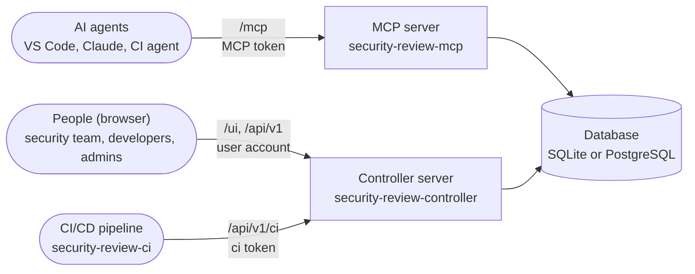
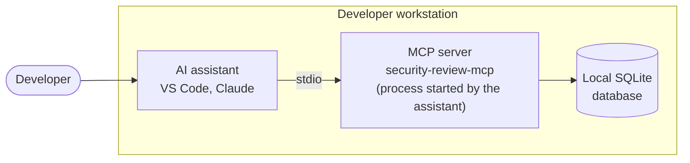
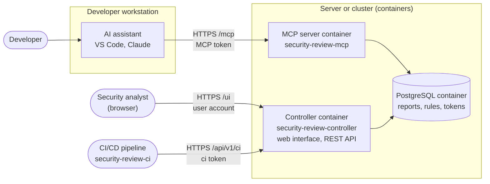

# Three services, three roles

All components are installed via a single PyPI package, `security-review`, and delivered within the same Docker image.
The MCP server and the Controller server never communicate directly with each other; instead, they share a common **database** where reports, rules, and tokens are stored.

The `security-review-ci` pipeline client does not have direct access to the database; it interacts with the Controller server via its REST API.

There are two possible deployment options:

- An all-in-one installation on a developer's machine. See [Local mode](getting-started/stdio.md)
- A modular installation on servers or within containers. See [Shared mode](getting-started/deploy.md)

| | MCP server | Controller server | Pipeline client |
|---|---|---|---|
| Command | `security-review-mcp` | `security-review-controller` | `security-review-ci` |
| Used by | the AI agents (in the editor or in a pipeline) | the people: security team, developers, administrators | the CI/CD pipelines |
| What it does | gives the agent the review prompts, the checklists, the pattern scan, and saves its reports | shows and triages the reports in the **web interface** (`/ui/`), serves the REST API, creates the schema, manages the tokens and the user accounts | sends the files of the repository to the Controller server, which scans them; gate, SARIF export, trends |
| Exposure | to the agents (`/mcp` endpoint) | to the people and to the pipelines (HTTPS) | none: it runs in the pipeline |

In short: **the agent talks to the MCP server, people and pipelines use the Controller server.** For a team, you
deploy **both**: without the Controller server, nobody can read the reports in a browser, decide on a
finding, nor create the tokens of the agents.

## MCP server

In local mode, the MCP server creates its own SQLite database. In shared mode, it uses the
database of the Controller server.

Although you can install the MCP server in **local mode (stdio)** on a developer's workstation
(see [Local mode (stdio)](getting-started/stdio.md)), we recommend the **shared mode (HTTP)**.

This way, you have no dependency on the technology used by the MCP server: you simply configure
your IDE to use the MCP server in Streamable HTTP mode. See
[HTTP transport](getting-started/host.md#http-transport).

For security reasons, an authentication token must be provided to interact with the server. If
no token is present, the MCP server informs your AI agent about the steps required to obtain
one ([enrollment](advanced/architecture/mcp-server.md#enrollment-personal-token-and-project-requests)).

Its routes, transports, start-up and guarantees: see [MCP server](advanced/architecture/mcp-server.md).

## Controller server

Running the `security-review-controller` command launches an application server, allowing you
to access the database via a web interface.

With this application, you can:

- view the reports generated by the agents of your developers;
- propose new [rules](review/rules.md) and [checklists](review/checklists.md);
- share your [development standards](review/standards.md) with the agents;
- track the vulnerabilities, conduct security reviews and manage the risk acceptances (see
  [triage of findings](usage/triage.md)).

The Controller server is fully configurable through environment variables or through its CLI.

Its routes, start-up, background tasks and exposure: see [Controller server](advanced/architecture/controller.md).

## CI/CD

You have a CI/CD chain and want to set up an acceptance gate?
This is possible with the `security-review-ci` client (a single Python file, without
dependency): see [CI](advanced/architecture/ci.md).

The same client can be used in your pre-commit (or prek) hooks to run your security reviews
or dependency analysis directly from your IDE. See [Pre-commit hooks](getting-started/commit-hooks.md).

## Design

**Local mode**: everything runs on the workstation of the developer. The assistant
starts the MCP server itself, and the reports stay in a local database.

**Shared mode**: the assistants of every workstation call the MCP server deployed in a
container; the security analyst works in the web interface of the Controller server, which the
pipelines also call. Both containers share the same PostgreSQL database.

!!! tip "Which mode to choose?"
    - **Shared mode (HTTP)**, the recommended case: the MCP server and the Controller server run on
      a machine or in containers, every developer and every pipeline connects to it with a
      token, and the reports are centralized. Start here.
    - **Local mode (stdio)**, for specific cases only: the host (VS Code, Claude) starts
      `security-review-mcp` itself on the developer workstation, without a network, a token,
      nor a Controller server. Handy to try the prompts alone or offline, but the reports stay in a
      local database that nobody else sees. See
      [Local mode (stdio)](getting-started/stdio.md).
