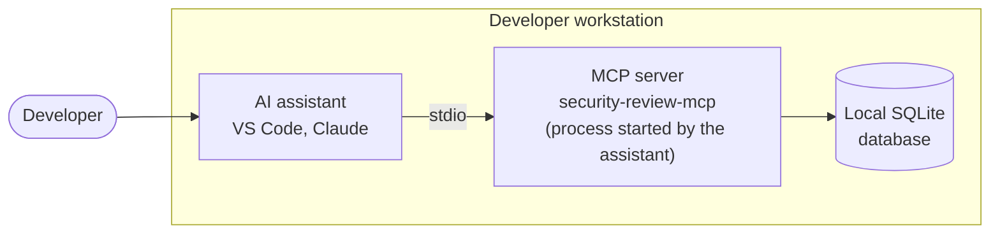
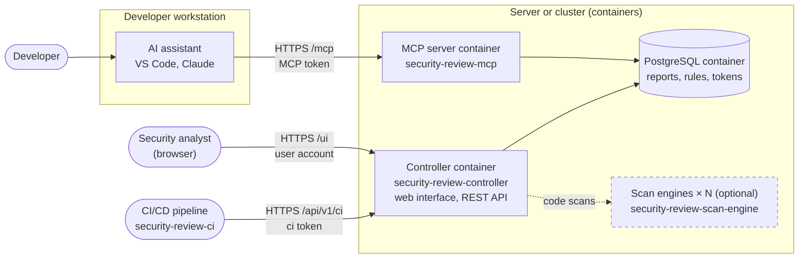

# Four services, four roles

All components are installed via a single PyPI package, `security-review`, and delivered
within the same Docker image. They fit together in two ways: an installation on the developer's
workstation, or an installation shared by the whole team.

## Two installations

### Local mode

Everything runs on the workstation of the developer. The assistant
starts the MCP server itself, and the reports stay in a local database. See
[Local mode (stdio)](getting-started/stdio.md).

!!! warning "What the local mode does not do"
    - No vulnerability search in the dependencies: no advisory database by default.
    - No full review of the repository (`start_codebase_scan`).
    - No OpenGrep analysis: only the pattern rules.

### Shared mode

The assistants of every workstation call the MCP server deployed in a
container; the security analyst works in the web interface of the Controller server, which the
pipelines also call. Both containers share the same PostgreSQL database. With many
developers, optional scan engines take load off the Controller server. See
[Shared mode](getting-started/deploy.md).

!!! tip "Which mode to choose?"
    - **Shared mode (HTTP)**, the recommended case: the MCP server and the Controller server run on
      a machine or in containers, every developer and every pipeline connects to it with a
      token, and the reports are centralized. Start here.
    - **Local mode (stdio)**: the host (VS Code, Claude) starts
      `security-review-mcp` itself on the developer workstation, without a network, a token,
      nor a Controller server. Handy to try the prompts alone or offline, but the reports stay in a
      local database that nobody else sees.

## The components

Four components, which do not all take part in both installations. The MCP server and the
Controller server never call each other: they share the same **database**, where the reports,
the rules and the tokens are stored. The pipeline client has no access to the database: it calls
the REST API of the Controller server. Neither do the scan engines: they only talk to the
Controller server.

| | MCP server | Controller server | Pipeline client | Scan engine |
|---|---|---|---|---|
| Local mode | yes (SQLite database of the workstation) | no | no | no |
| Shared mode | yes | yes | yes | optional |
| Command | `security-review-mcp` | `security-review-controller` | `security-review-ci` | `security-review-scan-engine` |
| Used by | the AI agents (in the editor or in a pipeline) | the people: security team, developers, administrators | the CI/CD pipelines | the Controller server |
| What it does | gives the agent the review prompts, the checklists, the pattern scan, and saves its reports | shows and triages the reports in the **web interface** (`/ui/`), serves the REST API, creates the schema, manages the tokens and the user accounts, scans the code and the dependencies | sends the files of the repository to the Controller server, which scans them; gate, SARIF export, trends | runs the rules and OpenGrep of the code scans in place of the Controller server, with as many replicas as needed |
| Exposure | to the agents (`/mcp` endpoint) | to the people and to the pipelines (HTTPS) | none: it runs in the pipeline | to the Controller server only (private network) |

In short: **the agent talks to the MCP server, people and pipelines use the Controller server.** For a team, you
deploy **both**: without the Controller server, nobody can read the reports in a browser, decide on a
finding, nor create the tokens of the agents.

### MCP server — local and shared mode

In local mode, the MCP server creates its own SQLite database. In shared mode, it uses the
database of the Controller server.

Although you can install the MCP server in **local mode (stdio)** on a developer's workstation
(see [Local mode (stdio)](getting-started/stdio.md)), we recommend the **shared mode (HTTP)**.

This way, you have no dependency on the technology used by the MCP server: you simply configure
your IDE to use the MCP server in Streamable HTTP mode. See
[HTTP transport](getting-started/host.md#http-transport).

Its routes, transports, start-up and guarantees: see [MCP server](advanced/architecture/mcp-server.md).

### Controller server — shared mode

Running the `security-review-controller` command launches an application server, allowing you
to access the database via a web interface.

With this application, you can:

- view the reports generated by the agents of your developers;
- propose new [rules](review/rules.md) and [checklists](review/checklists.md);
- share your [development standards](review/standards.md) with the agents;
- track the vulnerabilities, conduct security reviews and manage the risk acceptances (see
  [triage of findings](usage/triage.md)).

It also runs the **scans**:

- **the code**: the files sent by `security-review-ci` (pipelines, `start_codebase_scan`) and the
  `scan_code` fragments delegated by the MCP server. It analyzes them with its rules and
  [OpenGrep](review/analysis/opengrep.md), or hands them to the scan engines when there are some;
- **the dependencies**: it compares the manifests and lockfiles it receives with its database of
  vulnerability advisories ([dependency analysis](review/analysis/dependencies.md)).

The Controller server is fully configurable through environment variables or through its CLI.

Its routes, start-up, background tasks and exposure: see [Controller server](advanced/architecture/controller.md).

### Pipeline client (CI/CD) — shared mode

You have a CI/CD chain and want to set up an acceptance gate?
This is possible with the `security-review-ci` client (a single Python file, without
dependency): see [CI](advanced/architecture/ci.md).

The same client can be used in your pre-commit (or prek) hooks to run your security reviews
or dependency analysis directly from your IDE. See [Pre-commit hooks](advanced/commit-hooks.md).

### Scan engine — shared mode, optional

With many developers, the code scans (pipelines, `start_codebase_scan` and delegated
`scan_code`) load the Controller server. The scan engines take over this work: the Controller
server sends them the files, they run the rules and OpenGrep, and send back the results. They
have no access to any database.

Without an engine, the Controller server scans by itself. See [Scan engines](advanced/architecture/scan-engine.md).
