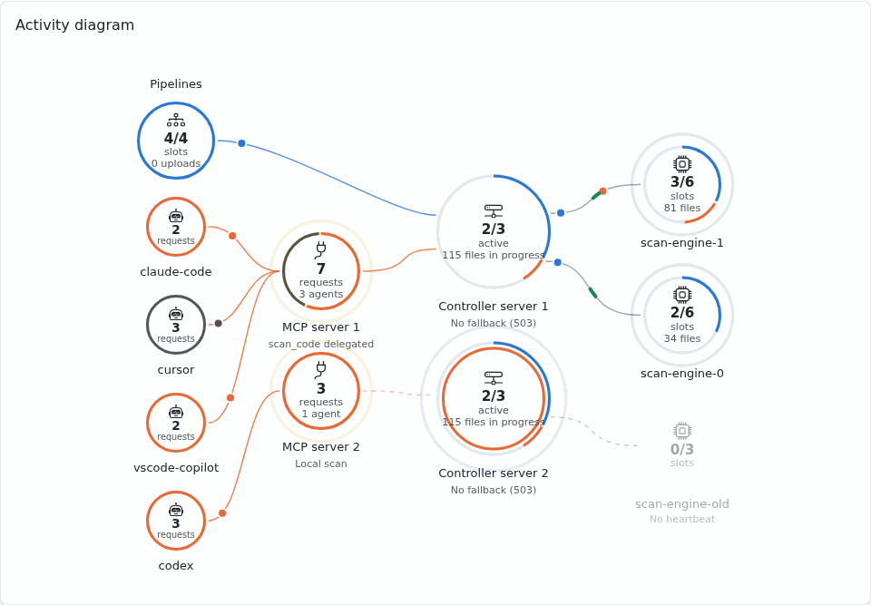
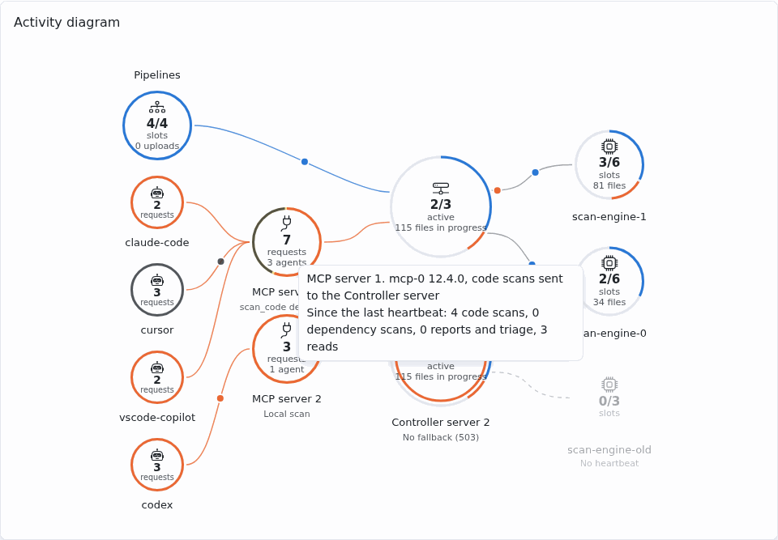

# Activité

La page **Activité** (permission `settings.manage`) montre ce qui tourne en ce moment et se
recharge toutes les 2 secondes tant qu'elle est visible. Elle a trois sections : le diagramme
d'activité, la délégation des scans de code et les moteurs de scan.

Le bouton **Journal d'audit**, à côté d'**Actualiser**, ouvre le [journal d'audit](audit-metrics.md)
(`audit.read`). L'ancienne adresse `/ui/scan-engines` mène à cette page.

## Diagramme d'activité

Le **Diagramme d'activité** montre les scans de code en cours. Il s'affiche
même sans aucun moteur (moteurs désactivés, ou aucun enrôlé) : seulement les agents, les serveurs
MCP et le serveur Controller, qui indique **Scanne lui-même (moteurs désactivés)** quand les
moteurs sont désactivés :

- à gauche, les pipelines (`security-review-ci`, revues du dépôt) et les agents (fragments de
  `scan_code`), avec leurs créneaux occupés sur ceux des moteurs actifs, ou sans moteur sur les
  créneaux OpenGrep du serveur Controller (**créneaux**) ; les
  pipelines donnent aussi les scans que `security-review-ci` envoie au serveur Controller depuis son
  battement de cœur précédent (**envois**), avec ou sans moteurs ;
- sous les pipelines, un cercle par agent qui a envoyé une requête à un serveur MCP dans les
  5 dernières minutes, relié à ce serveur, avec ses requêtes en cours (outils, prompts et
  ressources) depuis le battement de cœur précédent : son anneau est partagé en proportion par
  famille (voir les couleurs plus bas). Un agent est affiché par le nom de son client MCP (par exemple `claude-code`),
  jamais par le nom d'une personne ni d'un jeton ; les 6 plus récents sont empilés dans l'ordre de
  leurs serveurs MCP, pour que leurs liens ne se croisent pas, et un cercle **+N** regroupe
  les autres. Sans aucun agent connu (serveurs MCP d'une version précédente), un seul cercle
  **Agents** les représente ;
- à côté des agents, un cercle jaune par serveur MCP en marche (transport HTTP), plus grand que
  ceux des agents, avec le plus grand
  nombre de requêtes des agents simultanées depuis son battement de cœur précédent (**requêtes** :
  une requête courte y reste jusqu'au battement suivant, environ 5 secondes) et le nombre d'agents
  qui lui sont reliés ; son anneau est partagé en proportion des requêtes par famille. Le cercle
  d'un agent donne ses propres requêtes de la même façon. Les agents
  passent par lui pour atteindre le serveur Controller ; son lien vers le serveur Controller est en
  pointillés, avec **Scan local**, tant que la délégation de `scan_code` est désactivée : il scanne
  alors les fragments lui-même et ils n'atteignent jamais les moteurs. Les pipelines vont
  directement au serveur Controller. Les serveurs MCP en mode local (stdio) ont leur propre base
  et n'apparaissent jamais. Sans aucun serveur MCP en marche, les agents sont reliés directement au
  serveur Controller ;
- au centre, un cercle par processus du serveur Controller en marche. Chaque processus entretient
  un battement de cœur en base toutes les 5 secondes et disparaît après 30 secondes sans battement.
  Les réplicas partagent la base, leurs cercles montrent donc les mêmes nombres : moteurs actifs,
  fichiers en cours de traitement, et un anneau avec les scans de pipeline et les fragments en
  cours. Un anneau intérieur montre les scans que reçoit ce processus, en proportion par
  famille : les fichiers envoyés par `security-review-ci` (pipelines, scans du dépôt des agents),
  et les scans de code et de dépendances des agents relayés par les serveurs MCP. Sans moteur,
  chaque processus donne à la place les scans de code qu'il exécute lui-même : ses créneaux
  OpenGrep occupés sur son total (**créneaux**, `SECREVIEW_OPENGREP_MAX_CONCURRENT_SCANS` plus
  `SECREVIEW_OPENGREP_MAX_CONCURRENT_FRAGMENT_SCANS`) et les fichiers qu'il scanne en ce moment ;
  sans OpenGrep, ses scans n'ont pas de limite de créneaux et il ne donne que ses fichiers
  (**fichiers en cours**) ;
- à droite, un cercle par moteur, intitulé **Moteur de scan** avec son nom dessous (ou **Sans
  battement de cœur** quand il est arrêté), en colonnes de 4 reliées par la gauche au serveur
  Controller le plus proche, avec ses créneaux OpenGrep occupés sur son total
  (**créneaux**), les fichiers qu'il scanne en ce moment et, avec un signe d'alerte, ses scans en
  échec depuis son démarrage. Son anneau est partagé sur sa capacité : bleu pour les scans du
  dépôt, orange pour les fragments de `scan_code`, gris pour les créneaux libres ; un anneau
  plein signale un moteur occupé, qui refuse les scans suivants.

Des traits fins portent un point en mouvement pendant les scans : chaque famille de requêtes en
cours d'un agent a son point, qui va jusqu'à son serveur MCP ; un scan de code continue jusqu'au
serveur Controller quand ce serveur délègue `scan_code`. Un point bleu va des pipelines au serveur
Controller pendant que `security-review-ci` lui envoie des fichiers, avec ou sans moteurs. Chaque battement de cœur d'un moteur envoie une impulsion verte vers le serveur
Controller. Un moteur sans battement de cœur
récent est grisé. La page se recharge d'elle-même toutes les 2 secondes tant qu'elle est visible.
Le nombre de fragments actifs compte les requêtes `scan_code` simultanées, pas les agents
distincts. Le survol d'un cercle affiche son détail, dont les compteurs depuis le démarrage du
moteur (ils repartent de zéro quand il redémarre et s'enrôle de nouveau) ; la liste en dessous
donne les mêmes moteurs.

Le diagramme n'a pas de légende ; ses couleurs sont :

| Couleur | Signification |
|---|---|
| Bleu | Scans envoyés par les pipelines (`security-review-ci`, revues du dépôt) |
| Orange | Fragments envoyés par `scan_code`, et les scans de code des agents (`scan_code`, `start_codebase_scan`) |
| Aqua | Scans de dépendances (`scan_dependencies`, scan des dépendances du dépôt) |
| Violet | Rapports et triage (`save_security_report`, `propose_finding_status`, `propose_opengrep_rule`, `request_project`) |
| Gris | Lectures (les autres outils, les prompts et les ressources) |
| Jaune | Un serveur MCP et son battement de cœur (toutes les 5 s, aussitôt quand une requête d'un agent commence ou se termine) |
| Violet | Battement de cœur du serveur Controller (toutes les 5 s) |
| Vert | Battement de cœur d'un moteur (toutes les 5 s pendant un scan, 30 s au repos) |
| Vert clair | Un moteur connecté et inactif |
| Gris (atténué) | Un moteur sans battement de cœur récent |

Les points en mouvement sont les scans en cours ; les anneaux montrent les créneaux occupés.

## Délégation des scans de code

L'interrupteur **Le serveur MCP délègue l'analyse du code au serveur Controller** envoie les
fragments donnés à `scan_code` par les serveurs MCP à l'adresse du serveur Controller de la page
**Général** ([scans de fragments](../review/analysis/opengrep.md#scans-de-fragments-scan_code)), et
permet à `start_codebase_scan` de lui demander un
[ticket de scan](../review/analysis/code-scan.md#scan-lance-par-lagent-start_codebase_scan).
Il est verrouillé tant que `SECREVIEW_SCANCODE_DELEGATED` est définie, et exige une adresse du
serveur Controller connue.

## Moteurs de scan

La section liste les [moteurs de scan](../advanced/architecture/scan-engine.md) enrôlés auprès du
serveur Controller : nom, version, état (actif tant que son battement de cœur est récent), URL,
créneaux libres, date d'enrôlement et dernière activité, jamais un secret.

**Révoquer** coupe un moteur aussitôt : il ne reçoit plus de scans, et ne s'enrôle de nouveau
qu'à son redémarrage. Un moteur qui s'arrête normalement part de lui-même : rien à révoquer.
Détails : [Moteurs de scan : administration](../advanced/architecture/scan-engine.md#administration).
