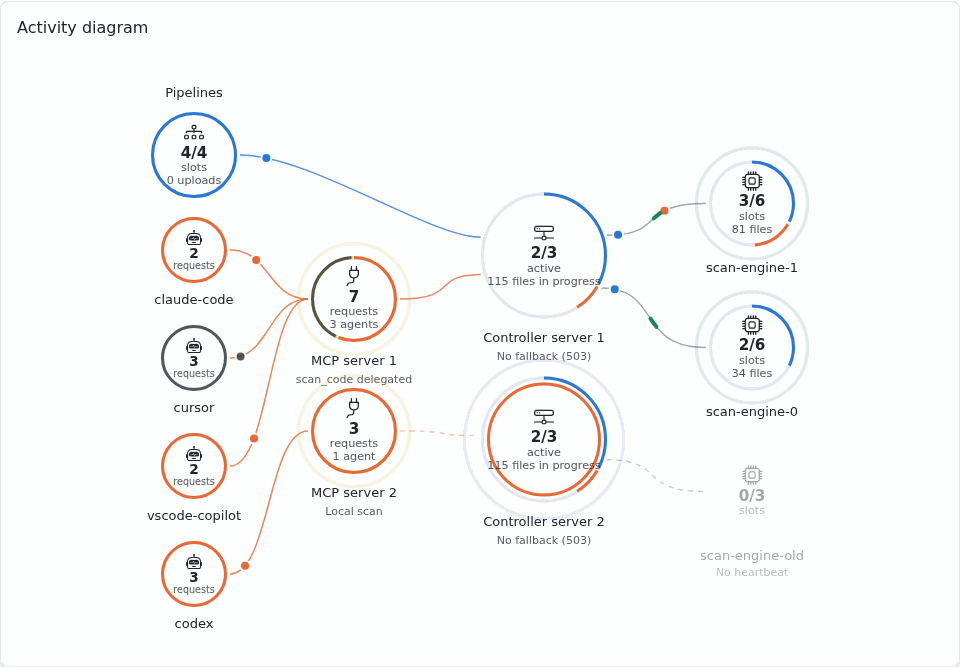
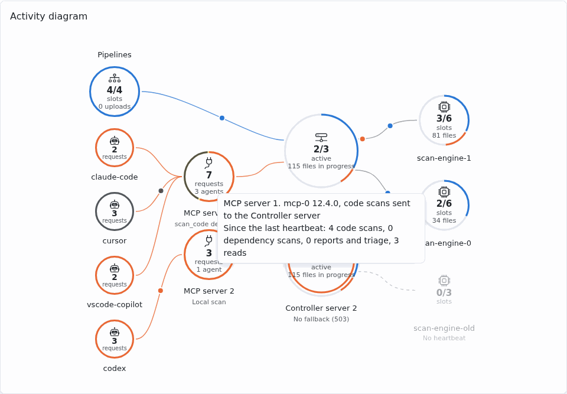

# Activity

The **Activity** page (permission `settings.manage`) shows what runs now and reloads itself every
2 seconds while it is visible. It has three sections: the activity diagram, the delegation of the
code scans and the scan engines.

The **Audit log** button, next to **Refresh**, opens the [audit log](audit-metrics.md)
(`audit.read`). The former address `/ui/scan-engines` leads to this page.

## Activity diagram

The **Activity diagram** shows the code scans running now. It shows even
without any engine (engines off, or none enrolled): then the agents, the MCP servers and the
Controller server only, which says **Scans itself (engines off)** when the engines are off:

- on the left, the pipelines (`security-review-ci`, codebase reviews) and the agents
  (`scan_code` fragments), with their occupied slots out of the slots of the active engines, or
  without engines out of the OpenGrep slots of the Controller server (**slots**); the pipelines also give the scans `security-review-ci` sends to the Controller
  server since its previous heartbeat (**uploads**), with or without engines;
- under the pipelines, one circle per agent that sent a request to an MCP server in the last
  5 minutes, linked to that server, with its requests running (tools, prompts and resources)
  since the previous heartbeat: its ring is split in proportion to them by family (see the
  colors below).
  An agent is shown by the name of its MCP client (for example `claude-code`), never by the name
  of a person nor of a token; the 6 most recent ones are stacked in the order of their MCP
  servers, so that their links never cross, and a **+N** circle stands for the others. Without any
  agent known (MCP servers of an earlier version), a single **Agents** circle stands for them;
- next to the agents, one yellow circle per running MCP server (HTTP transport), larger than
  the agents. Its center gives the most requests of the agents it ran at once since its
  previous heartbeat (**requests**: a short request stays there until the next heartbeat, about
  5 seconds) and the number of agents linked to it; its ring is split in proportion to the
  requests by family. An agent circle gives its own requests the same way. The agents reach the Controller
  server through it; its link to the Controller server is dashed, with **Local scan**, while the
  delegation of `scan_code` is off: it then scans the fragments itself and they never reach the
  engines. The pipelines go straight to the Controller server. The MCP servers in local mode
  (stdio) have their own database and never show. Without any MCP server running, the agents
  are linked straight to the Controller server;
- in the middle, one circle per running Controller server process. Each process keeps a heartbeat
  in the database every 5 seconds and disappears after 30 seconds without one. The replicas share
  the database, so their circles show the same numbers: active engines, files being processed,
  and a ring with the pipeline scans and fragments in progress. An inner ring shows the scans
  this process receives, in proportion by family: the files sent by `security-review-ci`
  (pipelines, codebase scans of the agents), and the code and dependency scans of the agents
  relayed by the MCP servers. Without engines, each process gives instead the code scans it runs
  itself: its occupied OpenGrep slots out of its total (**slots**,
  `SECREVIEW_OPENGREP_MAX_CONCURRENT_SCANS` plus `SECREVIEW_OPENGREP_MAX_CONCURRENT_FRAGMENT_SCANS`)
  and the files it scans now; without OpenGrep, its scans have no slot limit and it gives its
  files only (**files in progress**);
- on the right, one circle per engine, labelled **Scan engine** with its name below (or **No
  heartbeat** when it is down), in columns of 4 linked from the left to the closest Controller
  server, with its occupied OpenGrep slots out of its total
  (**slots**), the files it scans now and, with a warning sign, its failed scans since it
  started. Its ring is shared out of its capacity: blue for the codebase scans, orange for the
  `scan_code` fragments, grey for the free slots; a full ring means a busy engine, which refuses
  the next scans.

Thin links carry a moving dot while scans run: each family of requests of an agent running has
its dot, which goes to its MCP server; a code scan goes on to the Controller server when the
server delegates `scan_code`. A blue dot goes from the pipelines to the Controller server while
`security-review-ci` sends it files, with or without engines. Each engine
heartbeat sends a green pulse to the Controller server. An engine without a recent heartbeat is dimmed. The page reloads itself
every 2 seconds while it is visible. The number of active fragments counts concurrent `scan_code`
requests, not distinct agents. Hovering a circle shows its details, including the counters since
the engine started (they restart from zero when it restarts and enrolls again); the list below
gives the same engines.

The diagram has no legend; its colors are:

| Color | Means |
|---|---|
| Blue | Scans sent by the pipelines (`security-review-ci`, codebase reviews) |
| Orange | Fragments sent by `scan_code`, and the code scans of the agents (`scan_code`, `start_codebase_scan`) |
| Aqua | Dependency scans (`scan_dependencies`, a codebase dependency scan) |
| Violet | Reports and triage (`save_security_report`, `propose_finding_status`, `propose_opengrep_rule`, `request_project`) |
| Grey | Reads (the other tools, the prompts and the resources) |
| Yellow | An MCP server and its heartbeat (every 5 s, at once when a request of an agent starts or ends) |
| Purple | Heartbeat of the Controller server (every 5 s) |
| Green | Heartbeat of an engine (every 5 s while it scans, 30 s when idle) |
| Light green | An engine connected and idle |
| Grey (dimmed) | An engine without a recent heartbeat |

Moving dots are scans running now; rings show the occupied slots.

## Delegation of code scans

The switch **The MCP server delegates code analysis to the Controller server** sends the
fragments given to `scan_code` by the MCP servers to the Controller server address of the
**General** page ([fragment scans](../review/analysis/opengrep.md#fragment-scans-scan_code)), and
lets `start_codebase_scan` ask it for a
[scan ticket](../review/analysis/code-scan.md#scan-started-by-the-agent-start_codebase_scan).
It is locked while `SECREVIEW_SCANCODE_DELEGATED` is set, and needs a known Controller server
address.

## Scan engines

The section lists the [scan engines](../advanced/architecture/scan-engine.md) enrolled with the
Controller server: name, version, state (active while its heartbeat is recent), URL, free slots,
enrollment date and last activity, never a secret.

**Revoke** cuts an engine at once: it receives no more scans, and enrolls again only when it
restarts. An engine that stops normally leaves by itself: there is nothing to revoke. Details:
[Scan engines: administration](../advanced/architecture/scan-engine.md#administration).
