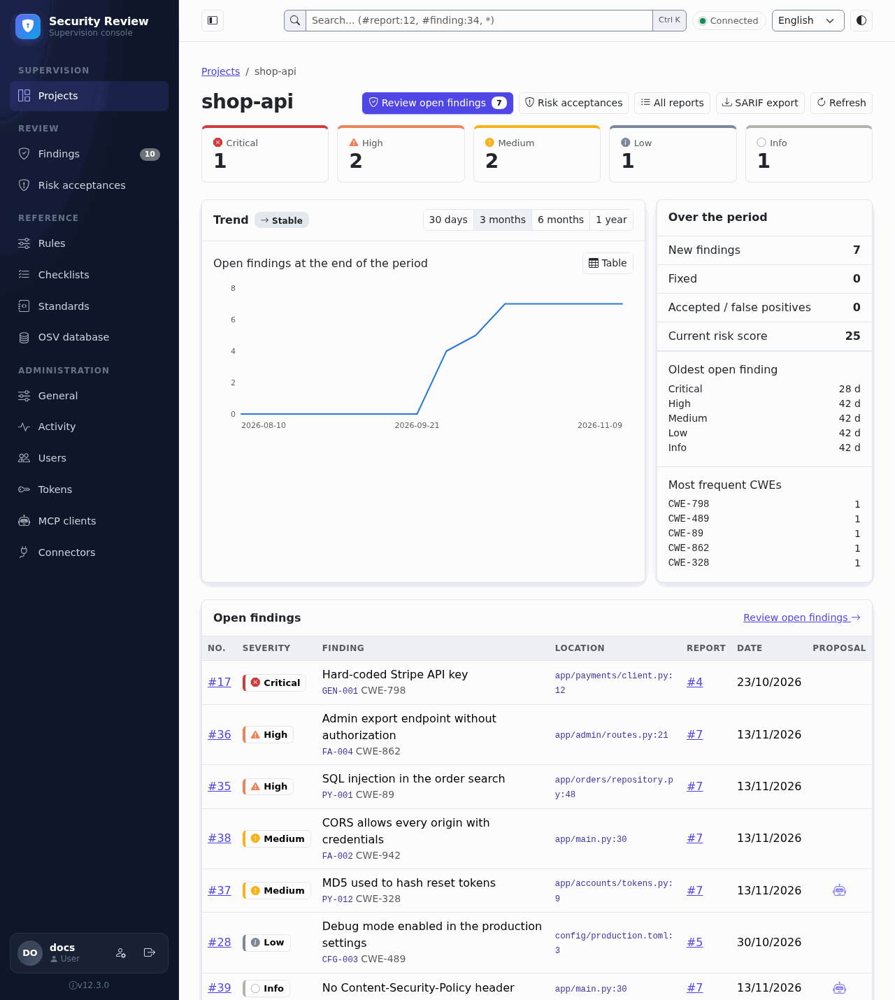
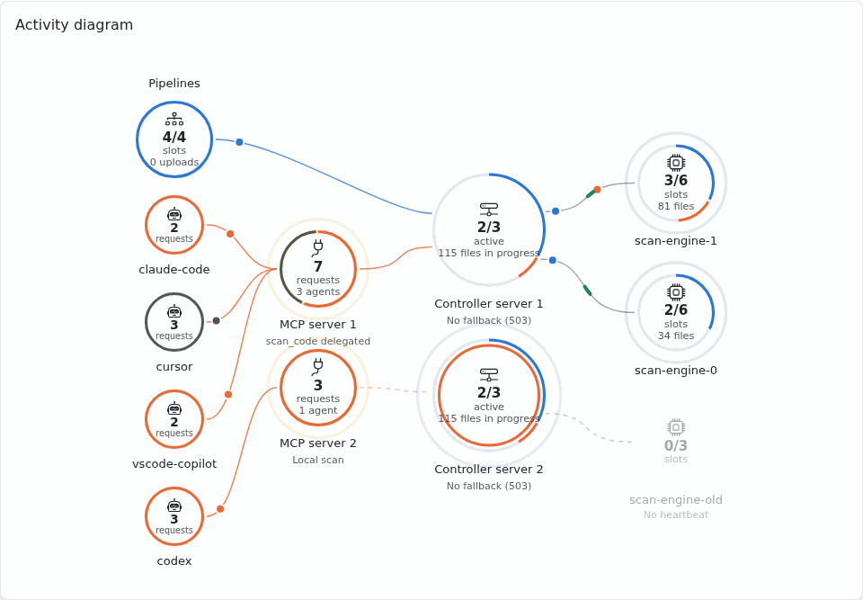

# Web interface

The web interface is where you follow the security of your projects: you browse the reports
saved by the agents and the pipelines, see the open findings and decide what to do with them
(the [triage](triage.md)). It is optional and provided by the Controller server
(`security-review-controller`).

## Signing in

Open the address of the Controller server followed by `/ui/` (for example
`https://secreview.example.com/ui/`) and sign in with your [user account](user-accounts.md):
a user name and a password, or your company login (OIDC) when it is configured. A token never
opens the interface: tokens are for the agents and the pipelines.

A page is missing? You do not hold its permission: ask an administrator (see
[permissions](access-control.md#permissions)).

## Finding your way

- The **sidebar** groups the pages in four sections: **Supervision** (projects),
  **Review** (findings and risk acceptances, with `reports.read`), **Reference** (rules,
  checklists, standards, OSV database) and **Administration**. You only see the pages your
  permissions allow. **Findings** shows the number of open findings in the projects you read.
- The **search field** in the middle of the top bar (Ctrl+K, ⌘K on a Mac) searches the
  findings and the reports in your projects, and offers the projects whose name contains the
  text (open the project, its findings or its reports). While you type, the list shows the first
  open findings (5) and the latest reports (3) found, with the number of matching findings;
  Enter opens the first suggestion:

    | Type | To |
    |---|---|
    | `sql injection` | Search the findings (title, rule, CWE, file, description, project, branch), or the reports, for the text |
    | `#report:12` | Open report 12 |
    | `xss #report:12` | Open report 12, its findings searched for "xss" |
    | `#finding:34` | Open finding 34 in its report |
    | `#report:text`, `xss #finding:*` | Search only the reports, or only the findings |
    | `#report:*`, `#finding:*`, `*` | List every report, every finding, or offer both |
    | `sql project:shop` | Only in project `shop` |
    | `severity:high,critical` (or `sev:`) | Only these severities (risk level of the reports) |
    | `status:accepted` | Findings with this status (`open`, `fixed`, `accepted`, `false_positive`) instead of the open ones |
    | `rule:PY-004`, `cwe:89` | Searched as text |

    Filters and text combine in any order: `sql project:shop sev:high #finding:*`. One
    `#report:` or `#finding:` per search; the rest of the text is searched. An unknown filter
    value (`sev:urgent`) is searched as text. A project name typed in full comes first. The
    findings need `reports.read`.
- At the top right, choose the language (English, French, Spanish) and the theme (automatic,
  light, dark). The language only changes the interface: the language of the reports is set in
  **General**.
- At the bottom of the sidebar: **My account** (password, personal tokens) and the version, a
  link to **About**.
- Click a column header to sort a table; the browser remembers the sort.
- **Projects**, **Findings**, **Reports** and **Audit log** read their data again when you come
  back to the browser tab, so that the reviews saved meanwhile show up (not after **Load more**,
  nor on **Findings** once a finding was triaged on the page: **Refresh** does it then). The
  pages of settings and reference data, only changed on the page itself, have no **Refresh**.
- The circled question mark next to a title opens the page of this documentation that explains
  the page (in French for a French interface, else in English).
- If the Controller server stops answering, the **Backend unavailable** page opens: it checks again
  on its own (after 5 s, then with a delay doubled after each failure, up to 60 s, paused while the
  tab is hidden) or when you click **Retry**, and brings you back to your page once it answers again.

## Pages

**Supervision**

| Page | What for |
|---|---|
| **Projects** | Every project with its open findings by severity. The starting point: open a project, **Review open findings** of every project, approve the **Pending projects** requested by the agents |
| **Project** | Trend, worst and oldest open findings (the [advisories of one vulnerable dependency](../review/analysis/dependencies.md#reading-the-result) folded in one row), SARIF export, **All reports** of the project |

**Review**: **Findings** and **Risk acceptances** for the users holding `reports.read` (on the projects they read); **Reports** for every user (on the projects they read), opened from the search field (`#report:*`) or **All reports** of a project

| Page | What for |
|---|---|
| **Findings** (**Findings to review**) | Every open finding of a project or of every project, once each, worst first: this is where you triage. The search field (title, rule, CWE, file, description, project, branch) narrows the list; the status, severity and review type filters accept several values |
| **Risk acceptances** | The accepted risks, with their expiry date, filtered by state and severity (several values each) |
| **Reports**, **Report** | Every saved review, filtered by one or several projects and risk levels, and its detail: summary, [review coverage](../review/prompts-tools.md#review-coverage), findings (searched by text, filtered by severity and status, the advisories of one vulnerable dependency grouped), Markdown and SARIF download |

**Reference**, edited by the administrators (**Export** and **Import** exchange the rules, checklists and standards as TOML files)

| Page | What for |
|---|---|
| **Rules** | The rules of the code scan, one tab per engine: **Pattern rules** ([rules](../review/rules.md)) and **OpenGrep rules**, with the rules proposed by the agents ([OpenGrep](../review/analysis/opengrep.md#managing-rules-from-the-web-interface)) |
| **Checklists** | The check items followed by the agents ([checklists](../review/checklists.md)) |
| **Standards** | The development standards given to the AI assistants ([standards](../review/standards.md)) |
| **OSV database** | State and update of the vulnerability database, automatic download (on/off, interval), choice of the downloaded ecosystems ([dependencies](../review/analysis/dependencies.md#automatic-update-by-the-controller-server)) (`settings.manage`) |

In the edit form, the long text fields (content of a standard, advice of a rule, checkpoint of a
checklist item) have a full screen button: the text opens in a large editor, next to its
Markdown preview (**Edit**, **Side by side** or **Preview**); side by side, both panes scroll
together. The changes go to the form, which still saves or cancels them.

**Administration**

| Page | What for |
|---|---|
| **General** | Report language, Controller server address (and delegation of `scan_code` to it) and outgoing proxy (OSV download and OIDC login); while the address is unknown, a banner at the top of every page links to it |
| **Activity** | What runs now, and the scan engines with their revocation (`settings.manage`): see [Activity](#activity) |
| **Users** | One tab each: **Accounts**, with their roles and their projects ([user accounts](user-accounts.md)), **Roles** ([roles and permissions](access-control.md)) and **OIDC sign-in**, the company login ([OIDC login](sso.md)) (`users.manage`) |
| **Tokens** | The tokens of the agents and the pipelines ([tokens](tokens.md)) |
| **MCP clients** | The MCP clients that log in through the browser ([OAuth login](../advanced/mcp-oauth.md#administration)): turning the login on or off, registered clients and approved accesses, revocation (`tokens.manage`) |
| **Connectors** | Sending the findings to Jira, ServiceNow... ([connectors](connectors/index.md)) |
| **Audit log** | Who did what: triage decisions, tokens, project requests ([audit log](audit-metrics.md)); opened by the **Audit log** button of **Activity**, in the menu only for the accounts that hold `audit.read` without `settings.manage` |

### Activity

The **Activity** page (`settings.manage`) shows what runs now and reloads itself every
2 seconds while it is visible:

- the **Activity diagram**: the agents, the pipelines, the MCP servers, the Controller servers and
  the scan engines, with the scans in progress (its colors are explained in
  [Scan engines](../advanced/architecture/scan-engine.md#administration));
- the **Scan engines** section: the [scan engines](../advanced/architecture/scan-engine.md#administration)
  enrolled with the Controller server (version, address, last activity) and their revocation.

The **Audit log** button, next to **Refresh**, opens the [audit log](audit-metrics.md)
(`audit.read`). The former address `/ui/scan-engines` leads to this page.

## Points to watch

- **An agent never closes a finding.** A blinking robot icon in the **Proposal** column marks a
  status proposed by an agent: a person with the triage permission applies or rejects it.
- **An accepted risk expires.** Past its date, the finding counts as open again (gate, trends):
  check **Risk acceptances** regularly.
- **The secret of a token is shown only once.** Copy it at once. If it is lost or leaked,
  **Rotate** it (the previous secret can keep working during a grace period) or revoke it.
- **Deleting a project deletes all its reports and findings**, with no way back.
- **A pending project expires**: a request not approved in time is deleted.
- **Default rules and checklist items** can be edited or disabled, not deleted; a change
  applies at once to the next reviews.
- **A locked field** in the settings is set by an environment variable, which always takes
  precedence ([settings stored in the database](../advanced/architecture/controller.md#settings-stored-in-the-database)).
- **A deleted OIDC account** is not created again at its next login, until an administrator
  clicks **Allow again** in **Users**.

## See also

- [Triage of findings](triage.md): decisions on the findings, severity, risk acceptances;
- [Tokens](tokens.md): roles of the tokens, API tokens, personal MCP and CI tokens;
- [User accounts](user-accounts.md): local and OIDC accounts, password policy.
