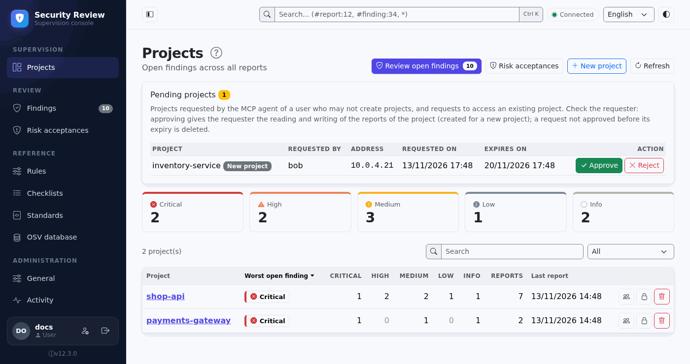
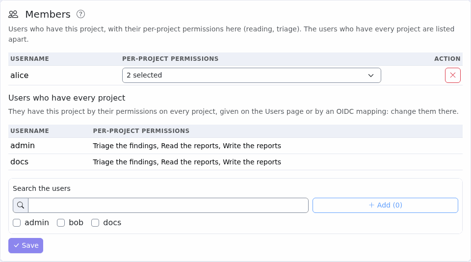

# Projets

Un **projet** regroupe tout ce qui concerne une application, en général un dépôt : ses rapports,
ses findings, sa tendance et sa gate, et qui peut le lire ou le trier. Chaque revue est
enregistrée dans un projet.

L'API REST et les règles détaillées sont dans
[Contrôle d'accès par l'API REST](../advanced/access-control-api.md#projets).

## Nom d'un projet

Le nom est **normalisé** : minuscules, dernier segment d'une URL de dépôt, et un seul `-` entre
les mots. `Mobile App`, `mobile_app` et `git@github.com:acme/mobile-app.git` donnent tous le
projet `mobile-app`, pour que les membres d'une équipe atteignent le même projet quelle que soit
leur saisie (voir [nom du projet](../reference/prompts-tools.md#nom-du-projet)).

## Comment un projet apparaît

| Moyen | Qui | Résultat |
|---|---|---|
| Bouton **Nouveau projet** de la page **Projets** | Une personne qui a `projects.create` | Créé aussitôt ([création d'un projet](#creation-dun-projet)) |
| L'agent d'un développeur le demande avant une revue | Un développeur avec un [jeton MCP personnel](tokens.md#jetons-mcp-et-ci-personnels) | Créé aussitôt, lu par le développeur, s'il peut créer des projets (même si son jeton atteint déjà tous les projets) ; sinon listé dans **Projets en attente**, à valider ([enrôlement](../advanced/architecture/mcp-server.md#enrolement-jeton-personnel-et-demande-de-projet)) |
| Premier rapport enregistré pour lui | Un jeton qui l'atteint (pipeline, jeton pour **Tous les projets**) | Le projet apparaît avec son premier rapport |

Un projet créé sans rapport affiche **Aucun rapport** jusqu'à sa première revue.

Tant que des demandes attendent une décision, l'entrée **Projets** du menu affiche leur nombre
dans un badge, pour les utilisateurs qui peuvent les valider (`projects.create`).

## Membres

Les **membres** d'un projet sont les comptes qui l'ont dans leurs projets, chacun avec ses droits
par projet ici (lecture, écriture, triage). Son créateur, ou le développeur dont la demande a été
validée, en reçoit la lecture et l'écriture (`reports.read` et `reports.write`), jamais le tri.

Une personne dotée de `users.manage` voit la section **Membres** en bas de la page du projet (repliée : cliquez sur son en-tête pour la déplier),
qu'ouvre aussi le bouton en forme de personnes de sa ligne sur la page **Projets** :
tapez un nom et choisissez le compte dans la liste proposée pour l'ajouter (avec la lecture), choisissez les droits de
chaque membre (**Écrire les rapports** pour ceux dont l'agent enregistre des revues) ou retirez-le : chaque changement est enregistré aussitôt. Les mêmes projets se donnent dans
**Utilisateurs** ([rôles et projets d'un compte](access-control.md#roles-et-projets-dun-compte)),
ou en validant la **Demande d'accès** déposée par un agent dans **Projets**. Les comptes qui ont
tous les projets, eux-mêmes ou par une [correspondance OIDC](sso.md#correspondances-oidc), sont
listés à part, sous **Hérite de "Tous les projets"**, en lecture seule : modifiez leurs
droits dans **Utilisateurs** ou dans la correspondance.

## Création d'un projet

Si vous avez la permission `projects.create`, le bouton **Nouveau projet** apparaît sur la page
**Projets**. Créer un projet l'ajoute à vos projets avec sa lecture et son écriture : vous le
lisez aussitôt, et votre agent peut y enregistrer ses revues.

## Renommage d'un projet

Avec la permission `projects.delete`, un bouton crayon apparaît sur chaque ligne de la page
**Projets**. Le nouveau nom est normalisé comme tout nom de projet et ne doit pas être déjà
connu, ni donné par une correspondance OIDC. Tout ce qui se rapporte au projet suit le nouveau nom : ses rapports, ses findings **et
leur triage** (un rapport suivant sous le nouveau nom garde les décisions prises), ses membres,
les correspondances OIDC, les jetons et les destinations des connecteurs.

Les pipelines et les agents qui envoient des rapports sous l'ancien nom doivent utiliser le
nouveau : les jetons n'atteignent plus l'ancien nom. Le journal d'audit garde les événements de
l'ancien nom et enregistre `project.renamed`. Un opérateur peut aussi renommer un projet avec
[`security-review-controller project rename`](../reference/cli.md#security-review-controller).

## Suppression d'un projet

Avec la permission `projects.delete`, un bouton corbeille apparaît sur chaque ligne de la page
**Projets**. La suppression est **irréversible** et retire tout ce qui se rapporte au projet :

- ses rapports, findings et commentaires ;
- le projet dans les projets des utilisateurs et des correspondances OIDC (une correspondance qui
  n'a plus de projet est supprimée) ;
- le projet dans les jetons : un jeton qui n'atteignait que ce projet est **révoqué**, et un
  pipeline qui l'utilisait s'arrête.

Le journal d'audit conserve les événements du projet. Une confirmation est demandée au moment
de l'action.

## Rejoindre un projet

L'agent d'un développeur peut demander à rejoindre un projet existant. Sa demande apparaît,
en attente de validation, dans **Projets en attente** sur la page **Projets**.

Une personne dotée des permissions `projects.create` et `users.manage` peut valider cette
demande ; une personne dotée de `users.manage` peut aussi donner le projet à l'utilisateur
([membres](#membres)).

Avec la permission `projects.autojoin`, le développeur **rejoint aussitôt le projet**, sans
demande : la requête de son agent ajoute le projet aux siens avec sa lecture et son écriture, pour
que son agent enregistre sa revue (jamais plus : pas de tri). Un développeur qui lit déjà le
projet sans **Écrire les rapports** dépose une demande à la place : l'adhésion automatique
n'élargit jamais ce qu'un administrateur a donné. Cette permission ne crée pas de nouveau projet : il
faut pour cela `projects.create`.

## Blocage de l'adhésion automatique

Avec la permission `users.manage`, un bouton cadenas apparaît sur chaque ligne de la page
**Projets**, pour les projets que vous lisez : `projects.create` seule ne bloque ni n'autorise
l'adhésion automatique. Il **bloque l'adhésion automatique** au projet : les
titulaires de `projects.autojoin` déposent alors une demande qui attend une validation, comme les
autres. Le projet affiche le badge **Adhésion automatique bloquée** ; le bouton cadenas ouvert
autorise de nouveau l'adhésion automatique. Les utilisateurs qui ont déjà rejoint le projet
gardent leur accès : retirez-les de ses [membres](#membres) si nécessaire.

## Revue complète du code

Sur la page d'un projet, la carte **Revue complète du code** demande à l'agent MCP une revue de
tout le dépôt, pas seulement d'un diff :

- **Demander une revue complète exceptionnelle** : une fois, par exemple après un incident ou une
  nouvelle règle ;
- **Demande périodique**, nombre de **jours** : de nouveau quand la dernière revue
  complète est plus ancienne que l'intervalle (aussitôt s'il n'y en a aucune).

Avec `findings.triage` sur le projet, depuis une session de l'interface web uniquement : un agent
ne se la demande jamais lui-même et ne la retire pas. La carte, au-dessus des findings ouverts, est
repliée : son bandeau affiche la dernière revue complète, la prochaine revue périodique et un drapeau
tant qu'une demande est en attente ; dépliez-la pour voir pourquoi une revue est attendue et changer
les réglages. La page **Projets** affiche une icône d'horloge à côté du projet ; son
infobulle l'explique.

Au début de sa revue suivante, `request_project` prévient l'agent (`save_security_report` aussi, pour un agent qui n'a pas appelé `request_project`), qui propose au développeur le
prompt `codebase-review` une fois sa tâche terminée. Seule une revue complète passée par le
serveur Controller satisfait la demande : un rapport `codebase-review` lié (`review_group`) au
scan de code de [`start_codebase_scan`](../review/analysis/code-scan.md), lancé après la demande (un rapport qui réutilise le `review_group` d'une revue plus ancienne ne compte pas). C'est un rappel : le
[gate](../review/gate.md) n'en dépend pas.

## Points d'attention

- **Une demande en attente expire** après 7 jours par défaut : l'agent doit la refaire.
- **Valider une demande d'accès** à un projet existant demande aussi `users.manage` : créer des
  projets ne donne jamais accès aux autres.
- **Supprimer un projet révoque ses jetons dédiés** : prévenez les équipes qui les utilisent.
- **`projects.autojoin` ouvre tous les projets** dont l'adhésion automatique n'est pas bloquée,
  et indique à son titulaire quels projets existent : bloquez l'adhésion automatique des projets
  sensibles.
- **Un nom est normalisé** : `My.App` et `my-app` sont le même projet.
